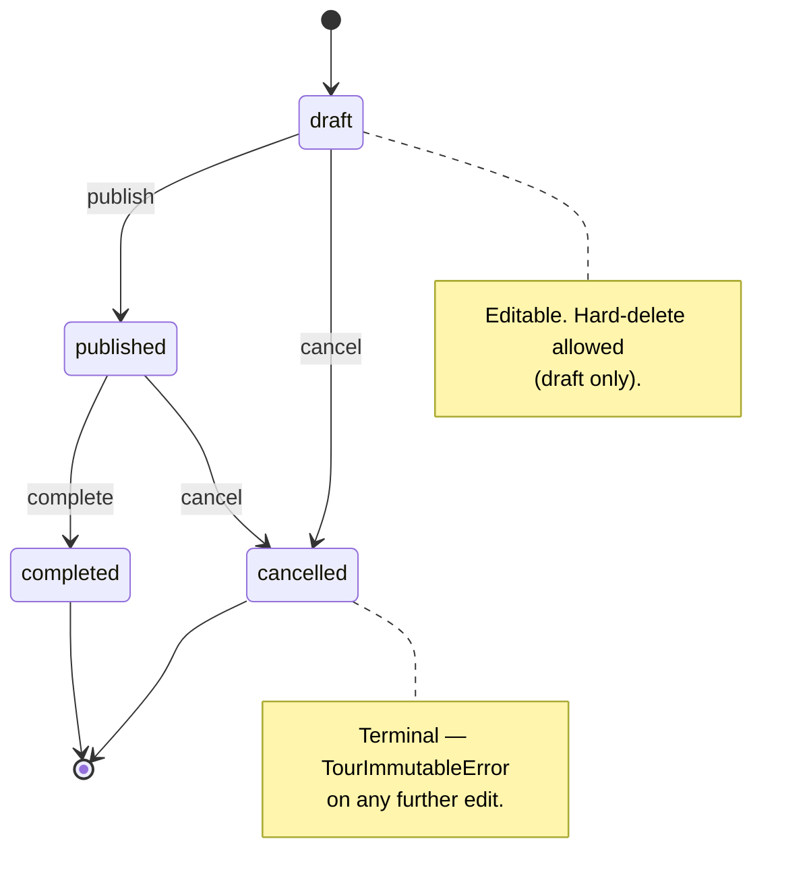
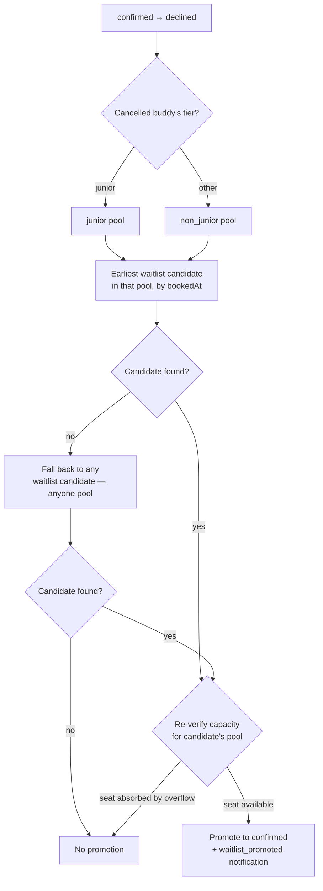

# Product Requirements Document
## Buddy Booking App

**Version:** 0.4 (MVP)
**Last Updated:** 2026-04-26
**Author:** [Your Name]
**Status:** Draft

---

## Table of Contents

1. [Overview](#1-overview)
2. [Goals & Non-Goals](#2-goals--non-goals)
3. [Users & Roles](#3-users--roles)
4. [Authentication](#4-authentication)
5. [Buddy Profile](#5-buddy-profile)
6. [Group Management](#6-group-management)
7. [Tour Management](#7-tour-management)
8. [Booking System](#8-booking-system)
9. [Evaluation System](#9-evaluation-system)
10. [Notifications](#10-notifications)
11. [Admin Dashboard](#11-admin-dashboard)
12. [Internationalisation](#12-internationalisation)
13. [Tech Stack](#13-tech-stack)
14. [Data Migration](#14-data-migration)
15. [Future Roadmap](#15-future-roadmap)
16. [Out of Scope (v1)](#16-out-of-scope-v1)
17. [Open Questions](#17-open-questions)

---

## 1. Overview

A web-first internal booking application for managing group tour assignments. The app serves two user types: **Buddies** (tour guides) and **Admins** (our team). Buddies can view upcoming tours, book a session (server auto-assigns Confirmed or Waitlist based on tier-pool capacity — see §8.9), manage their profile, submit self-evaluations, and track their history. Admins manage tours, groups, approve buddies, configure rules, and evaluate buddy performance.

**Primary language:** Japanese
**Supported languages:** Japanese, English (i18n from day one)

---

## 2. Goals & Non-Goals

### Goals
- Replace the existing Google Sheets workflow with a structured, reliable web app
- Give buddies a self-service experience for booking and profile management
- Give admins full visibility, control, and notification coverage
- Build a clean foundation that can grow without a rewrite

### Non-Goals (v1)
- Participant-facing features (tour participants do not use this app)
- Travel agency integration
- Native mobile apps (web-first PWA; native post-v1.5)
- Advanced analytics or reporting dashboards
- Peer evaluation between buddies
- Payment handling
- Calendar integration (planned for v1.5)

---

## 3. Users & Roles

| Role | Description |
|---|---|
| **Buddy** | Tour guide. Can book tours, manage own profile, submit self-evaluations, view history. |
| **Admin** | Regular admin. Can manage tours, groups, buddies, bookings, and evaluations. |
| **Super Admin** | All admin capabilities plus admin account management and system configuration. |

**Scale:**
- Launch: ~50 buddies
- Maximum expected: ~200 buddies
- Admins: small team (5–6 non-dev members)

---

## 4. Authentication

- **Social login:** Google and Apple (OAuth 2.0) via Firebase Auth.
- **Signup flow:**
  1. Buddy signs in via Google or Apple in the frontend (Firebase issues an ID token).
  2. Frontend calls `POST /auth/register` with an optional profile payload (`displayName`, `realName`, `languages`, `photoUrl`, `bio`). The server upserts a `User` (role `buddy`) and a `BuddyProfile` in `pending` state. If `displayName` is missing it falls back to the email prefix.
  3. Subsequent requests go through `authMiddleware`, which validates the Firebase token and looks the user up by `firebaseUid`.
  4. Admins receive an in-app notification and a post to the shared Slack channel on new signup. Admin email is off by default (§10.2).
  5. Admin approves or rejects via `PUT /admin/buddies/:id/status`. Allowed status values via the API: `trainee` / `active` / `rejected`. See §11.4 for the approval flow and §5.1 for status constraints.
  6. On approval (`pending` → `trainee`) or rejection (`pending` → `rejected`), the buddy receives an in-app + immediate-email notification.
- **Admin accounts:** A `User` with role `admin` or `super_admin` is created by a Super Admin (`POST /admin/profiles`). On first login, `ensureAdminProfile` middleware lazily creates an `AdminProfile` row if one is missing, using Firebase `name` or the email prefix as the initial display name.
- **Session management:** Firebase Auth handles token lifecycle. Identity + role for the current user are obtained from `GET /me/profile` (buddies) or `GET /admin/profile` (admins).

---

## 5. Buddy Profile

### 5.1 Account Status (admin-managed, visible to admins only)

| Status | Description |
|---|---|
| **Pending** | Signed up, awaiting admin approval |
| **Active** | Cleared to log in; tier determines booking eligibility (see §5.2) |
| **Rejected** | Signup rejected by admin — account is closed |
| **Suspended** | Temporarily or permanently deactivated after being active |

Status is set manually by admin via `PUT /admin/buddies/:id/status`. The API accepts only `trainee` / `active` / `rejected`. `pending` is the initial state (set on registration) and is not reachable via update. `suspended` is **Planned** — the enum value exists but no API endpoint transitions to it yet.

Typical progression: Pending → Trainee (approve) → Active (promote — auto-sets `tier = junior`) or → Rejected (terminal). Rejected and Suspended are distinct: Rejected means the signup was never approved; Suspended means an active buddy was deactivated.

Buddies are never deleted from the database. Status updates are the only lifecycle change.

**Trainee access:** Trainees (`status = trainee`, `tier = null`) can log in but cannot see tours or make bookings. Their nav shows Profile only — Tour and History would dead-end — and `/buddy` shows a training-status message (`tour.traineeMessage`), not the "not registered" message shown to rejected and suspended buddies. Training schedules are arranged outside the system; a dedicated section is planned for a future release. Admins manage trainees via `/admin/trainees`; promotion to junior is done through the buddy detail page (tier dropdown), which requires confirmation.

### 5.2 Internal Tier (admin-managed, hidden from buddies)

Once Active, an internal tier is assigned and updated manually by admin:

| Tier | Description |
|---|---|
| **Junior** | Recently activated, limited experience |
| **Mid** | Comfortable with regular tours |
| **Senior** | Experienced, handles complex groups |
| **Expert** | Top-tier, can mentor and guide others |
| **Instructor** | Can teach and train buddies; must reach Expert first |
| **Organizer** | Oversees full sessions, manages time and handles emergencies; must reach Instructor first. Can still participate as a buddy. |

Tier is for internal reference only — buddies have no visibility.

Typical progression: Junior → Mid → Senior → Expert → Instructor → Organizer.

### 5.3 Self-Managed Fields (edited by buddy)

| Field | Type | Notes |
|---|---|---|
| Display name / nickname | Text | Chosen by buddy; editable in profile settings |
| Real name | Text | For admin reference; editable in profile settings |
| Profile photo | Image upload | **Shipped** via Cloudflare R2. `POST /me/profile/photo` (multipart `photo` field) and `DELETE /me/profile/photo`. Constraints: ≤ 2 MB, MIME in `image/jpeg` / `image/png` / `image/webp`, magic-byte validated. |
| Bio | Long text | Free description |
| Contact info | Text / Email | Preferred contact method |
| Languages spoken | Multi-select enum (`LanguageSchema`) | See enum values below |
| Skills & interests | Free text (one per line) | v1: plain textarea; structured multi-select in future |
| Availability | Free text | General availability notes (v1); structured input in future |

#### Language Enum (`LanguageSchema`)

Ordered for UI display — priority tier shown first:

| Value (code) | Priority |
|---|---|
| `english` | Priority |
| `korean` | Priority |
| `chinese_simplified` | Priority |
| `chinese_traditional` | Priority |
| `arabic` | Standard |
| `french` | Standard |
| `german` | Standard |
| `italian` | Standard |
| `japanese` | Standard |
| `portuguese` | Standard |
| `russian` | Standard |
| `spanish` | Standard |
| `thai` | Standard |
| `vietnamese` | Standard |

`LanguageSchema.options` preserves this order — UI iterates it directly for consistent display without sorting logic.

`UpdateBuddyProfileSchema.languages` validates against `LanguageSchema` (not raw strings). `BuddyProfileResponse.languages` is typed as `Language[]`.

### 5.4 Admin-Managed Fields

| Field | Type | Notes |
|---|---|---|
| Account status | Enum | See §5.1 |
| Internal tier | Enum | See §5.2 — hidden from buddy |
| Internal notes | Free text | Admins only |
| Admin evaluation records | See §9 | Admins only |

### 5.5 Migration
- Existing buddy data imported from Google Sheets at launch
- Admin completes missing fields via dashboard post-import
- Buddies complete their own profiles after first login

---

## 6. Group Management

Groups represent visiting parties — schools, companies, community groups, etc.

### 6.1 Group Fields

| Field | Type | Notes |
|---|---|---|
| `id` | UUID | Auto |
| `name` | Text | Required, min 1 char. e.g. "Sakura High School", "Acme Corp" |
| `type` | Enum | `GroupTypeSchema`: `school` / `company` / `community` / `other` (stored as lowercase; currently rendered raw — no per-value i18n label yet) |
| `contactName` | Text | Optional |
| `contactEmail` | Email | Optional. Validated as email format on create/update |
| `contactPhone` | Text | Optional |
| `notes` | Long text | Optional. Admin-maintained; visit history, special considerations, etc. |
| `createdAt` / `updatedAt` | Timestamp | Auto |

### 6.2 Rules
- Groups created and managed by admins only — all four endpoints under `/admin/groups`; no buddy-facing group routes
- Each tour is linked to exactly one group via `Tour.groupId` (FK; non-nullable)
- Groups cannot be deleted in v1 (no `DELETE` endpoint); tour history accumulates over time
- Group name is not unique — duplicate names are permitted
- Group detail (`GET /admin/groups/:id`) returns the full tour list nested under `tours: GroupTourSummary[]` (each with date, status, location, participant count, session summaries) for the linked tour history

---

## 7. Tour Management

### 7.1 Tour Fields

A `Tour` carries metadata (date, location, deadlines, status, admin assignments). Capacity, meeting time and per-session timing live on `TourSession` rows under the tour — a tour has **1 or 2 sessions** (hard cap; the API rejects a third with `TooManySessionsError`).

**Tour-level fields**

| Field | Type | Notes |
|---|---|---|
| `id` | UUID | Auto |
| `groupId` | UUID FK | Linked to a managed Group |
| `tourDate` | Date | |
| `location` | Text | |
| `description` | Long text? | Visible to buddies |
| `adminMemo` | Long text? | **Admin-only** — never sent in buddy responses |
| `bookingOpen` | Boolean | Default `false`. Admin toggles to open/close bookings for a Published tour. Buddies can only book while this is `true` (and tourDate is in the future). |
| `cancellationDeadline` | Date | Default: 7 days before tour. Must be after (closer to tour than) the Maybe deadline. **Per-buddy override is Planned** — schema model (`BuddyCancellationDeadlineOverride`) exists but no admin API endpoint manages it yet. |
| `maybeDeadline` | Date? | Default: 9 days before tour. Must be before the cancellation deadline. Validated server-side. |
| `notificationOffsets` | Int[] | Days before tour date to send reminders; default `[3, 1]`. Matches the shipped form label ("days before, comma-separated"). |
| `status` | Enum | `draft` / `published` / `cancelled` / `completed` |
| Assigned admins | Many | Optional. Stored as `TourAdminAssignment(tourId, adminId)` rows — many-to-many with `AdminProfile`. |
| `staffInChargeId` | UUID FK? | Optional FK to `AdminProfile`. Required to be one of the assigned admins; nullable only if no admins are assigned. |

**Session-level fields** (`TourSession`)

| Field | Type | Notes |
|---|---|---|
| `id` | UUID | Auto |
| `tourId` | UUID FK | |
| `order` | Int | Display order; unique within tour |
| `label` | Text? | e.g. "Morning"; if absent the UI uses a default like "Session 1" |
| `meetingTime` | Time | Required |
| `startTime` | Time? | Schema field. Not rendered in the current create/edit form |
| `endTime` | Time? | Schema field. Not rendered in the current create/edit form |
| `capacity` | Int | Required. Total seats for the session |
| `minBuddies` | Int? | Optional. When `participantCount < minBuddies` the session is flagged `belowMinimum` in responses and UI |
| `participantCount` | Int | Default `0`. Cached group size (number of visitors, not buddies) used to compute `belowMinimum` |
| `createdAt` / `updatedAt` | Timestamp | Auto |

### 7.2 Tour Status Lifecycle

Transitions are gated server-side via `PATCH /admin/tours/:id/status` with `{action: 'publish' | 'cancel' | 'complete'}`. Allowed transitions:



- **Draft:** Editable. Hard-delete allowed via `DELETE /admin/tours/:id` (draft only — other statuses reject with `TourNotDraftError`).
- **Published:** Visible to Active buddies. Bookable while `bookingOpen = true`. Can be edited, cancelled, or completed.
- **Cancelled:** Booking closed. All buddies with status Confirmed, Maybe, or Waitlist receive an in-app + email notification (`tour_cancelled`). **No further edits** — the API rejects updates with `TourImmutableError`.
- **Completed:** Booking closed. The tour detail page surfaces the per-tour evaluation section as the natural prompt to add evaluations. **No further edits** — same `TourImmutableError`.

### 7.3 Rules
- Only admins can create, edit, cancel, or complete tours
- Tours must be **Published** before Active or Trainee buddies can see them
- Only **Active** buddies can book tours

### 7.4 Tour Admin Assignment

Each tour can have one or more admins assigned to it.

**Assignment rules:**
- Any admin can assign or unassign admins to a tour
- Assignments can be made at any point — during draft, after publishing, or even post-cancellation for record-keeping
- A tour is not required to have assigned admins (optional)

**Staff in charge:**
- One assigned admin must be designated as **staff in charge**
- Staff in charge is required if at least one admin is assigned; optional otherwise (i.e. if no admins are assigned, the field is empty)
- Staff in charge must be one of the assigned admins
- Staff in charge has no additional system permissions — it is a designation for operational clarity and record-keeping

**Removing an assigned admin who is staff in charge triggers a prompt with two paths:**
1. **Designate a replacement from remaining assigned admins** (if others exist)
2. **Assign a new admin and designate them as staff in charge** (always available)

If the admin being removed is the only assigned admin, removing them leaves the tour with no assigned admins and no staff in charge — which is a valid data state but flagged visually in the admin UI as unresolved.

**Notification routing:**
- Tour-specific notifications (booking changes, cancellations, Maybe deadline events, post-deadline "I can't go" reports) are sent to assigned admins only
- If no admins are assigned to a tour, no tour-specific notifications are sent for that tour

**Data:**
- Assignment stored as a many-to-many relation between admins and tours
- Staff in charge stored as a single foreign key on the tour record
- Visible to all admins in tour detail view
- Not visible to buddies

---

## 8. Booking System

### 8.1 Booking Statuses

| Status | Meaning | Who sets it |
|---|---|---|
| **Confirmed** | Definitely attending | Buddy |
| **Maybe** | Tentative; must resolve by admin-set deadline | Buddy |
| **Waitlist** | Join only if a seat opens | Buddy |
| **Declined** | Opted out or cancelled | Buddy or Admin |

### 8.2 Seat Counts

Capacity, pools, and seat counts live at the **session** level (see §7.1 — `TourSession`), not at the tour level. The buddy-facing detail response (`GET /tours/:id`) returns per-session:
- `seatCounts: { confirmed, maybe, waitlist, declined }` — all four status counts, visible to every buddy
- `remaining` — overall remaining seats based on confirmed
- `myCapacity` / `myRemaining` — the caller's tier-pool-aware view: how many seats the caller could still claim given their tier and the session's `TierCapacity` allocation
- `myBookingStatus` — the caller's own booking status for that session (null if not booked)

Only **Confirmed** bookings count against capacity. Maybe and Waitlist do not consume a seat. Buddies never see who else has booked — only counts.

### 8.3 Booking Rules

- **One booking per buddy per session.** Unique constraint `(buddyId, sessionId)`. A multi-session tour can have one booking row per buddy per session.
- Only **Active** buddies **with a tier assigned** can book (trainees cannot — see §8.9 Eligibility)
- Booking is open while:
  1. Tour is `published` AND `bookingOpen = true`
  2. `tourDate` is not in the past
  3. Cancellation deadline has not passed (per buddy, after applying any `BuddyCancellationDeadlineOverride`)
- Admin override of per-buddy cancellation deadline is **Planned** (schema model exists; no API endpoint manages it yet — see §7.1 and §11.2)
- **Cancellation deadline takes precedence (server-side):** Once the cancellation deadline has passed for a buddy, **all status changes via the regular update endpoint are blocked** (`PUT /tours/:tourId/sessions/:sessionId/bookings/me` returns `DEADLINE_PASSED`). The only post-deadline buddy action is the "I can't go" endpoint below.
- **Maybe deadline takes precedence for `→ maybe` transitions:** If the maybe deadline has passed, transitioning *into* Maybe is rejected (`MAYBE_DEADLINE_PASSED`). Transitions out of Maybe (to Confirmed, Declined, etc.) follow the cancellation-deadline rule.
- **Post-deadline "I can't go":** After the cancellation deadline has passed, buddies can still report that they cannot attend via `POST /tours/:tourId/sessions/:sessionId/bookings/me/cant-go`. The buddy submits a reason (category + optional free text). The booking status is changed to `declined` immediately, a `CancellationReason` row is recorded with `unavoidable = NULL` (unreviewed) and `recordedBy = buddy.userId`, and if the original status was `confirmed`, waitlist auto-promotion runs (see §8.6). Assigned admins receive an immediate in-app + email notification (`cant_go_post_deadline`); this event is intentionally not part of `NotifEventType` and is not user-configurable (always immediate).

### 8.4 Status Transition Matrix

The buddy-update endpoint (`PUT /tours/:tourId/sessions/:sessionId/bookings/me`) enforces:

| From \ To | Confirmed | Maybe | Waitlist | Declined |
|---|---|---|---|---|
| Confirmed | — | ✅ * | ✅ | ✅ † |
| Maybe | ✅ ‡ | — | ✅ | ✅ |
| Waitlist | ✅ ‡ | ✅ * | — | ✅ |
| Declined | ✅ ‡ | ✅ * | ✅ | — |

\* Blocked after `maybeDeadline` passes (`MAYBE_DEADLINE_PASSED`).  
† Requires a `reason` payload (`REASON_REQUIRED`) — a `CancellationReason` row is created.  
‡ Capacity-checked against the session's tier pools (`TOUR_FULL` if no slot available, taking the caller's tier and pool overflow into account).

All transitions above are gated by `cancellationDeadline` — once it passes, the regular update endpoint rejects everything with `DEADLINE_PASSED`. Post-deadline, only the `/cant-go` endpoint works (→ `declined` only). Admins can override any booking status at any time via `PATCH /admin/bookings/:id/status` with no capacity or deadline checks.

### 8.5 Maybe Flow

1. Buddy selects "Maybe" (only available before cancellation deadline)
2. Admin sets a **Maybe confirmation deadline** per tour (default offset: 9 days before tour if not set; configurable globally)
3. Buddy receives reminders at **3 days** and **1 day** before the deadline. Default offsets are baked in code; the hourly cron job that fires these reminders is **Planned** (see §10.5). `/admin/config` to make offsets globally configurable is Planned — see §11.5; no per-tour override in v1.
4. Buddy must update to **Confirmed** or **Declined** before deadline
5. If no action taken by deadline, booking status remains **Maybe** and assigned admins are notified to follow up manually (`maybe_deadline_missed`). The hourly cron job that detects expired Maybe deadlines is **Planned** (see §10.5).
6. **After cancellation deadline:** The maybe deadline becomes irrelevant. The "Maybe" status is no longer available, and buddies in confirmed status cannot transition to maybe (they are committed to attending). Buddies in maybe status who have not resolved must attend.

### 8.6 Waitlist Flow

Waitlist is created automatically (not chosen by the buddy) — `createBooking` assigns `confirmed` if a pool seat is available, else `waitlist` (see §8.9 assignment logic). A buddy on Waitlist sees their status on the session card.

**Auto-promotion** runs server-side whenever a `confirmed` booking transitions to `declined` (via the regular update endpoint, the "I can't go" endpoint, or admin status override). The promotion is performed inside a serializable transaction:

1. Identify the cancelled buddy's tier pool (junior → `junior` pool; everyone else → `non_junior` pool)
2. Find the earliest `waitlist` candidate in that primary pool, ordered by `bookedAt` ascending
3. If none exists, fall back to any `waitlist` candidate (anyone pool)
4. Re-verify capacity for the candidate's pool, then promote them to `confirmed`



Only one promotion runs per cancellation event — no cascading. If the freed seat was already absorbed by the overflow into the `anyone` pool, no promotion may occur.

Buddies never need to manually claim a freed seat. The promoted buddy receives an in-app + email notification (`waitlist_promoted`).

### 8.7 Cancellation & Cancellation Reasons

- Buddies can cancel (change status to `declined`) up to the cancellation deadline via the regular update endpoint, or any time after via `/cant-go`
- A `CancellationReason` row is created when a buddy cancels via either path. Server-side rule:
  - `Confirmed → declined` via the regular update endpoint **requires** a reason payload (the server rejects with `REASON_REQUIRED` if missing)
  - `Maybe → declined` and `Waitlist → declined` via the regular endpoint do **not** require a reason and create no `CancellationReason` row
  - The `/cant-go` endpoint always creates a `CancellationReason` regardless of the prior status
- Admin status overrides (`PATCH /admin/bookings/:id/status`) bypass the reason requirement — admins can set status directly with no checks; if a reason is needed for the record, it's set separately via the cancellation-reason endpoint
- Cancellation reason fields (`CancellationReason` table):

| Field | Type | Notes |
|---|---|---|
| `category` | Enum | `health` / `emergency` / `personal` / `work` / `other` |
| `freeText` | Text? | Optional — buddy's own explanation |
| `unavoidable` | Boolean? | `null` = unreviewed; `true` / `false` set by admin via `PATCH /admin/bookings/:id/cancellation-reason` |
| `recordedBy` | User ref | Auto-filled — the user who triggered the cancellation (buddy in buddy-initiated paths; admin in admin-initiated paths if extended later) |

- No category is automatically flagged as unavoidable — it is always a human (admin) judgement
- Admin reviews context and sets the unavoidable flag accordingly; admin can update it at any time, including back to `null` (unreviewed)
- The admin buddy-detail page surfaces a cancellation summary: total / unavoidable / avoidable / unreviewed counts

### 8.8 Booking History

- All past bookings stored permanently per buddy — records are never deleted (declined bookings are reused on re-book via upsert; see §8.9)
- History grows steadily — DB design must account for this (indexes documented in data-model.md)
- Admins view full booking history for any buddy via `GET /admin/buddies/:id` (`AdminBuddyBookingEntry[]` includes all statuses)
- Buddies view their own bookings via `GET /me/bookings` — **declined bookings are excluded** from this listing; the buddy history page splits results into Upcoming and Past sections by tour date

### 8.9 Tier-Based Booking System

Buddies book tours via the tier-based seat pool system. The system auto-assigns a `confirmed` booking or creates a `waitlist` booking based on pool availability.

There is no separate Application entity — a `Booking` row is created immediately on signup, with status `confirmed` or `waitlist`.

#### Eligibility

- Only **Active** buddies with a tier assigned can book
- **Trainee** tier cannot book (they cannot participate in tours yet)
- Only when tour is **Published** and `bookingOpen = true`

#### Seat Pools

Total tour capacity is split into three pools:

| Pool | Who fills it | Default % |
|---|---|---|
| **Junior** | `junior` tier only | 20% |
| **Non-junior** | `mid`, `senior`, `expert`, `instructor`, `organizer` | 30% |
| **Anyone** | Any eligible tier (overflow from either pool) | 50% |

Percentages default to 20/30/50 for all tours. Per-tour overrides are supported via the `TierCapacity` table (`pool: BookingPool, percent: Int`). Override rules:

- Either use all defaults (no `TierCapacity` rows for the tour), or provide all three pools explicitly
- All three percentages must sum to 100% — partial overrides are not allowed
- The `anyone` pool is the shared overflow — both junior and non-junior buddies can fill from it once their respective pools are full

#### Assignment Logic

When a buddy books, the system immediately determines their slot:

1. **Junior buddy**: check junior pool → if full, check anyone pool → if full, `waitlist`
2. **Non-junior buddy**: check non-junior pool → if full, check anyone pool → if full, `waitlist`

A `Booking` row is created with the result. `Booking.buddyTier` is frozen at booking time to ensure pool counts remain stable even if the buddy's tier changes later.

#### Booking Statuses

| Status | Meaning |
|---|---|
| `confirmed` | Got a slot in a pool. |
| `waitlist` | All relevant pools were full. Buddy waits. |
| `maybe` | Buddy marked themselves as uncertain (post-booking). |
| `declined` | Buddy cancelled. Row is kept and reused on re-book. |

#### Cancellation

- Buddy can cancel at any time while `waitlist` or `confirmed`
- Cancelling a `confirmed` booking frees a pool slot and triggers promotion
- After cancel, re-book is allowed if any vacancy exists in the buddy's pool or the anyone pool
- Status is set to `declined` on cancel; the booking row is reused on re-book (upsert)

#### Promotion

When a `confirmed` booking is cancelled:

1. The freed pool slot is identified by the cancelled buddy's tier
2. The earliest `waitlist` booking from the same pool is promoted to `confirmed`
3. If no waitlisted buddy exists in that pool, the anyone pool is checked

#### UI Entry Point

- `/dashboard/tours/[id]` — the tour detail page
- When no booking exists and tour is published and `bookingOpen`: show Book button
- When `waitlist`: show waitlist status badge and cancel option
- When `confirmed`: show confirmed status, cancel and set-maybe options
- No separate booking history page — buddy reaches history via tour list

---

## 9. Evaluation System

### 9.1 Overview

There are two distinct evaluation types: **admin evaluations** (internal, hidden from buddies) and **buddy self-evaluations** (visible to admins and the buddy themselves).

### 9.2 Admin Evaluations

#### Types

Backed by two distinct database models (see data-model.md):

| Type | Model | Trigger | Notes |
|---|---|---|---|
| **Per-tour evaluation** | `AdminEvaluation` | After a specific tour | Linked to a tour record; `tourId` is required |
| **General profile evaluation** | `AdminProfileEvaluation` | Anytime | Not tied to a specific tour |

#### Fields

All score fields use the scale: **1 = Poor / 2 = Below Average / 3 = Average / 4 = Good / 5 = Excellent** (matching shipped i18n labels). All text fields are optional. All score fields are nullable — admins can fill in any subset.

| Field | Score | Text | Per-tour | Profile | Notes |
|---|---|---|---|---|---|
| Overall rating | 1–5 | ✅ | ✅ | ✅ | |
| Reliability | 1–5 | ✅ | ✅ | ✅ | Admin-only metric (not in self-eval) |
| Communication | 1–5 | ✅ | ✅ | ✅ | |
| Group engagement | 1–5 | ✅ | ✅ | ✅ | |
| Memory | 1–5 | ✅ | ✅ | ✅ | Remembering names, details, preferences |
| Knowledge | 1–5 | ✅ | ✅ | ✅ | Content accuracy and depth |
| Dedication | 1–5 | ✅ | ✅ | ✅ | Effort and commitment |
| Dialogue | 1–5 | ✅ | ✅ | ✅ | **Core differentiating skill** — buddies open a genuine dialogue with participants, not just a one-way tour |
| Adaptability | 1–5 | ✅ | ✅ | ✅ | Handling unexpected situations |
| Emotion | — | ✅ | ✅ | ✅ | Warmth, empathy, expressiveness — cannot be meaningfully scored (`emotionNote` only) |
| Confidence | 1–5 | ✅ | ✅ | ✅ | |
| Absent without report | boolean | — | ✅ | — | Per-tour only. Admin sets when a buddy missed the tour without advance notice. Surfaces as `absenceSummary.absentWithoutReport` count on the buddy detail page |
| Evaluator | — | — | ✅ | ✅ | Auto-filled from submitting admin's `AdminProfile.name` (returned as `createdByName`) |
| Date | — | — | ✅ | ✅ | Auto-filled |

#### Access
- Only admins can create, read, or edit admin evaluations
- Buddies have no visibility into admin evaluations

#### Multi-admin ownership
- Each admin submits their own independent evaluation
  - Per-tour: uniqueness is `(buddyId, tourId, createdBy)`
  - Profile: uniqueness is `(buddyId, createdBy)`; profile evaluations are upserted via `PUT /admin/profile-evaluations/:buddyId`
- An admin can only edit or delete their own evaluations; other admins see them as read-only (enforced server-side — 403 if requester is not the creator)
- Evaluator display name is shipped: each `AdminProfile.name` is surfaced as `createdByName` in evaluation responses

#### Post-completion prompt (UX)
- When an admin clicks **Mark Complete**, a single confirmation modal appears showing the list of confirmed buddies
- Admin confirms in that modal; the tour is marked completed and the page refreshes
- The existing evaluation section on the tour detail page serves as the natural prompt to add evaluations — no second modal is shown

### 9.3 Buddy Self-Evaluations

#### Trigger
- When a tour is marked **Completed**, buddies who had **Confirmed** status are eligible to submit a self-evaluation for that tour
- Eligibility is enforced server-side: `POST /me/self-evaluations` rejects with 403 unless the buddy had a `confirmed` booking and the tour is in `completed` status
- Self-evaluation is optional — buddy can skip

#### Fields

Same scale as admin evaluations: **1 = Poor / 2 = Below Average / 3 = Average / 4 = Good / 5 = Excellent**. All text fields are optional. Reliability is admin-only and does not appear here.

| Field | Score | Text |
|---|---|---|
| Overall rating | 1–5 | ✅ |
| Communication | 1–5 | ✅ |
| Group engagement | 1–5 | ✅ |
| Memory | 1–5 | ✅ |
| Knowledge | 1–5 | ✅ |
| Dedication | 1–5 | ✅ |
| Dialogue | 1–5 | ✅ |
| Adaptability | 1–5 | ✅ |
| Emotion | — | ✅ |
| Confidence | 1–5 | ✅ |
| Date | — | Auto-filled |

#### Edit window
- Buddies can edit their own self-evaluation via `PUT /me/self-evaluations/:id`
- Edit window is **7 days from creation** (`SELF_EVAL_EDIT_WINDOW_DAYS = 7`); after that the evaluation is locked
- The response includes `locked: Boolean` so UI can disable the edit form once the window has passed
- One self-evaluation per buddy per tour (unique constraint `(buddyId, tourId)`)

#### Access
- Buddies can submit and view their own self-evaluations
- Admins can view all buddy self-evaluations via `GET /admin/self-evaluations`
- Buddies cannot see other buddies' self-evaluations

---

## 10. Notifications

**Shipped:** Event-triggered in-app + email delivery via an outbox/dispatcher pattern. The `Notification` (read-model), `NotificationJob` (outbox queue), `NotificationPreference`, and `DigestQueue` tables are live; events are enqueued inside the originating transaction and a single cron endpoint (`POST /jobs/notifications/dispatch`) drains the queue. Email is sent via Gmail API; recipient locale comes from `User.locale` and templates are bundled per-locale.

**Planned:** The daily admin digest flush — see §10.5 and `docs/roadmap.md`. It is no longer on the launch path now that admin notifications go to Slack rather than email (`docs/decisions.md` 2026-08-15).

### 10.1 Buddy Notifications

| Event | Channels | Timing | Status |
|---|---|---|---|
| New tour published (`tour_published`) | In-app + email | Immediate, to Active buddies | Shipped |
| Tour details changed (`tour_details_changed`) | In-app + email | Immediate, to Confirmed / Maybe / Waitlist | Shipped (fires on `tourDate` or `location` change only — see note below) |
| Tour cancelled (`tour_cancelled`) | In-app + email | Immediate, to Confirmed / Maybe / Waitlist | Shipped |
| Tour reminder (`tour_reminder`) | In-app + email | Per-tour offsets (default: 3 days, 1 day before); evaluated hourly | Planned (§10.5) |
| Maybe deadline reminder (`maybe_reminder`) | In-app + email | Global offsets (default: 3 days, 1 day before deadline); evaluated hourly | Planned (§10.5) |
| Waitlist seat opened (`waitlist_opened`) | In-app + email | Immediate, to all buddies on the waitlist for the freed pool | Planned (no enqueue site yet) |
| Waitlist auto-promotion (`waitlist_promoted`) | In-app + email | Immediate, to the promoted buddy | Shipped |
| Self-evaluation prompt (`self_eval_prompt`) | In-app only | On tour Completed, to Confirmed buddies | Planned (no enqueue site yet) |
| Account approved / rejected (`account_approved` / `account_rejected`) | In-app + email | Immediate | Shipped |

Tour-edit notifications fire **only** when `tourDate` or `location` changes on the tour. Changes to a session's `meetingTime`, to `adminMemo`, assigned admins, staff in charge, or pool percentages are silent today; wiring `meetingTime` to also trigger `tour_details_changed` is tracked in `docs/roadmap.md`.

### 10.2 Admin Notifications

Admins independently configure their preferred notification channel(s) and delivery mode per event type. Tour-specific events (new booking, cancellation, post-deadline reports, Maybe resolution, Maybe deadline missed) are routed to **assigned admins only**. If no admins are assigned to a tour, no tour-specific notifications are sent for that tour.

**Slack is the primary admin channel; email is off by default.** See
`docs/decisions.md` 2026-08-15. Every admin event posts to one shared Slack
channel, and an admin may opt back into email per event.

| Event | Channels | Default Timing | Status |
|---|---|---|---|
| New buddy signup (`new_signup`) | In-app + Slack (email opt-in) | Immediate | Shipped |
| New booking (`new_booking`) | In-app + Slack (email opt-in) | Immediate | Shipped |
| Booking cancelled before deadline (`cancellation`) | In-app + Slack (email opt-in) | Immediate | Shipped |
| Post-deadline "I can't go" report (`cant_go_post_deadline`) | In-app + Slack + email | **Always immediate — not configurable** | Shipped |
| Maybe → Confirmed or Declined (`maybe_resolved`) | In-app + Slack (email opt-in) | Immediate | Shipped |
| Maybe deadline passed unresolved (`maybe_deadline_missed`) | In-app + Slack (email opt-in) | On deadline (hourly evaluation) | Shipped |

`NotifEventType` enum values shipped in code: `new_signup`, `new_booking`, `cancellation`, `maybe_resolved`, `maybe_deadline_missed`. Post-deadline "I can't go" is handled by code as always-immediate and is intentionally not a configurable preference — it is not in the enum. It is the one admin event that still emails by default, deliberately: it is the most urgent and warrants a second channel.

**Slack targeting caveat:** Slack posts go to one shared channel, so the
"assigned admins only" routing above applies to the in-app and email channels
only. Every admin in the channel sees every tour-specific event. At 5–6 admins
this is acceptable and arguably better for shared visibility — see
`docs/decisions.md`.

**Email delivery modes (configurable per admin per event):**
- **Immediate:** email sent at time of event
- **Daily digest:** single email at 09:00 JST covering all activity from the previous day; only sent if there was activity. **Not implemented** — nothing writes to `DigestQueue` and there is no flush job. An admin who enables email and selects digest receives nothing. Tracked in `docs/roadmap.md`.

**Default delivery per admin:**
- All five configurable events: Slack on, email off
- Post-deadline "I can't go" reports: Always immediate in-app + Slack + email (not configurable)

Slack notifications are always immediate.

### 10.3 Slack Delivery Model

One shared Slack channel (e.g. `#peace-buddy-ops`) configured via a single
`SLACK_WEBHOOK_URL` env var, posted to with an incoming webhook.

Because delivery is channel-wide rather than per-recipient:

- One `NotificationJob` row is written per event, not one per admin, and it
  carries `recipientUserId: null`.
- `NotificationPreference.slackEnabled` is **informational only** — nothing reads
  it at enqueue time. Per-admin Slack toggles and `@mention` targeting are
  deferred; they would require per-user Slack IDs and a bot token rather than a
  webhook.
- The channel is single-language (Japanese), since there is no per-recipient
  locale to honour. Templates live in
  `apps/api/src/services/slackTemplates/messages.ja.json`.

Only admin-targeted events post to Slack. Buddy-targeted events stay on in-app +
email — they have no place in an internal ops channel.

Sending is gated the same way as email: `SLACK_ENABLED=true` or
`NODE_ENV=production`, with `SLACK_DISABLED=true` as a kill switch. Failures land
in `NotificationJob.lastError` and retry on the standard backoff.

### 10.4 Channels and Storage

- **In-app:** a `Notification` row is written for every event that lists "In-app" in the table above, for every recipient. Read via `GET /me/notifications`. Both buddies and admins receive in-app notifications.
- **Email:** sent via the Gmail API (see §13). Recipient locale determines language; locale is read from `User.locale: 'ja' | 'en'` (default `'ja'`), surfaced to the user as a language toggle in profile settings.
- **Slack:** Planned — see §10.3.

### 10.5 Scheduled Jobs

**Shipped:** `POST /jobs/notifications/dispatch` — drains pending `NotificationJob` rows (the outbox queue). Protected by the `X-Scheduler-Secret` middleware. Hooked into Cloud Scheduler at whatever cadence the queue requires.

**Planned:** the four time-based jobs below. All endpoints are protected by the same middleware.

| Job | Endpoint | Cadence | Purpose | Status |
|---|---|---|---|---|
| Tour reminders | `POST /jobs/notifications/reminders` | Hourly | Match `Tour.notificationOffsets` against now; enqueue `tour_reminder` to confirmed / maybe / waitlist buddies | Planned |
| Maybe pre-reminders | `POST /jobs/notifications/maybe-reminders` | Hourly | Enqueue `maybe_reminder` to buddies still in Maybe before their deadline | Planned |
| Maybe deadline expiry | `POST /jobs/notifications/maybe-deadlines` | Hourly | Enqueue `maybe_deadline_missed` to assigned admins for any unresolved Maybe; fires only on the JST day after deadline | Shipped |
| Daily admin digest | `POST /jobs/notifications/digest` | 09:00 JST | Flush `DigestQueue` per admin; send one email per admin with activity | Planned |

Hourly cadence is sufficient because all offsets are day-granular. Idempotency for the planned jobs will be enforced via a `NotificationDispatchLog(eventKey UNIQUE)` table — each scheduled job inserts a row keyed by `(eventType, scope, recipientUserId)` before sending; unique-constraint collisions mean the reminder was already dispatched. **Not yet added to schema** — to be added alongside the first scheduled job that needs it.

### 10.6 Channel Config UI

Each admin sets, per event type:
- `emailEnabled: Boolean`
- `emailMode: 'immediate' | 'digest'`
- `slackEnabled: Boolean`

via `GET / PUT /notification-preferences` (api.md). Slack target is governed by §10.3.

---

## 11. Admin Dashboard

### 11.1 Buddy Home Screen

Route: `/buddy`. Fetches `GET /tours?from=<today>` and renders a list of upcoming tour cards.

**Per-tour card shows:** group name, status badge (`tourStatus.*`), tour date, meeting times (concatenated across sessions), location, total capacity (sum across sessions), participant count.

**Non-active buddy:** if the caller's status isn't `active`, the page replaces the list with a "you're not registered" message (`tour.notRegistered`).

**Per-buddy booking statuses are not shown on this page** — they live on `/buddy/history` (Upcoming / Past sections). Navigation to that page is via the "My bookings" link in the header. Profile is reached via the sidebar (`/dashboard/profile`).

### 11.2 Tour Management

**Pages & Routes** (admin only):

| Route | Purpose |
|---|---|
| `/admin/tours` | List tours (filterable by status: draft / published / cancelled / completed; sortable by tourDate, group, status; "today" divider in list) |
| `/admin/tours/new` | Create tour form |
| `/admin/tours/:id` | Tour detail — metadata, sessions, tier capacities, bookings, admin assignments, evaluations |
| `/admin/tours/:id/edit` | Edit tour form |

**Capabilities:**
- Create, edit tours; hard-delete restricted to `draft` tours
- Status transitions via `PATCH /admin/tours/:id/status` with action `publish` / `cancel` / `complete` — gated by the table in §7.2
- Toggle `bookingOpen` to open/close bookings while a tour is Draft or Published
- Manage **1–2 sessions** per tour (`POST` / `PUT` / `DELETE /admin/tours/:id/sessions`); session deletion blocked if the session has bookings or is the last session
- Set **tier capacity per session** (junior / non_junior / anyone percentages; must sum to 100%) via `PATCH /admin/tours/:id/sessions/:sessionId/tier-capacities`
- Add / edit admin-only memo
- Set / change cancellation deadline and Maybe deadline on the tour (deadline order validated server-side)
- Configure per-tour notification schedule (`Tour.notificationOffsets`, days before tour)
- View all bookings per tour (buddy name, status, sessions booked, bookedAt, cancellation reason)
- Assign / unassign admins via `POST` / `DELETE /admin/tours/:id/admins`
- Designate staff in charge via `PUT /admin/tours/:id/staff-in-charge`. Server enforces: staff-in-charge must be one of the assigned admins; cannot null it out while admins are still assigned; unassigning the current staff-in-charge admin while others remain requires designating a replacement first
- After a tour is `completed`, the per-tour evaluation section appears on the detail page; admins use it to record evaluations (see §9)

**Planned (not shipped):**
- Per-buddy cancellation deadline override — `BuddyCancellationDeadlineOverride` schema exists but no admin API or UI manages it yet

### 11.3 Group Management

**Pages & Routes** (admin only):

| Route | Purpose |
|---|---|
| `/admin/groups` | List all groups (sortable by name and type) |
| `/admin/groups/new` | Create new group form |
| `/admin/groups/:id` | Detail view — metadata card + linked tour history table (sortable by tour date, status, location, capacity) |
| `/admin/groups/:id/edit` | Edit group form |

**Capabilities:**
- Create, edit groups; no delete in v1
- View group tour history on detail page — each row links to the tour detail
- Manage contact info (name, email, phone) and free-text notes

**Responsive layout:** Card-on-mobile, table-on-desktop per the convention in architecture.md.

### 11.4 Buddy Management

#### Pages & Routes

**Flat navigation:** Both "Pending Approval" and "Buddies" shown as separate top-level menu items.

| Route | Purpose | Access |
|---|---|---|
| `/admin/buddies/pending` | Approval queue — pending signups awaiting admin decision | Admin only |
| `/admin/buddies` | Buddy roster — all approved (active) buddies with tier management | Admin only |
| `/admin/buddies/:id` | Buddy detail — full profile, tier/notes editor, booking history | Admin only |

#### Pending Approval Page (`/admin/buddies/pending`)

- **Table:** displayName, email, [Approve] [Reject]
- **Sortable by:** name, email
- **Actions** (both call `PUT /admin/buddies/:id/status`):
  - **Approve** → `{status: 'trainee'}` — buddy can now log in but cannot see tours / book yet. Tier remains null until later promotion (see Buddy Detail).
  - **Reject** → `{status: 'rejected'}` (terminal)

#### Buddy Roster (`/admin/buddies`)

- **Table:** displayName, email, tier, [View Detail]
- **Sortable by:** name, email, tier, status
- **Actions:** Click row → navigate to detail page

#### Buddy Detail Page (`/admin/buddies/:id`)

**Display section:**
- Real name, email, photo
- Status (`trainee` / `active` / `rejected` — `suspended` planned)
- Tier (`junior` / `mid` / `senior` / `expert` / `instructor` / `organizer`; null for trainees)
- Internal notes
- Created date
- **Cancellation summary** — total / unavoidable / avoidable / unreviewed counts derived from the buddy's `CancellationReason` rows
- **Absence summary** — `absentWithoutReport` count from `AdminEvaluation` rows; admins use it to inform the `reliability` score in `AdminProfileEvaluation`
- Full booking history (table of tours + booking status) — see below

**Edit form** (`PUT /admin/buddies/:id` — body `{tier?, internalNotes?}`):
- Tier dropdown
- Internal notes textarea
- [Save] [Cancel]

**Status transitions on this page** (`PUT /admin/buddies/:id/status`):
- Promote trainee → active (auto-sets tier to `junior`)
- Reject pending (from this page if needed)
- Suspend / un-suspend — **Planned**: enum value exists but no API path yet

**Booking history table:**
- Columns: Group name (linked to `/admin/tours/:id`), Tour date, Location, Booking status
- Sortable by: group name, tour date, booking status
- Default sort: tour date descending (most recent first)
- Shows all bookings regardless of booking or buddy status — no filter
- Empty state: "No bookings"
- API: `GET /admin/buddies/:id` returns `AdminBuddyDetailResponse` (extends `AdminBuddyResponse` with `bookings: AdminBuddyBookingEntry[]`)

**`AdminBuddyBookingEntry` fields:** `id`, `tourId`, `sessionId`, `sessionOrder`, `sessionLabel`, `status` (`BookingStatus`), `bookedAt`, `cancellationReason`, `tour: { tourDate, location, group: { name }, status }`

#### API Endpoints

Frontend page routes and API endpoints are separate layers. `/admin/buddies/pending` is a Next.js page URL; the underlying API call uses query parameters.

| Method | Path | Description |
|---|---|---|
| `GET` | `/admin/buddies?status=pending` | List pending buddies (called by the `/admin/buddies/pending` page) |
| `GET` | `/admin/buddies?status=active&tier=...` | List active buddies (called by the `/admin/buddies` page); filterable by tier |
| `GET` | `/admin/buddies/:id` | Fetch `AdminBuddyDetailResponse` (profile + bookings + cancellation/absence summaries) |
| `PUT` | `/admin/buddies/:id/status` | Set status. Allowed values: `trainee` / `active` / `rejected`. `→ active` auto-sets `tier = junior`. |
| `PUT` | `/admin/buddies/:id` | Update `tier` and/or `internalNotes` (both nullable) |

#### Business Rules

| Rule | Detail |
|---|---|
| Approval | Admins only. Approve → `trainee`; Reject → `rejected` (terminal). |
| Promotion | Trainee → Active via the same status endpoint with `{status: 'active'}`. Server auto-sets `tier = junior` on that transition. |
| Tier updates | Admin can change tier any time after promotion via `PUT /admin/buddies/:id`. |
| Internal notes | Admins only; never visible to buddies (excluded from buddy responses by `select`). |
| Tier values | `junior` / `mid` / `senior` / `expert` / `instructor` / `organizer`. Trainees have `tier = null`. |
| Data retention | Buddies are never deleted; all history retained. |

#### Planned

- Suspension flow: `BuddyStatus.suspended` exists in schema, but the status endpoint doesn't accept `suspended`. Admin promotion to / from suspended is not yet exposed.

### 11.5 System Configuration (Super Admin only)

**Shipped:**

| Capability | Surface |
|---|---|
| Manage admin profiles (create, list, rename, soft-delete) | `/admin/profiles*` endpoints + `/admin/profile`, `/admin/profiles` pages |
| Per-admin notification preferences | `/admin/notification-preferences` page + `GET / PUT /notification-preferences` API |

**Planned (not shipped):**

| Capability | Status |
|---|---|
| Global defaults (cancellation deadline offset, Maybe deadline offset, notification schedule offsets) | No `/admin/config` route, service, or DB model exists yet. Per-tour deadlines are stored on each `Tour` row. Earlier doc references to `/admin/config.maybeReminderOffsets` are aspirational. |
| Org-wide notification defaults applied to new admins | Today every admin starts from hard-coded defaults in `notificationPreference.service.ts`; no super-admin surface to change those defaults. |

### 11.6 Buddy Profile Settings

#### Route

`/dashboard/profile` — accessible to all authenticated buddies (any status)

Nav item: "Profile" in buddy shell sidebar (alongside "Dashboard").

#### Page Layout

**Read-only display section** (not editable inline):
- Account status badge
- Tier (hidden — not shown to buddy)
- Member since date

**Edit form** (`PUT /me/profile`):

| Field | Widget | Notes |
|---|---|---|
| Display name | Text input | |
| Real name | Text input | |
| Bio | Textarea | |
| Contact info | Text input | |
| Languages | Checkbox group | Ordered by `LanguageSchema.options`; priority tier (en/ko/zh) shown first |
| Skills & interests | Textarea | One skill per line; split on `\n` before submit; joined with `\n` for display |
| Availability | Textarea | Free text |
| Profile photo | File input + preview | Uploads via `POST /me/profile/photo` to Cloudflare R2; delete via `DELETE /me/profile/photo`. See §5.3 for constraints. |

`[Save]` `[Cancel]`

After save: stay on page, refetch profile, show inline success message. Cancel navigates to `/dashboard`.

#### API

Uses existing endpoints — no new API work required:

| Method | Path | Description |
|---|---|---|
| `GET` | `/me/profile` | Fetch own profile |
| `PUT` | `/me/profile` | Update self-managed fields |

#### Module Boundaries

```
apps/web/src/app/[locale]/dashboard/profile/
  dashboard.profile.ts          ← fetchMyProfile, updateMyProfile (thin functions)
  dashboard.profile.test.ts     ← unit tests
  page.tsx                      ← fetch on mount, render <ProfileForm />
  _components/
    profile-form.tsx             ← form state + submit handler
```

New additions:
- `apiClient.getMyProfile` + `apiClient.updateMyProfile` in `api-client.ts`
- `routes.dashboardProfile` in `routes.ts`
- `shell.nav.profile` + `profile.*` + `languages.*` keys in `en.json` and `ja.json`

#### i18n Namespaces

- `profile.*` — all profile page strings (field labels, placeholders, errors, photo coming-soon text)
- `languages.*` — language display names (separate namespace for reuse in admin buddy detail)

---

## 12. Internationalisation

**Shipped:**

| Capability | Notes |
|---|---|
| i18n framework | `next-intl` on the Next.js frontend |
| Default language | Japanese (`ja`) |
| Supported locales | `ja`, `en` |
| UI strings | All in `apps/web/messages/{en,ja}.json` |
| Date / time / number formatting | Respects locale via `next-intl` formatters |
| Language switching in user settings | `User.locale` (`ja` / `en`, default `ja`) is on the schema; toggle UI is `apps/web/src/components/language-switcher.tsx`. |
| Email templates localised | Templates live under `apps/api/src/services/notificationTemplates/messages.{en,ja}.json`; dispatcher reads `User.locale` to pick the language. |

---

## 13. Tech Stack

### 13.1 Stack

| Layer | Choice | Notes |
|---|---|---|
| Frontend | Next.js (App Router) | UI only — no business logic; web-first, mobile-responsive PWA |
| Backend | Hono | Dedicated REST API; all business logic, auth middleware, Prisma access |
| Repo | Monorepo (pnpm workspaces) | `apps/web`, `apps/api`, `packages/types`, `prisma/` |
| Hosting | GCP Cloud Run | Both services; via GCP nonprofit credits |
| Database | GCP Cloud SQL (Postgres) | Via GCP nonprofit credits |
| ORM | Prisma | Lives in `apps/api`; schema in `prisma/` |
| Auth | Firebase Auth | Google + Apple OAuth; token validated in Hono middleware |
| File storage | Cloudflare R2 (S3-compatible) | Profile photos; single-step multipart upload via `POST /me/profile/photo` |
| Scheduled jobs | GCP Cloud Scheduler | Hits Hono API routes for reminders, deadline checks, digest flush |
| Email | Gmail API (Google Workspace for Nonprofits) | Single `sendEmail()` utility in `apps/api`; env: `GMAIL_*` credentials (provider-specific) |
| Slack notifications | Slack Incoming Webhooks | Admin notifications; env: `SLACK_WEBHOOK_URL`; fired from `apps/api` |
| Scheduler auth | Shared secret header | `X-Scheduler-Secret` matched against `SCHEDULER_SECRET` env; middleware exists in `apps/api/src/middleware/schedulerAuth.ts` |
| Shared types | Zod + TypeScript (`packages/types`) | Shared between frontend and backend |
| i18n | next-intl | Frontend only |
| CI/CD | GitHub Actions | Via GitHub nonprofit free Team plan |

### 13.2 Nonprofit Programs to Apply For

| Service | Program |
|---|---|
| GCP / Firebase | Google for Nonprofits (via TechSoup) |
| GitHub | GitHub for Nonprofits |
| Google Workspace | Google for Nonprofits — provides the Gmail API mailbox used for outbound email |

### 13.3 Email Abstraction

A single `sendEmail()` utility wraps the email provider. v1 uses the Gmail API authenticated against the Google Workspace for Nonprofits mailbox; switching providers requires changes in one file only.

### 13.4 Migration Path

When GCP nonprofit credits run low:
- Cloud Run → small always-on instance (~$5–10/mo)
- Cloud SQL → retain or migrate to Supabase Pro ($25/mo, same Postgres)
- Same Prisma schema throughout — minimal migration effort

### 13.5 Mobile Strategy

| Phase | Approach |
|---|---|
| v1 | Web-first, mobile-responsive PWA (Next.js) |
| v1.5+ | Evaluate Flutter native app against the same Postgres backend via API |
| Future | App Store / Play Store — out of scope until explicitly prioritised |

---

## 14. Data Migration

- **Source:** Google Sheets (buddy profile data)
- **Scope:** Buddy profiles only at launch
- **Process:**
  1. Export Google Sheets to CSV
  2. Map fields to Prisma schema
  3. Run one-time import script
  4. Admin reviews and fills missing fields via dashboard
  5. Buddies complete profiles after first login

---

## 15. Future Roadmap

| Version | Feature |
|---|---|
| v1.5 | Calendar integration (Google Calendar, Apple Calendar) |
| v1.5 | PWA improvements |
| v2+ | Native mobile app (Flutter) |
| v2+ | Reporting / export for admins |
| v2+ | Advanced evaluation analytics |
| v2+ | Structured availability input for buddy profiles |
| v2+ | Admin profile avatar upload (display name already shipped) |

---

## 16. Out of Scope (v1)

- Participant-facing features
- Travel agency integration
- Calendar integration (v1.5)
- Native mobile apps (post-v1.5)
- Advanced analytics or reporting
- Peer evaluations
- Payment or compensation tracking
- Structured availability input (free text in v1)

(Automated waitlist promotion *is* in scope and shipped — see §8.6.)

---

## 17. Open Questions

| # | Question | Owner | Status |
|---|---|---|---|
| 1 | Final enum values for evaluation fields (admin and self-evaluation) | Team | **Resolved** — see §9 |
| 2 | Exact fields to migrate from Google Sheets | Team | Open |
| 3 | Slack workspace / webhook setup | Admin | **Resolved** — single shared channel (e.g. `#peace-buddy-ops`) with one webhook URL in `SLACK_WEBHOOK_URL`; per-admin opt-in via account settings. See §10.3. |
| 4 | Apple Developer account for Apple login | Dev | Open |
| 5 | Default Maybe confirmation deadline offset (days before tour) | Team | **Resolved** — 9 days before tour; reminders at 3 days + 1 day before deadline. Cancellation deadline defaults to 7 days before (always after Maybe deadline). |
| 6 | Cancellation reason category enum values | Team | **Resolved** — `health` / `emergency` / `personal` / `work` / `other` |
| 7 | Group type enum values — School / Company / Community / Other sufficient? | Team | **Resolved** — confirmed as-is |
| 8 | Internal tier names | Team | **Resolved** — `junior` / `mid` / `senior` / `expert` / `instructor` / `organizer` |
| 9 | When no admins are assigned to a tour, should post-deadline "I can't go" reports notify all admins as a fallback? | Team | **Resolved** — no fallback; notification only goes to assigned admins. Tours without assigned admins flagged visually in UI as unresolved. |
| 10 | Tier-based booking pool split percentages | Team | **Resolved** — junior 20%, non-junior 30%, anyone 50%. See §8.9. |
| 11 | Can a buddy re-book after cancelling? | Team | **Resolved** — yes, if a vacancy exists in their pool or the anyone pool. See §8.9. |
| 12 | What happens when `mentorshipBalanced = false` and a buddy books? | Team | **Resolved** — `mentorshipBalanced` flag removed entirely. All tours always use the 3-pool system. Default percentages (20/30/50) apply when no `TierCapacity` rows exist for the tour. |
| 13 | Should per-tour pool percentage overrides be partial or all-or-nothing? | Team | **Resolved** — all-or-nothing. A tour either uses all defaults (no rows) or provides all 3 pools summing to 100%. |
| 14 | Email provider for v1 | Team | **Resolved** — Gmail API via Google Workspace for Nonprofits. See §13.1, §13.3. |
| 15 | Cron cadence for notification jobs | Team | **Resolved** — hourly for reminder / Maybe pre-reminder / Maybe deadline expiry; once daily at 09:00 JST for admin digest. See §10.5. |
