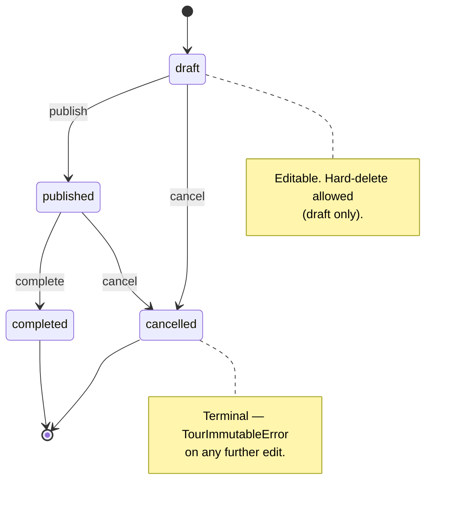
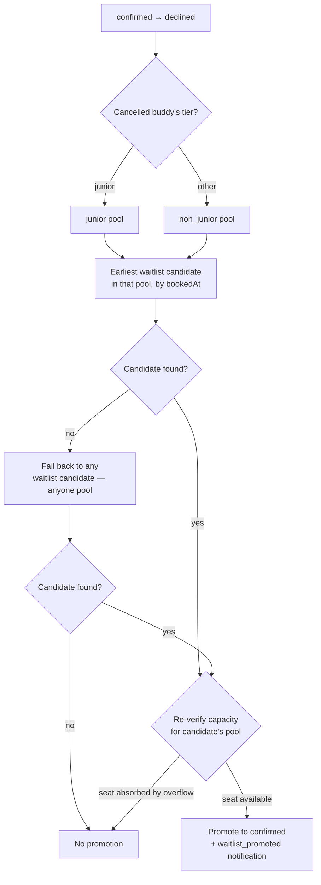

# Product Requirements Document
## Buddy Booking App

**Version:** 0.4 (MVP)
**Last Updated:** 2026-09-24
**Status:** Living document — when it and the code disagree, the code wins

---

## Table of Contents

1. [Overview](#1-overview)
2. [Goals & Non-Goals](#2-goals--non-goals)
3. [Users & Roles](#3-users--roles)
4. [Authentication](#4-authentication)
5. [Buddy Profile](#5-buddy-profile)
6. [Group Management](#6-group-management)
7. [Tour Management](#7-tour-management)
8. [Booking System](#8-booking-system)
9. [Evaluation System](#9-evaluation-system)
10. [Notifications](#10-notifications)
11. [Screens](#11-screens)
12. [Internationalisation](#12-internationalisation)
13. [Tech Stack](#13-tech-stack)
14. [Data Migration](#14-data-migration)
15. [Future Roadmap](#15-future-roadmap)
16. [Out of Scope (v1)](#16-out-of-scope-v1)
17. [Open Questions](#17-open-questions)

---

## 1. Overview

A web-first internal booking application for managing group tour assignments. The app serves two user types: **Buddies** (tour guides) and **Admins** (our team). Buddies can view upcoming tours, book a session (server auto-assigns Confirmed or Waitlist based on tier-pool capacity — see §8.9), manage their profile, write a reflection on each tour they guided, and track their history. Admins manage tours, groups, approve buddies, configure rules, and evaluate buddy performance.

**Primary language:** Japanese
**Supported languages:** Japanese, English (i18n from day one)

---

## 2. Goals & Non-Goals

### Goals
- Replace the existing Google Sheets workflow with a structured, reliable web app
- Give buddies a self-service experience for booking and profile management
- Give admins full visibility, control, and notification coverage
- Build a clean foundation that can grow without a rewrite

### Non-Goals (v1)
- Participant-facing features (tour participants do not use this app)
- Travel agency integration
- Native mobile apps (web-first PWA; native post-v1.5)
- Peer evaluation between buddies
- Payment handling
- Live calendar subscription / Google & Apple OAuth sync (planned for v1.5; see §16)

---

## 3. Users & Roles

| Role | Description |
|---|---|
| **Buddy** | Tour guide. Can book tours, manage own profile, write tour reflections, view history. |
| **Admin** | Regular admin. Can manage tours, groups, buddies, bookings, and evaluations. |
| **Super Admin** | All admin capabilities plus admin account management and system configuration. |

**Scale:**
- Launch: ~50 buddies
- Maximum expected: ~200 buddies
- Admins: small team (5–6 non-dev members)

---

## 4. Authentication

- **Social login:** Google and Apple (OAuth 2.0) via Firebase Auth.
- **Signup flow:**
  1. Buddy signs in via Google or Apple in the frontend (Firebase issues an ID token).
  2. Frontend calls `POST /auth/register` with an optional profile payload (`displayName`, `realName`, `languages`, `bio`). The server upserts a `User` (role `buddy`) and a `BuddyProfile` in `pending` state. If `displayName` is missing it falls back to the email prefix.
  3. Subsequent requests go through `authMiddleware`, which validates the Firebase token and looks the user up by `firebaseUid`.
  4. Admins receive an in-app notification and a post to the shared Slack channel on new signup. Admin email is off by default (§10.2).
  5. Admin approves or rejects via `PUT /admin/buddies/:id/status`. Allowed status values via the API: `trainee` / `active` / `rejected`. See §11.4 for the approval flow and §5.1 for status constraints.
  6. On approval (`pending` → `trainee`) or rejection (`pending` → `rejected`), the buddy receives an in-app + immediate-email notification.
- **Admin accounts:** A `User` with role `admin` or `super_admin` is created by a Super Admin (`POST /admin/profiles`). On first login, `ensureAdminProfile` middleware lazily creates an `AdminProfile` row if one is missing, using Firebase `name` or the email prefix as the initial display name.
- **Session management:** Firebase Auth handles token lifecycle. Identity + role for the current user are obtained from `GET /me/profile` (buddies) or `GET /admin/profile` (admins).

---

## 5. Buddy Profile

### 5.1 Account Status (admin-managed, visible to admins only)

| Status | Description |
|---|---|
| **Pending** | Signed up, awaiting admin approval |
| **Active** | Cleared to log in; tier determines booking eligibility (see §5.2) |
| **Rejected** | Signup rejected by admin — account is closed |
| **Suspended** | Temporarily or permanently deactivated after being active |

Status is set manually by admin via `PUT /admin/buddies/:id/status`. The API accepts only `trainee` / `active` / `rejected`. `pending` is the initial state (set on registration) and is not reachable via update. `suspended` is **Planned** — the enum value exists but no API endpoint transitions to it yet.

Typical progression: Pending → Trainee (approve) → Active (promote — auto-sets `tier = junior`) or → Rejected (terminal). Rejected and Suspended are distinct: Rejected means the signup was never approved; Suspended means an active buddy was deactivated.

Buddies are never deleted from the database. Status updates are the only lifecycle change.

**Trainee access:** Trainees (`status = trainee`, `tier = null`) can log in but cannot see tours or make bookings. Their nav shows Profile only — Tour and History would dead-end — and `/buddy` shows a training-status message (`tour.traineeMessage`), not the "not registered" message shown to rejected and suspended buddies. Training schedules are arranged outside the system; a dedicated section is planned for a future release. Admins manage trainees via `/admin/trainees`; promotion to junior is done through the buddy detail page (tier dropdown), which requires confirmation.

### 5.2 Tier (admin-managed)

Once Active, a tier is assigned and updated manually by admin:

| Tier | Description |
|---|---|
| **Junior** | Recently activated, limited experience |
| **Buddy** | Comfortable with regular tours, handles complex groups |
| **Star** | Can act as roving supervisor (浮き), covering all groups on a tour rather than one. Can run offline training sessions as trainer |
| **Blackstar** | Can act as session lead (統括): roving supervision, plus counterpart for the group and the back-office work. Can run online and offline training sessions |

浮き and 統括 are capabilities of a tier, not a separate field and not a per-tour role assignment.

A buddy sees the tier they hold on their own profile page; `GET /me/profile` returns it. `internalNotes` and `adminMemo` stay admin-only. A buddy never sees another buddy's tier. A buddy with no tier assigned — a trainee, or an active buddy whose tier an admin cleared — gets no tier row at all rather than an empty one.

Typical progression: Junior → Buddy → Star → Blackstar.

Employment is a separate axis and is not encoded here — see §5.2.1.

### 5.2.1 Member Type (admin-managed)

`memberType` answers "what is this person to PLAB", where tier answers "what can this person do":

| Member type | Description |
|---|---|
| **Buddy** (バディ) | A part-time buddy |
| **PLAB Member** (PLABメンバー) | On the PLAB team rather than a part-time buddy |

The two axes are independent. A PLAB member holds a tier like anyone else, and the requirements for each tier are identical either way — a blackstar PLAB member and a blackstar buddy have met the same bar. This is why the old `organizer` tier was removed: it encoded employment on the capability axis and left "blackstar PLAB member" unrepresentable.

Unlike tier, `memberType` is never null and defaults to `buddy` — employment is known for everyone, trainees included. It changes nothing behavioural: booking eligibility, seat pools, capacity, permissions and notifications all ignore it.

社員 and アルバイト are not used for these values anywhere in the UI or the docs — the team's own vocabulary is バディ and PLABメンバー.

### 5.3 Self-Managed Fields (edited by buddy)

| Field | Type | Notes |
|---|---|---|
| Display name / nickname | Text | Chosen by buddy; editable in profile settings |
| Real name | Text | For admin reference; editable in profile settings |
| Profile photo | Image upload | **Shipped**, stored in a private Azure Blob container and shown through signed links that last until the end of the next UTC day. `POST /me/profile/photo` (multipart `photo` field) and `DELETE /me/profile/photo`. Constraints: ≤ 2 MB, MIME in `image/jpeg` / `image/png` / `image/webp`, magic-byte validated. |
| Bio | Long text | Free description |
| Contact info | Text / Email | Preferred contact method |
| Languages spoken | Multi-select enum (`LanguageSchema`) | See enum values below |
| Skills & interests | Free text (one per line) | v1: plain textarea; structured multi-select in future |
| Availability | Free text | General availability notes (v1); structured input in future |

#### Language Enum (`LanguageSchema`)

Ordered for UI display — priority tier shown first:

| Value (code) | Priority |
|---|---|
| `english` | Priority |
| `korean` | Priority |
| `chinese_simplified` | Priority |
| `chinese_traditional` | Priority |
| `arabic` | Standard |
| `french` | Standard |
| `german` | Standard |
| `italian` | Standard |
| `japanese` | Standard |
| `portuguese` | Standard |
| `russian` | Standard |
| `spanish` | Standard |
| `thai` | Standard |
| `vietnamese` | Standard |

`LanguageSchema.options` preserves this order — UI iterates it directly for consistent display without sorting logic.

`UpdateBuddyProfileSchema.languages` validates against `LanguageSchema` (not raw strings). `BuddyProfileResponse.languages` is typed as `Language[]`.

### 5.4 Admin-Managed Fields

| Field | Type | Notes |
|---|---|---|
| Account status | Enum | See §5.1 |
| Tier | Enum | See §5.2 — visible to the buddy it belongs to (`GET /me/profile`), never to other buddies |
| Member type | Enum | See §5.2.1 — `buddy` / `plab_member`; admin-only, default `buddy` |
| Internal notes | Free text | Admins only |
| Admin evaluation records | See §9 | Admins only |

### 5.5 Migration
- Existing buddy data imported from Google Sheets at launch
- Admin completes missing fields via dashboard post-import
- Buddies complete their own profiles after first login

---

## 6. Group Management

Groups represent visiting parties — schools, companies, community groups, etc.

### 6.1 Group Fields

| Field | Type | Notes |
|---|---|---|
| `id` | UUID | Auto |
| `name` | Text | Required, min 1 char. e.g. "Sakura High School", "Acme Corp" |
| `type` | Enum | `GroupTypeSchema`: `school` / `company` / `community` / `other` (stored as lowercase; displayed via the top-level `groupType` i18n namespace) |
| `contactName` | Text | Optional |
| `contactEmail` | Email | Optional. Validated as email format on create/update |
| `contactPhone` | Text | Optional |
| `notes` | Long text | Optional. Admin-maintained; visit history, special considerations, etc. Limited Markdown (bold, lists, links) via the editor toolbar |
| `createdAt` / `updatedAt` | Timestamp | Auto |

### 6.2 Rules
- Groups created and managed by admins only — all four endpoints under `/admin/groups`; no buddy-facing group routes
- Each tour is linked to exactly one group via `Tour.groupId` (FK; non-nullable)
- Groups cannot be deleted in v1 (no `DELETE` endpoint); tour history accumulates over time
- Group name is not unique — duplicate names are permitted
- Group detail (`GET /admin/groups/:id`) returns the full tour list nested under `tours: GroupTourSummary[]` (each with date, status, place names, participant count, session summaries) for the linked tour history

---

## 7. Tour Management

### 7.1 Tour Fields

A `Tour` carries metadata (date, deadlines, status, admin assignments). Place, capacity, meeting time and per-session timing live on `TourSession` rows under the tour — a tour has **1 or 2 sessions** (hard cap; the API rejects a third with `TooManySessionsError`).

**Tour-level fields**

| Field | Type | Notes |
|---|---|---|
| `id` | UUID | Auto |
| `groupId` | UUID FK | Linked to a managed Group |
| `tourDate` | Date | |
| `description` | Long text? | Visible to buddies — shown on tour detail and, on the tour day, as the brief on `/buddy` (§11.1). Limited Markdown (bold, lists, links) via the editor toolbar |
| `adminMemo` | Long text? | **Admin-only** — never sent in buddy responses. Limited Markdown (bold, lists, links) via the editor toolbar |
| `bookingOpen` | Boolean | Default `false`. Admin toggles to open/close bookings for a Published tour. Buddies can only book while this is `true` (and tourDate is in the future). |
| `cancellationDeadline` | Date | Default: 7 days before tour. Must be after (closer to tour than) the Maybe deadline. **Per-buddy override is Planned** — schema model (`BuddyCancellationDeadlineOverride`) exists but no admin API endpoint manages it yet. |
| `maybeDeadline` | Date? | Default: 9 days before tour. Must be before the cancellation deadline. Validated server-side. |
| `notificationOffsets` | Int[] | Days before tour date to send reminders; default `[3, 1]`. Matches the shipped form label ("days before, comma-separated"). |
| `status` | Enum | `draft` / `published` / `cancelled` / `completed` |
| Assigned admins | Many | Optional. Stored as `TourAdminAssignment(tourId, adminId)` rows — many-to-many with `AdminProfile`. |
| `staffInChargeId` | UUID FK? | Optional FK to `AdminProfile`. Required to be one of the assigned admins; nullable only if no admins are assigned. |

**Session-level fields** (`TourSession`)

| Field | Type | Notes |
|---|---|---|
| `id` | UUID | Auto |
| `tourId` | UUID FK | |
| `order` | Int | Display order; unique within tour |
| `label` | Text? | e.g. "Morning"; if absent the UI uses a default like "Session 1" |
| `meetingTime` | Time | Required |
| `startTime` | Time? | Schema field. Not rendered in the current create/edit form |
| `endTime` | Time? | Schema field. Not rendered in the current create/edit form |
| `capacity` | Int | Required. Total seats for the session |
| `minBuddies` | Int? | Optional. When `participantCount < minBuddies` the session is flagged `belowMinimum` in responses and UI |
| `participantCount` | Int | Default `0`. Cached group size (number of visitors, not buddies) used to compute `belowMinimum` |
| `placeId` | UUID FK | Required. Exactly one place per session; a tour's two sessions may go to different places. Replaced the old tour-level free-text `location` field (#239) — see §7.5 |
| `createdAt` / `updatedAt` | Timestamp | Auto |

### 7.2 Tour Status Lifecycle

Transitions are gated server-side via `PATCH /admin/tours/:id/status` with `{action: 'publish' | 'cancel' | 'complete'}`. Allowed transitions:



- **Draft:** Editable. Hard-delete allowed via `DELETE /admin/tours/:id` (draft only — other statuses reject with `TourNotDraftError`).
- **Published:** Visible to Active buddies. Bookable while `bookingOpen = true` and the tour date is after today in Japan: booking closes on the tour day itself (`isBookingAllowed` on the web, `NOT_BOOKABLE` from the API). Can be edited, cancelled, or completed.
- **Cancelled:** Booking closed. All buddies with status Confirmed, Maybe, or Waitlist receive an in-app + email notification (`tour_cancelled`). **No further edits** — the API rejects updates with `TourImmutableError`.
- **Completed:** Booking closed. The tour detail page surfaces the per-tour evaluation section as the natural prompt to add evaluations. **No further edits** — same `TourImmutableError`.

### 7.3 Rules
- Only admins can create, edit, cancel, or complete tours
- Tours must be **Published** before Active or Trainee buddies can see them
- Only **Active** buddies can book tours

### 7.4 Tour Admin Assignment

Each tour can have one or more admins assigned to it.

**Assignment rules:**
- Any admin can assign or unassign admins to a tour
- Assignments can be made at any point — during draft, after publishing, or even post-cancellation for record-keeping
- A tour is not required to have assigned admins (optional)

**Staff in charge:**
- One assigned admin must be designated as **staff in charge**
- Staff in charge is required if at least one admin is assigned; optional otherwise (i.e. if no admins are assigned, the field is empty)
- Staff in charge must be one of the assigned admins
- Staff in charge has no additional system permissions — it is a designation for operational clarity and record-keeping

**Removing an assigned admin who is staff in charge triggers a prompt with two paths:**
1. **Designate a replacement from remaining assigned admins** (if others exist)
2. **Assign a new admin and designate them as staff in charge** (always available)

If the admin being removed is the only assigned admin, removing them leaves the tour with no assigned admins and no staff in charge — which is a valid data state but flagged visually in the admin UI as unresolved.

**Notification routing:**
- Tour-specific notifications (booking changes, cancellations, Maybe deadline events, post-deadline "I can't go" reports) are sent to assigned admins only
- If no admins are assigned to a tour, no tour-specific notifications are sent for that tour

**Data:**
- Assignment stored as a many-to-many relation between admins and tours
- Staff in charge stored as a single foreign key on the tour record
- Visible to all admins in tour detail view
- Not visible to buddies

### 7.5 Places and Spots Management

Replaces the old free-text `Tour.location` (#239). Each session goes to exactly one **place** (e.g. a park); the two sessions of a tour may go to different places, and a tour's places are its sessions' places. A place contains **spots** (e.g. a monument inside it) — a buddy's memorable moments (§9.3) happen at spots, and there can be several per session. Most places have no spots at all.

**Model:** admin-managed lookup tables, `Place` and `Spot`, both bilingual (`nameJa`/`nameEn`), ordered (`sortOrder`) and retirable (`active`). Neither is ever deleted — a place cannot be analysed if it disappears from history. `Spot.placeId` is fixed at creation; a spot is never reassigned to a different place.

**Rules:**
- A session has exactly one place, picked from the admin-managed list — there is no free-text location field
- A session's place can be changed after creation, except while a `TourReflectionMoment` on that session references a spot of its current place (§9.3)
- Renaming a place or spot is a correction only (typo, translation) — never a repurposing to mean something else
- Retiring (`active: false`) hides a place/spot from new pickers without breaking historical references

**Admin UI (`/admin/places`):** a sortable list (name in both languages, order, active) with create/edit; each place opens to its own spot list, same pattern. No delete action anywhere — only deactivate.

**Tour form:** each session row has a dropdown of active places, replacing the old free-text location input. The edit form shows the same dropdown per existing session, and saves it together with the session's other changed fields in one `PUT /admin/tours/:id/sessions/:sessionId`; the add-session form on the tour detail page has it too.

---

## 8. Booking System

### 8.1 Booking Statuses

| Status | Meaning | Who sets it |
|---|---|---|
| **Confirmed** | Definitely attending | Buddy |
| **Maybe** | Tentative; must resolve by admin-set deadline | Buddy |
| **Waitlist** | Join only if a seat opens | Buddy |
| **Declined** | Opted out or cancelled | Buddy or Admin |

### 8.2 Seat Counts

Capacity, pools, and seat counts live at the **session** level (see §7.1 — `TourSession`), not at the tour level. The buddy-facing detail response (`GET /tours/:id`) returns per-session:
- `seatCounts: { confirmed, maybe, waitlist, declined }` — all four status counts, visible to every buddy
- `remaining` — overall remaining seats based on confirmed
- `myCapacity` / `myRemaining` — the caller's tier-pool-aware view: how many seats the caller could still claim given their tier and the session's `TierCapacity` allocation
- `myBookingStatus` — the caller's own booking status for that session (null if not booked)

Only **Confirmed** bookings count against capacity. Maybe and Waitlist do not consume a seat. Buddies never see who else has booked — only counts.

### 8.3 Booking Rules

- **One booking per buddy per session.** Unique constraint `(buddyId, sessionId)`. A multi-session tour can have one booking row per buddy per session.
- Only **Active** buddies **with a tier assigned** can book (trainees cannot — see §8.9 Eligibility)
- Booking is open while:
  1. Tour is `published` AND `bookingOpen = true`
  2. `tourDate` is after today in Japan — booking closes on the tour day itself (§7.2)
  3. Cancellation deadline has not passed (per buddy, after applying any `BuddyCancellationDeadlineOverride`)
- Admin override of per-buddy cancellation deadline is **Planned** (schema model exists; no API endpoint manages it yet — see §7.1 and §11.2)
- **Cancellation deadline takes precedence (server-side):** Once the cancellation deadline has passed for a buddy, **all status changes via the regular update endpoint are blocked** (`PUT /tours/:tourId/sessions/:sessionId/bookings/me` returns `DEADLINE_PASSED`). The only post-deadline buddy action is the "I can't go" endpoint below.
- **Maybe deadline takes precedence for `→ maybe` transitions:** If the maybe deadline has passed, transitioning *into* Maybe is rejected (`MAYBE_DEADLINE_PASSED`). Transitions out of Maybe (to Confirmed, Declined, etc.) follow the cancellation-deadline rule.
- **Post-deadline "I can't go":** After the cancellation deadline has passed, buddies can still report that they cannot attend via `POST /tours/:tourId/sessions/:sessionId/bookings/me/cant-go`. The buddy submits a reason (category + optional free text). The booking status is changed to `declined` immediately, a `CancellationReason` row is recorded with `unavoidable = NULL` (unreviewed) and `recordedBy = buddy.userId`, and if the original status was `confirmed`, waitlist auto-promotion runs (see §8.6). Assigned admins receive an immediate in-app + email notification (`cant_go_post_deadline`); this event is intentionally not part of `NotifEventType` and is not user-configurable (always immediate).

### 8.4 Status Transition Matrix

The buddy-update endpoint (`PUT /tours/:tourId/sessions/:sessionId/bookings/me`) enforces:

| From \ To | Confirmed | Maybe | Waitlist | Declined |
|---|---|---|---|---|
| Confirmed | — | ✅ * | ✅ | ✅ † |
| Maybe | ✅ ‡ | — | ✅ | ✅ |
| Waitlist | ✅ ‡ | ✅ * | — | ✅ |
| Declined | ✅ ‡ | ✅ * | ✅ | — |

\* Blocked after `maybeDeadline` passes (`MAYBE_DEADLINE_PASSED`).  
† Requires a `reason` payload (`REASON_REQUIRED`) — a `CancellationReason` row is created.  
‡ Capacity-checked against the session's tier pools (`TOUR_FULL` if no slot available, taking the caller's tier and pool overflow into account).

All transitions above are gated by `cancellationDeadline` — once it passes (from 00:00 JST on the deadline date, like every date rule; see `docs/decisions.md`), the regular update endpoint rejects everything with `DEADLINE_PASSED`. Post-deadline, only the `/cant-go` endpoint works (→ `declined` only). Admins can override any booking status at any time via `PATCH /admin/bookings/:id/status` with no capacity or deadline checks.

### 8.5 Maybe Flow

1. Buddy selects "Maybe" (only available before the Maybe and cancellation deadlines), either on a session they have not booked (`POST /tours/:id/bookings` with `status: "maybe"`) or by changing an existing booking (§8.4)
2. Admin sets a **Maybe confirmation deadline** per tour (default offset: 9 days before tour if not set; configurable globally)
3. Buddy receives reminders at **3 days** and **1 day** before the deadline. Default offsets are baked in code; the `maybe-reminders` job (§10.5) enqueues them. `/admin/config` to make offsets globally configurable is Planned — see §11.5; no per-tour override in v1.
4. Buddy must update to **Confirmed** or **Declined** before deadline
5. If no action taken by deadline, booking status remains **Maybe** and assigned admins are notified to follow up manually (`maybe_deadline_missed`), enqueued by the `maybe-deadlines` job (§10.5).
6. **After cancellation deadline:** The maybe deadline becomes irrelevant. The "Maybe" status is no longer available, and buddies in confirmed status cannot transition to maybe (they are committed to attending). Buddies in maybe status who have not resolved must attend.

### 8.6 Waitlist Flow

Waitlist is created automatically (not chosen by the buddy) — `createBooking` assigns `confirmed` if a pool seat is available, else `waitlist` (see §8.9 assignment logic). A buddy on Waitlist sees their status on the session card.

**Auto-promotion** runs server-side whenever a `confirmed` booking transitions to `declined` (via the regular update endpoint, the "I can't go" endpoint, or admin status override). The promotion is performed inside a serializable transaction:

1. Identify the cancelled buddy's tier pool (junior → `junior` pool; everyone else → `non_junior` pool)
2. Find the earliest `waitlist` candidate in that primary pool, ordered by `bookedAt` ascending
3. If none exists, fall back to any `waitlist` candidate (anyone pool)
4. Re-verify capacity for the candidate's pool, then promote them to `confirmed`



Only one promotion runs per cancellation event — no cascading. If the freed seat was already absorbed by the overflow into the `anyone` pool, no promotion may occur.

Buddies never need to manually claim a freed seat. The promoted buddy receives an in-app + email notification (`waitlist_promoted`).

### 8.7 Cancellation & Cancellation Reasons

- Buddies can cancel (change status to `declined`) up to the cancellation deadline via the regular update endpoint, or any time after via `/cant-go`
- A `CancellationReason` row is created when a buddy cancels via either path. Server-side rule:
  - `Confirmed → declined` via the regular update endpoint **requires** a reason payload (the server rejects with `REASON_REQUIRED` if missing)
  - `Maybe → declined` and `Waitlist → declined` via the regular endpoint do **not** require a reason and create no `CancellationReason` row
  - The `/cant-go` endpoint always creates a `CancellationReason` regardless of the prior status
- Admin status overrides (`PATCH /admin/bookings/:id/status`) bypass the reason requirement — admins can set status directly with no checks; if a reason is needed for the record, it's set separately via the cancellation-reason endpoint
- Cancellation reason fields (`CancellationReason` table):

| Field | Type | Notes |
|---|---|---|
| `category` | Enum | `health` / `emergency` / `personal` / `work` / `other` |
| `freeText` | Text? | Optional — buddy's own explanation |
| `unavoidable` | Boolean? | `null` = unreviewed; `true` / `false` set by admin via `PATCH /admin/bookings/:id/cancellation-reason` |
| `recordedBy` | User ref | Auto-filled — the user who triggered the cancellation (buddy in buddy-initiated paths; admin in admin-initiated paths if extended later) |

- No category is automatically flagged as unavoidable — it is always a human (admin) judgement
- Admin reviews context and sets the unavoidable flag accordingly; admin can update it at any time, including back to `null` (unreviewed)
- The admin buddy-detail page surfaces a cancellation summary: total / unavoidable / avoidable / unreviewed counts

### 8.8 Booking History

- All past bookings stored permanently per buddy — records are never deleted (declined bookings are reused on re-book via upsert; see §8.9)
- History grows steadily — DB design must account for this (indexes documented in data-model.md)
- Admins view full booking history for any buddy via `GET /admin/buddies/:id` (`AdminBuddyBookingEntry[]` includes all statuses)
- Buddies view their own bookings via `GET /me/bookings` — **declined bookings are excluded** from this listing

#### Buddy history page (`/buddy/history`)

Answers "what have I done". Tours are split by the date in Japan (`getTodayJst()`): **Upcoming** is every booked tour from today on, **Past** is every earlier tour the buddy attended.

- **Attended** means the tour was not `cancelled` and the buddy has a `confirmed` booking on at least one session. There is no attendance record. Past tours the buddy did not attend (tour cancelled, or only Maybe/Waitlist bookings left when the date passed) are not shown on this page.
- **Summary line** under the title: `N tours · M groups · since <date>`, counted over attended past tours. Groups are counted by distinct group name. Hidden when there are none.
- **Past is grouped by year**, newest first, each header carrying that year's tour count after filters.
- **Filters** (Past only, combinable):
  - *No reflection written (N)*: shows past tours with `reflectionSubmitted = false` — no reflection on any of the tour's sessions. The home screen stops prompting 30 days after a tour (§11.1), so this is where an older tour with no reflection stays reachable. Hidden when N is 0.
  - *Group name*: text search, case-insensitive substring match on the group name.
- No filters for group type, place, tour status or cancellations.

### 8.9 Tier-Based Booking System

Buddies book tours via the tier-based seat pool system. The system auto-assigns a `confirmed` booking or creates a `waitlist` booking based on pool availability.

There is no separate Application entity — a `Booking` row is created immediately on signup, with status `confirmed` or `waitlist`.

#### Eligibility

- Only **Active** buddies with a tier assigned can book
- **Trainees** (a status, with `tier = null`) cannot book — they cannot participate in tours yet
- Only when tour is **Published** and `bookingOpen = true`

#### Seat Pools

Total tour capacity is split into three pools:

| Pool | Who fills it | Default % |
|---|---|---|
| **Junior** | `junior` tier only | 20% |
| **Non-junior** | `buddy`, `star`, `blackstar` | 30% |
| **Anyone** | Any eligible tier (overflow from either pool) | 50% |

Percentages default to 20/30/50 for all tours. Per-tour overrides are supported via the `TierCapacity` table (`pool: BookingPool, percent: Int`). Override rules:

- Either use all defaults (no `TierCapacity` rows for the tour), or provide all three pools explicitly
- All three percentages must sum to 100% — partial overrides are not allowed
- The `anyone` pool is the shared overflow — both junior and non-junior buddies can fill from it once their respective pools are full

#### Assignment Logic

When a buddy books, the system immediately determines their slot:

1. **Junior buddy**: check junior pool → if full, check anyone pool → if full, `waitlist`
2. **Non-junior buddy**: check non-junior pool → if full, check anyone pool → if full, `waitlist`

A `Booking` row is created with the result. `Booking.buddyTier` is frozen at booking time to ensure pool counts remain stable even if the buddy's tier changes later.

#### Booking Statuses

| Status | Meaning |
|---|---|
| `confirmed` | Got a slot in a pool. |
| `waitlist` | All relevant pools were full. Buddy waits. |
| `maybe` | Buddy marked themselves as uncertain (post-booking). |
| `declined` | Buddy cancelled. Row is kept and reused on re-book. |

#### Cancellation

- Buddy can cancel while `waitlist` or `confirmed` up to the cancellation deadline; after it, only via "I can't go" (§8.3)
- Cancelling a `confirmed` booking frees a pool slot and triggers promotion
- After cancel, re-book is allowed if any vacancy exists in the buddy's pool or the anyone pool
- Status is set to `declined` on cancel; the booking row is reused on re-book (upsert)

#### Promotion

When a `confirmed` booking is cancelled:

1. The freed pool slot is identified by the cancelled buddy's tier
2. The earliest `waitlist` booking from the same pool is promoted to `confirmed`
3. If no waitlisted buddy exists in that pool, the anyone pool is checked

#### UI Entry Point

- `/buddy/tours/[id]` — the tour detail page
- When no booking exists and the tour is bookable: show Join (`参加を希望`) and, before the Maybe and cancellation deadlines, Maybe (`未定`)
- When `waitlist`: show waitlist status badge and cancel option
- When `confirmed`: show confirmed status, cancel and set-maybe options
- Booking history lives on `/buddy/history` (§8.8)

---

## 9. Evaluation System

### 9.1 Overview

There are two distinct records of how a tour went: **admin evaluations** (scored, internal, hidden from buddies) and **buddy tour reflections** (free text, written by the buddy, visible to admins and the buddy themselves).

### 9.2 Admin Evaluations

#### Types

Backed by two distinct database models (see data-model.md):

| Type | Model | Trigger | Notes |
|---|---|---|---|
| **Per-tour evaluation** | `AdminEvaluation` | After a specific tour | Linked to a tour record; `tourId` is required |
| **General profile evaluation** | `AdminProfileEvaluation` | Anytime | Not tied to a specific tour |

#### Fields

All score fields use the scale: **1 = Poor / 2 = Below Average / 3 = Average / 4 = Good / 5 = Excellent** (matching shipped i18n labels). All text fields are optional. All score fields are nullable — admins can fill in any subset.

| Field | Score | Text | Per-tour | Profile | Notes |
|---|---|---|---|---|---|
| Overall rating | 1–5 | ✅ | ✅ | ✅ | |
| Reliability | 1–5 | ✅ | ✅ | ✅ | Admin-only metric |
| Communication | 1–5 | ✅ | ✅ | ✅ | |
| Group engagement | 1–5 | ✅ | ✅ | ✅ | |
| Memory | 1–5 | ✅ | ✅ | ✅ | Remembering names, details, preferences |
| Knowledge | 1–5 | ✅ | ✅ | ✅ | Content accuracy and depth |
| Dedication | 1–5 | ✅ | ✅ | ✅ | Effort and commitment |
| Dialogue | 1–5 | ✅ | ✅ | ✅ | **Core differentiating skill** — buddies open a genuine dialogue with participants, not just a one-way tour |
| Adaptability | 1–5 | ✅ | ✅ | ✅ | Handling unexpected situations |
| Emotion | — | ✅ | ✅ | ✅ | Warmth, empathy, expressiveness — cannot be meaningfully scored (`emotionNote` only) |
| Confidence | 1–5 | ✅ | ✅ | ✅ | |
| Absent without report | boolean | — | ✅ | — | Per-tour only. Admin sets when a buddy missed the tour without advance notice. Surfaces as `absenceSummary.absentWithoutReport` count on the buddy detail page |
| Evaluator | — | — | ✅ | ✅ | Auto-filled from submitting admin's `AdminProfile.name` (returned as `createdByName`) |
| Date | — | — | ✅ | ✅ | Auto-filled |

#### Access
- Only admins can create, read, or edit admin evaluations
- Buddies have no visibility into admin evaluations

#### Multi-admin ownership
- Each admin submits their own independent evaluation
  - Per-tour: uniqueness is `(buddyId, tourId, createdBy)`
  - Profile: uniqueness is `(buddyId, createdBy)`; profile evaluations are upserted via `PUT /admin/profile-evaluations/:buddyId`
- An admin can only edit or delete their own evaluations; other admins see them as read-only (enforced server-side — 403 if requester is not the creator)
- Evaluator display name is shipped: each `AdminProfile.name` is surfaced as `createdByName` in evaluation responses

#### Post-completion prompt (UX)
- When an admin clicks **Mark Complete**, a single confirmation modal appears showing the list of confirmed buddies
- Admin confirms in that modal; the tour is marked completed and the page refreshes
- The existing evaluation section on the tour detail page serves as the natural prompt to add evaluations — no second modal is shown

### 9.3 Buddy Tour Reflections

A buddy is not asked to grade themselves. They are asked what happened.

#### Trigger
- When a tour is marked **Completed**, a buddy who held a **Confirmed** booking may write a reflection on each session they guided
- Eligibility is enforced server-side: `POST /me/reflections` rejects with 403 unless the buddy holds a `confirmed` booking **on that session** and the tour is in `completed` status
- Writing one is optional — a buddy can skip

#### Prompts

Four free-text prompts, no scores, plus structured **moments** (below). **At least one prompt must be non-empty, or at least one moment must exist**; the other three prompts may be blank. Nobody finishes a session with no thoughts at all, and a fully blank row would silence the reminder while recording nothing. `memorableMoment` was a fifth free-text prompt until #239 replaced it with moments — the whole point being that "an impressive moment" is now analysable per spot rather than buried in a paragraph.

| Prompt | Column |
|---|---|
| What I did well | `didWell` |
| What I could have done better | `couldImprove` |
| To share with other buddies and admins | `notesForOthers` |
| Questions I couldn't answer | `openQuestions` |

#### Moments

Zero or more structured memorable moments per reflection (`TourReflectionMoment`), each with a `description` (required) and either a `spotId` or free-text `placeNote` — never both, never neither.

- **The spot picker** offers every active spot of the session's place, plus **Other** (free text via `placeNote`). A spot retired after a moment was tagged with it stays selectable on that reflection. The API rejects a `spotId` that is not a spot of the session's place
- **When the session's place has no spots**, the picker has nothing to offer: the form falls back to a single textarea (no add/remove), and on submit the one resulting moment's `placeNote` is filled in automatically with the place's Japanese name (`nameJa`, whatever the buddy's UI language). A reflection already holding more than one moment, or a note that is not the place's name (written while the place still had spots), keeps the full picker instead, with Other as its only choice, so editing it never drops a moment
- **Where spots do exist**, the form shows one moment row by default with a "+ add another moment" affordance; each additional row gets its own remove (trash) control, and reorder (up/down) controls appear once there are 2+ rows
- `position` preserves entry order (usually the route order walked that day) — row order in the database is not guaranteed

#### Rows per session, obligation per tour

`Tour.tourDate` is a single date, so a tour is one day and its `TourSession` rows are time slots within it. A buddy working two slots may write two reflections if the groups felt different, but is only ever asked for one: any reflection on any session of the tour silences the `self_eval_prompt` reminder (§10.1) and sets `reflectionSubmitted` on `GET /me/bookings`.

#### Edit window
- Buddies edit their own reflection via `PUT /me/reflections/:id`, which **replaces** the four prompts and every moment (deleted and recreated from the array, with fresh `position`s)
- Edit window is **7 days from creation** (`REFLECTION_EDIT_WINDOW_DAYS = 7`); after that the row is locked
- The response includes `locked: Boolean` so the UI can drop back to a read-only card once the window has passed
- One reflection per buddy per session (unique constraint `(buddyId, sessionId)`)

#### Where it lives
- Its own page, `/{locale}/buddy/tours/{tourId}/reflection`, one form per session the buddy guided. The tour detail page links to it rather than hosting the form. Past reflections are read back on the same page.

#### Access
- Buddies write and read their own reflections
- Admins read all reflections via `GET /admin/reflections`
- Buddies cannot see other buddies' reflections — including `notesForOthers` and `openQuestions`, which are named for sharing but not yet surfaced to anyone but admins

---

## 10. Notifications

**Shipped:** Event-triggered in-app + email delivery via an outbox/dispatcher pattern. The `Notification` (read-model), `NotificationJob` (outbox queue), `NotificationPreference`, and `DigestQueue` tables are live; events are enqueued inside the originating transaction and a single cron endpoint (`POST /jobs/notifications/dispatch`) drains the queue. Email is sent via Gmail API; recipient locale comes from `User.locale` and templates are bundled per-locale.

**Planned:** The daily admin digest flush — see §10.5 and `docs/roadmap.md`. It is no longer on the launch path now that admin notifications go to Slack rather than email (`docs/decisions.md` 2026-08-15).

### 10.1 Buddy Notifications

| Event | Channels | Timing | Status |
|---|---|---|---|
| New tour published (`tour_published`) | In-app + email | Immediate, to Active buddies | Shipped |
| Tour details changed (`tour_details_changed`) | In-app + email | Immediate, to Confirmed / Maybe / Waitlist | Shipped (fires on `tourDate`, or a session's place or meeting time change only — see note below) |
| Tour cancelled (`tour_cancelled`) | In-app + email | Immediate, to Confirmed / Maybe / Waitlist | Shipped |
| Tour reminder (`tour_reminder`) | In-app + email | Per-tour offsets (default: 3 days, 1 day before); evaluated hourly | Shipped (job route; not scheduled — §10.5) |
| Maybe deadline reminder (`maybe_reminder`) | In-app + email | Global offsets (default: 3 days, 1 day before deadline); evaluated hourly | Shipped (job route; not scheduled — §10.5) |
| Waitlist seat opened (`waitlist_opened`) | In-app + email | Immediate, to all buddies on the waitlist for the freed pool | Planned (no enqueue site yet) |
| Waitlist auto-promotion (`waitlist_promoted`) | In-app + email | Immediate, to the promoted buddy | Shipped |
| Reflection prompt (`self_eval_prompt`) | In-app only | On tour Completed, to Confirmed buddies with no reflection on any session of that tour | Planned (no enqueue site yet) |
| Account approved / rejected (`account_approved` / `account_rejected`) | In-app + email | Immediate | Shipped |

**Buddies configure email per event.** Four of the events above are mutable —
`tour_published`, `tour_details_changed`, `tour_reminder`, `maybe_reminder` —
via `GET / PUT /me/notification-preferences` (api.md), surfaced as a section of
`/buddy/profile`. Default is on for all four, so a buddy who never opens the
settings receives exactly what they did before preferences existed.

The rest are **not** mutable and are enforced as such: `tour_cancelled`,
`waitlist_promoted`, `account_approved` and `account_rejected` have no
`NotifEventType` value, so no preference row can be stored and the enqueue path
ignores one if it somehow exists. Muting them means turning up to a tour that
isn't running, or never learning a seat opened up. `waitlist_opened` and
`self_eval_prompt` have no email template, so there is nothing to mute.
See `docs/decisions.md` 2026-09-18.

In-app delivery is never configurable, for buddies or admins: the preference is
about what lands in an inbox, and a muted event stays findable in the app.

Tour-edit notifications fire **only** when `tourDate` changes, or when a session's **place** (which place — not its name or spots) or **`meetingTime`** changes. A session change notifies every booked buddy on the tour, not only that session's. Changes to a session's label, capacity, `minBuddies` or `participantCount`, to `adminMemo`, assigned admins, staff in charge, or pool percentages are silent.

### 10.2 Admin Notifications

Admins independently configure their preferred notification channel(s) and delivery mode per event type. Tour-specific events (new booking, cancellation, post-deadline reports, Maybe resolution, Maybe deadline missed) are routed to **assigned admins only**. If no admins are assigned to a tour, no tour-specific notifications are sent for that tour.

**Slack is the primary admin channel; email is off by default.** See
`docs/decisions.md` 2026-08-15. Every admin event posts to one shared Slack
channel, and an admin may opt back into email per event.

| Event | Channels | Default Timing | Status |
|---|---|---|---|
| New buddy signup (`new_signup`) | In-app + Slack (email opt-in) | Immediate | Shipped |
| New booking (`new_booking`) | In-app + Slack (email opt-in) | Immediate | Shipped |
| Booking cancelled before deadline (`cancellation`) | In-app + Slack (email opt-in) | Immediate | Shipped |
| Post-deadline "I can't go" report (`cant_go_post_deadline`) | In-app + Slack + email | **Always immediate — not configurable** | Shipped |
| Maybe → Confirmed or Declined (`maybe_resolved`) | In-app + Slack (email opt-in) | Immediate | Shipped |
| Maybe deadline passed unresolved (`maybe_deadline_missed`) | In-app + Slack (email opt-in) | On deadline (hourly evaluation) | Shipped |

`NotifEventType` enum values shipped in code: `new_signup`, `new_booking`, `cancellation`, `maybe_resolved`, `maybe_deadline_missed`. Post-deadline "I can't go" is handled by code as always-immediate and is intentionally not a configurable preference — it is not in the enum. It is the one admin event that still emails by default, deliberately: it is the most urgent and warrants a second channel.

**Slack targeting caveat:** Slack posts go to one shared channel, so the
"assigned admins only" routing above applies to the in-app and email channels
only. Every admin in the channel sees every tour-specific event. At 5–6 admins
this is acceptable and arguably better for shared visibility — see
`docs/decisions.md`.

**Email delivery modes (configurable per admin per event):**
- **Immediate:** email sent at time of event
- **Daily digest:** single email at 09:00 JST covering all activity from the previous day; only sent if there was activity. **Not implemented** — nothing writes to `DigestQueue` and there is no flush job. An admin who enables email and selects digest receives nothing. Tracked in `docs/roadmap.md`.

**Default delivery per admin:**
- All five configurable events: Slack on, email off
- Post-deadline "I can't go" reports: Always immediate in-app + Slack + email (not configurable)

Slack notifications are always immediate.

### 10.3 Slack Delivery Model

One shared Slack channel (e.g. `#peace-buddy-ops`) configured via a single
`SLACK_WEBHOOK_URL` env var, posted to with an incoming webhook.

Because delivery is channel-wide rather than per-recipient:

- One `NotificationJob` row is written per event, not one per admin, and it
  carries `recipientUserId: null`.
- `NotificationPreference.slackEnabled` is **informational only** — nothing reads
  it at enqueue time. Per-admin Slack toggles and `@mention` targeting are
  deferred; they would require per-user Slack IDs and a bot token rather than a
  webhook.
- The channel is single-language (Japanese), since there is no per-recipient
  locale to honour. Templates live in
  `apps/api/src/services/slackTemplates/messages.ja.json`.

**Message content.** Every admin event names the acting buddy and the tour —
group name and date — not just the fact that something happened. Those values
are snapshotted into `NotificationJob.payload` at enqueue time rather than
resolved at render time (`docs/decisions.md` 2026-09-13). Each template carries
two variants: the detailed one, and a generic fallback used when any of its
fields is missing from the payload, which is what rows written before the
payloads were widened look like. Interpolated values are buddy- and
admin-controlled, so each is escaped for its channel at the substitution
boundary. The same two-variant mechanism backs the email templates, so
buddy-facing mail names the tour too.

Only admin-targeted events post to Slack. Buddy-targeted events stay on in-app +
email — they have no place in an internal ops channel.

Sending is gated the same way as email: `SLACK_ENABLED=true` or
`NODE_ENV=production`, with `SLACK_DISABLED=true` as a kill switch. Failures land
in `NotificationJob.lastError` and retry on the standard backoff.

### 10.4 Channels and Storage

- **In-app:** a `Notification` row is written for every event that lists "In-app" in the table above, for every recipient. Read via `GET /me/notifications`. Both buddies and admins receive in-app notifications.
- **Email:** sent via the Gmail API (see §13). Recipient locale determines language; locale is read from `User.locale: 'ja' | 'en'` (default `'ja'`), surfaced to the user as a language toggle in profile settings.
- **Payload:** `Notification.payload`, `NotificationJob.payload` and `DigestQueue.payload` are `Json` columns. What each event kind writes is typed in `packages/types` (`NotifPayloadSchemas`); nothing parses a payload on the way out, because rows predating a field must still render (§10.3).
- **Slack:** admin events only, one shared channel — see §10.3.

### 10.5 Scheduled Jobs

**Shipped:** `POST /jobs/notifications/dispatch` — drains pending `NotificationJob` rows (the outbox queue). Protected by the `X-Scheduler-Secret` middleware.

**No scheduler is deployed** since GCP Cloud Scheduler was retired on 2026-09-13 (§13.1): the shipped job routes below exist, but nothing calls them yet. All endpoints are protected by the same middleware.

| Job | Endpoint | Cadence | Purpose | Status |
|---|---|---|---|---|
| Tour reminders | `POST /jobs/notifications/reminders` | Hourly | Match `Tour.notificationOffsets` against now; enqueue `tour_reminder` to confirmed / maybe / waitlist buddies | Shipped |
| Maybe pre-reminders | `POST /jobs/notifications/maybe-reminders` | Hourly | Enqueue `maybe_reminder` to buddies still in Maybe before their deadline | Shipped |
| Maybe deadline expiry | `POST /jobs/notifications/maybe-deadlines` | Hourly | Enqueue `maybe_deadline_missed` to assigned admins for any unresolved Maybe; fires only on the JST day after deadline | Shipped |
| Daily admin digest | `POST /jobs/notifications/digest` | 09:00 JST | Flush `DigestQueue` per admin; send one email per admin with activity | Planned |

Hourly cadence is sufficient because all offsets are day-granular. Idempotency is enforced via the `NotificationDispatchLog(eventKey UNIQUE)` table — each scheduled job inserts a row keyed by `(eventType, scope, recipientUserId)` before sending; unique-constraint collisions mean the reminder was already dispatched.

### 10.6 Channel Config UI

Both audiences read and write the same `NotificationPreference` table, through
separate endpoints and screens.

**Admins** set, per event type, at `/admin/notification-preferences`:
- `emailEnabled: Boolean`
- `emailMode: 'immediate' | 'digest'`
- `slackEnabled: Boolean`

via `GET / PUT /admin/notification-preferences` (api.md). Slack target is governed by §10.3.

**Buddies** set `emailEnabled` alone, for the four mutable events in §10.1, via
`GET / PUT /me/notification-preferences`, in a section of `/buddy/profile`.
There is no mode (the digest is an admin concept) and no Slack column (Slack is
not a buddy channel — §10.3).

---

## 11. Screens

### 11.1 Buddy Home Screen

Route: `/buddy`. An obligations screen: what the buddy has committed to and still owes comes first, tours they could book come last. It fetches `GET /me/bookings` and `GET /tours?from=<today>` and builds the three sections client-side (`apps/web/src/app/[locale]/buddy/buddy.home.ts`).

1. **Your next tour** (`home.nextTour`) is the nearest `published` tour, dated today or later, where the buddy holds a `confirmed` booking. It shows group name, date, the meeting time of each confirmed session and the tour's place names, and links to the tour. A Maybe or Waitlist booking never makes a tour "next"; those tours appear in section 2.
2. **Needs your action** (`home.actions`), in this order:
   - Every upcoming `published` tour where the buddy holds a `maybe` booking, whatever its distance from the deadline. It reads "confirm or cancel by {maybeDeadline}". Once the deadline has passed it is marked overdue instead, with the deadline day itself counting as passed, the same rule as the tour detail page (`isPastDeadline`). A tour with no `maybeDeadline` shows no date.
   - Every `completed` tour where the buddy held a `confirmed` booking, dated within the last 30 days (`REFLECTION_PROMPT_DAYS`), with no reflection on any of its sessions. It links to the tour's reflection page.
   - Every upcoming `published` tour where the buddy holds a `waitlist` booking.
3. **Tours looking for buddies** (`tour.title`) is `GET /tours` filtered through `isBookingAllowed`: `published`, `bookingOpen`, and dated after today. Nearest first. The first three are shown, and "Show all" expands the rest in place. Each card is one tour-level header plus **one section per session**. The header carries group name, tour date and the tour's place names — `places` is a tour-level array (its sessions' places, each once — §7.5), so it is shown once, not per section. Each section carries the session's `label` when set, its meeting time, the booking badge, the **buddy number** and that session's `participantCount`. A single-session tour renders one section, in the same layout.

**On the day of a tour** section 1 becomes **Your tour today** (`home.tourDay`). It applies when the next confirmed tour (section 1's rule) is dated today, so a Maybe-only booking today never triggers it. The page then also fetches `GET /tours/:id` for that tour, and the panel shows, for each session the buddy is confirmed on, the meeting time in large type, the group's participant count and how many other buddies are confirmed (`seatCounts.confirmed` less the buddy). Below that: the tour's place names, group name and type, the staff in charge by name, the tour's `description` as the brief, and a link to the tour. Other buddies are a count, not names or tiers, and the staff in charge carries no contact details. Sections 2 and 3 stay below the panel. Until the detail loads, or if it fails, the usual next-tour card is shown. On every other day the page is unchanged.

Sections 1 and 2 stay hidden until `GET /me/bookings` has loaded, and section 3 shows no empty-state line until `GET /tours` has. Each section has its own empty-state line. A failed request shows a load error in place of its sections (`home.bookingsLoadError`, `tour.loadError`), so a failure never reads as "nothing here".

**Today** is the date in Japan (`getTodayJst`) for every date rule on this page, including the `from` sent to `GET /tours`, as it is everywhere else in the app. Tours run in Japan and their dates are Japanese calendar dates.

**Excluded from this screen:** tours-attended counts, hours volunteered and tier progress. Buddy numbers are planned as their own surface (#251); tier progress stays out — tier is a policy surface, not a UI one.

**Onboarding redirect:** an approved buddy (`trainee` or `active`) with no `onboardingSeenAt` is sent to `/buddy/profile?onboarding=1`, and the visit is stamped. Neither request above is made for that buddy.

**Non-active buddy:** a trainee sees `tour.traineeMessage` and any other non-active buddy sees `tour.notRegistered`, in place of the whole screen.

**The buddy number** on those cards is `minBuddies`, or `capacity` when `minBuddies` is null, for that one session — never a sum across sessions. `capacity` is the *maximum* number of buddies (admin label 「最大バディ数」); what a buddy weighing a signup needs is the minimum the session asks for. The two cases share one label (`tour.buddyCount` / 「バディ数」) because the value is not always a minimum. Both fields, and `participantCount`, already come back on each `sessions[]` entry of `GET /tours`.

**The caller's own booking status** is shown beside each session's meeting time as a badge (`bookingStatus.*`): Confirmed, Maybe or Waitlist. It is per session because bookings are — a two-session tour can read `09:00 Confirmed · 13:00 Waitlist`. A session with no booking shows nothing, and so does a `declined` one: the buddy cancelled it and can book it again. `GET /tours` returns this as `sessions[].myBookingStatus`, resolved for every listed session in one query.

**No tour status badge:** the page requests `GET /tours` without `status`, which defaults to `published`, so every card would read "Published". It told the buddy nothing and shared the primary fill with the Confirmed badge. The page title says what the list is instead: "Tours looking for buddies" / 「バディ募集中のツアー」 (`tour.title`). Only bookable tours are listed, so the title holds for every card.

The full booking list, including past tours, lives on `/buddy/history` (Upcoming / Past sections). History and Profile (`/buddy/profile`) are reached via the buddy nav; the home screen also links to history.

**Analytics** (tours-attended counts and similar numbers, reflection summary) are tracked in #251 and belong on their own surface, not on this obligations screen.

### 11.2 Tour Management

**Pages & Routes** (admin only):

| Route | Purpose |
|---|---|
| `/admin/tours` | List or month-calendar view of tours, chosen by `?view=`. **List:** client-side search on group name and place names; filters for status, date range (upcoming / past / all), group type and below-minimum-only, combined with AND and kept in the URL query string; sortable by every column; "today" divider in list. **Calendar:** six Monday-first weeks for `?month=YYYY-MM`, one chip per tour (status dot, group name, `confirmed/capacity`, below-minimum marker), three chips per day before the rest collapse into a count. The leading and trailing days belong to the neighbouring months and carry no chips — they hold the grid at six rows, and a tour landing on one is only shown by that month's own grid. All four statuses appear; cancelled is struck through. The calendar ignores the list's filters and hides the filter bar, but leaves the filter params in the URL so switching back to the list restores them |
| `/admin/tours/new` | Create tour form. The group picker is a type-to-filter combobox; the selected group shows a summary (type, contact fields, notes) and a new-tab link to its detail page |
| `/admin/tours/:id` | Tour detail — metadata, sessions, tier capacities, bookings, admin assignments, evaluations |
| `/admin/tours/:id/edit` | Edit tour form — same group picker and selected-group summary as the create form. Every field of each existing session (place, label, meeting time, capacity, min buddies, participant count) is editable; adding or removing a session is not (done from the detail page) |

**Capabilities:**
- Create, edit tours; hard-delete restricted to `draft` tours
- Status transitions via `PATCH /admin/tours/:id/status` with action `publish` / `cancel` / `complete` — gated by the table in §7.2
- Toggle `bookingOpen` to open/close bookings while a tour is Draft or Published
- Manage **1–2 sessions** per tour (`POST` / `PUT` / `DELETE /admin/tours/:id/sessions`); session deletion blocked if the session has bookings or is the last session; a session's capacity cannot be lowered below its Confirmed bookings (`CapacityBelowConfirmedError`) — no booking is ever un-confirmed by an edit
- Set **tier capacity per session** (junior / non_junior / anyone percentages; must sum to 100%) via `PATCH /admin/tours/:id/sessions/:sessionId/tier-capacities`
- Add / edit admin-only memo
- Set / change cancellation deadline and Maybe deadline on the tour (deadline order validated server-side)
- Configure per-tour notification schedule (`Tour.notificationOffsets`, days before tour)
- View all bookings per tour (buddy name, status, sessions booked, bookedAt, cancellation reason)
- Assign / unassign admins via `POST` / `DELETE /admin/tours/:id/admins`
- Designate staff in charge via `PUT /admin/tours/:id/staff-in-charge`. Server enforces: staff-in-charge must be one of the assigned admins; cannot null it out while admins are still assigned; unassigning the current staff-in-charge admin while others remain requires designating a replacement first
- After a tour is `completed`, the per-tour evaluation section appears on the detail page; admins use it to record evaluations (see §9)

**Planned (not shipped):**
- Per-buddy cancellation deadline override — `BuddyCancellationDeadlineOverride` schema exists but no admin API or UI manages it yet

### 11.3 Group Management

**Pages & Routes** (admin only):

| Route | Purpose |
|---|---|
| `/admin/groups` | List all groups (sortable by name and type) |
| `/admin/groups/new` | Create new group form |
| `/admin/groups/:id` | Detail view — metadata card + linked tour history table (sortable by tour date, status, place names, capacity) |
| `/admin/groups/:id/edit` | Edit group form |

**Capabilities:**
- Create, edit groups; no delete in v1
- View group tour history on detail page — each row links to the tour detail
- Manage contact info (name, email, phone) and free-text notes

**Responsive layout:** Card-on-mobile, table-on-desktop per the convention in architecture.md.

### 11.4 Buddy Management

#### Pages & Routes

**Navigation:** "Pending Approval", "Buddies" and "Trainees" are separate items under the バディ管理 heading of the task-grouped admin sidebar.

| Route | Purpose | Access |
|---|---|---|
| `/admin/buddies/pending` | Approval queue — pending signups awaiting admin decision | Admin only |
| `/admin/buddies` | Buddy roster — all approved (active) buddies with tier management | Admin only |
| `/admin/buddies/:id` | Buddy detail — full profile, tier/notes editor, booking history | Admin only |

#### Pending Approval Page (`/admin/buddies/pending`)

- **Table:** displayName, email, [Approve] [Reject]
- **Sortable by:** name, email
- **Actions** (both call `PUT /admin/buddies/:id/status`):
  - **Approve** → `{status: 'trainee'}` — buddy can now log in but cannot see tours / book yet. Tier remains null until later promotion (see Buddy Detail).
  - **Reject** → `{status: 'rejected'}` (terminal)

#### Buddy Roster (`/admin/buddies`)

- **Table:** displayName, email, tier, member type, [View Detail]
- **Sortable by:** name, email, tier, member type, status
- **Actions:** Click row → navigate to detail page

#### Buddy Detail Page (`/admin/buddies/:id`)

**Display section:**
- Real name, email, photo
- Status (`trainee` / `active` / `rejected` — `suspended` planned)
- Tier (`junior` / `buddy` / `star` / `blackstar`; null for trainees)
- Member type (`buddy` / `plab_member`; never null)
- Internal notes
- Created date
- **Cancellation summary** — total / unavoidable / avoidable / unreviewed counts derived from the buddy's `CancellationReason` rows
- **Absence summary** — `absentWithoutReport` count from `AdminEvaluation` rows; admins use it to inform the `reliability` score in `AdminProfileEvaluation`
- Full booking history (table of tours + booking status) — see below

**Edit form** (`PUT /admin/buddies/:id` — body `{tier?, memberType?, internalNotes?}`):
- Tier dropdown — hidden for trainees, who have no tier yet
- Member type dropdown — shown for every status, including trainees, since employment does not depend on account status
- Internal notes textarea
- [Save] [Cancel]

**Status transitions on this page** (`PUT /admin/buddies/:id/status`):
- Promote trainee → active (auto-sets tier to `junior`)
  - Promotion shares the page with the member type and notes fields, so an unsaved edit to either is written first via `PUT /admin/buddies/:id`.
  - The two writes are not atomic. A failed profile write leaves the status unchanged; a failed status change leaves the profile edit applied. Both surface the same error, and retrying is safe — the second attempt recomputes the same diff.
- Reject pending (from this page if needed)
- Suspend / un-suspend — **Planned**: enum value exists but no API path yet

**Booking history table:**
- Columns: Group name (linked to `/admin/tours/:id`), Tour date, Places, Booking status
- Sortable by: group name, tour date, booking status
- Default sort: tour date descending (most recent first)
- Shows all bookings regardless of booking or buddy status — no filter
- Empty state: "No bookings"
- API: `GET /admin/buddies/:id` returns `AdminBuddyDetailResponse` (extends `AdminBuddyResponse` with `bookings: AdminBuddyBookingEntry[]`)

**`AdminBuddyBookingEntry` fields:** `id`, `tourId`, `sessionId`, `sessionOrder`, `sessionLabel`, `status` (`BookingStatus`), `bookedAt`, `cancellationReason`, `tour: { tourDate, places, group: { name }, status }`

#### API Endpoints

Frontend page routes and API endpoints are separate layers. `/admin/buddies/pending` is a Next.js page URL; the underlying API call uses query parameters.

| Method | Path | Description |
|---|---|---|
| `GET` | `/admin/buddies?status=pending` | List pending buddies (called by the `/admin/buddies/pending` page) |
| `GET` | `/admin/buddies?status=active&tier=...&memberType=...` | List active buddies (called by the `/admin/buddies` page); filterable by tier and member type |
| `GET` | `/admin/buddies/:id` | Fetch `AdminBuddyDetailResponse` (profile + bookings + cancellation/absence summaries) |
| `PUT` | `/admin/buddies/:id/status` | Set status. Allowed values: `trainee` / `active` / `rejected`. `→ active` auto-sets `tier = junior`. |
| `PUT` | `/admin/buddies/:id` | Update `tier`, `memberType` and/or `internalNotes`. `tier` and `internalNotes` are nullable; `memberType` is not |

#### Business Rules

| Rule | Detail |
|---|---|
| Approval | Admins only. Approve → `trainee`; Reject → `rejected` (terminal). |
| Promotion | Trainee → Active via the same status endpoint with `{status: 'active'}`. Server auto-sets `tier = junior` on that transition. |
| Tier updates | Admin can change tier any time after promotion via `PUT /admin/buddies/:id`. |
| Internal notes | Admins only; never visible to buddies (excluded from buddy responses by `select`). |
| Tier values | `junior` / `buddy` / `star` / `blackstar`. Trainees have `tier = null`. |
| Member type values | `buddy` / `plab_member`, default `buddy`, never null. Independent of tier and of status; see §5.2.1. |
| Data retention | Buddies are never deleted; all history retained. |

#### Planned

- Suspension flow: `BuddyStatus.suspended` exists in schema, but the status endpoint doesn't accept `suspended`. Admin promotion to / from suspended is not yet exposed.

### 11.5 System Configuration (Super Admin only)

**Shipped:**

| Capability | Surface |
|---|---|
| Manage admin profiles (create, list, rename, soft-delete) | `/admin/profiles*` endpoints + `/admin/profile`, `/admin/profiles` pages |
| Per-admin notification preferences | `/admin/notification-preferences` page + `GET / PUT /admin/notification-preferences` API |

**Planned (not shipped):**

| Capability | Status |
|---|---|
| Global defaults (cancellation deadline offset, Maybe deadline offset, notification schedule offsets) | No `/admin/config` route, service, or DB model exists yet. Per-tour deadlines are stored on each `Tour` row. Earlier doc references to `/admin/config.maybeReminderOffsets` are aspirational. |
| Org-wide notification defaults applied to new admins | Today every admin starts from hard-coded defaults in `notificationPreference.service.ts`; no super-admin surface to change those defaults. |

### 11.6 Buddy Profile Settings

#### Route

`/buddy/profile` — accessible to all authenticated buddies (any status)

Nav item: "Profile" in the buddy nav (the only item for trainees — §5.1).

#### Page Layout

**Read-only display section** (not editable inline):
- Account status badge
- Tier — the buddy's own, when one is assigned (§5.2)
- Member since date

**Edit form** (`PUT /me/profile`):

| Field | Widget | Notes |
|---|---|---|
| Display name | Text input | |
| Real name | Text input | |
| Bio | Textarea | |
| Contact info | Text input | |
| Languages | Checkbox group | Ordered by `LanguageSchema.options`; priority tier (en/ko/zh) shown first |
| Skills & interests | Textarea | One skill per line; split on `\n` before submit; joined with `\n` for display |
| Availability | Textarea | Free text |
| Profile photo | File input + preview | Uploads via `POST /me/profile/photo` to Azure Blob; delete via `DELETE /me/profile/photo`. See §5.3 for constraints. |

`[Save]` `[Cancel]`

After save: stay on page, refetch profile, show inline success message. Cancel navigates to `/buddy`.

#### API

Uses existing endpoints — no new API work required:

| Method | Path | Description |
|---|---|---|
| `GET` | `/me/profile` | Fetch own profile |
| `PUT` | `/me/profile` | Update self-managed fields |

#### Module Boundaries

```
apps/web/src/app/[locale]/buddy/profile/
  buddy.profile.ts              ← fetchMyProfile, updateMyProfile (thin functions)
  buddy.profile.test.ts         ← unit tests
  page.tsx                      ← fetch on mount, render the sections below
  _components/
    profile-header.tsx           ← status, tier, member since
    profile-form.tsx             ← form state + submit handler
    profile-photo.tsx            ← photo upload / delete
    linked-accounts.tsx          ← second auth provider
    notification-preferences.tsx ← buddy email preferences (§10.6)
```

Route: `routes.buddyProfile` in `routes.ts`.

#### i18n Namespaces

- `profile.*` — all profile page strings (field labels, placeholders, errors, photo coming-soon text)
- `languages.*` — language display names (separate namespace for reuse in admin buddy detail)

### 11.7 Admin Home (`/admin`)

`/admin` is a worklist. It answers "what needs me today" with actionable queues, each linking into the page where the work is done. Login sends admins here, and it is the first item in the admin sidebar ("Home").

It is not a metrics dashboard. Admin analytics (reflection analytics, per-buddy numbers) are tracked in #250 and belong on their own page, not in this worklist.

| Queue | Listed | Links to |
|---|---|---|
| Pending applications | Buddies with status `pending`, oldest first | Each buddy to `/admin/buddies/:id`; the section to `/admin/buddies/pending` |
| Unresolved Maybes past deadline | Published tours with at least one `maybe` booking whose `maybeDeadline` JST day has ended and whose tour date has not passed. Not limited to tours with assigned admins | `/admin/tours/:id` |
| Short of buddies | Published tours in the next 14 JST days with a session whose `confirmed` bookings are below its `minBuddies`. Sessions without `minBuddies` are never listed. This is **not** `belowMinimum`, which compares the visitor count (`participantCount`) to the threshold | `/admin/tours/:id` |
| Completed tours missing evaluations | `completed` tours with a confirmed buddy who has no `AdminEvaluation` for that tour from any admin, newest first. Buddy reflections are not counted | `/admin/tours/:id` |
| Unread notifications | The viewing admin's five most recent unread in-app notifications, each markable as read | `/notifications` |

The first four come from `GET /admin/dashboard`. Its service calls one query per owning service — `listBuddies`, `listOverdueMaybeTours`, `listUnderfilledTours`, `listToursMissingEvaluations` — rather than re-implementing any of them, and `listOverdueMaybeTours` shares its where-clause with the `maybe-deadlines` cron (§10.5). Notifications come from `GET /me/notifications`, the call the bell already polls.

Every queue renders an empty state when nothing is waiting, so an empty section reads as done rather than not loaded.

### 11.8 Places and Spots Management

| Route | Description |
|---|---|
| `/admin/places` | List of places — nameJa, nameEn, sortOrder, active — sortable, with create/edit. No delete; deactivate only |
| `/admin/places/:id` | That place's spots, same sortable-list-with-create/edit pattern |

Picking a session's place happens on the tour create/edit form itself (a dropdown of active places per session), not here — see §7.5.

---

## 12. Internationalisation

**Shipped:**

| Capability | Notes |
|---|---|
| i18n framework | `next-intl` on the Next.js frontend |
| Default language | Japanese (`ja`) |
| Supported locales | `ja`, `en` |
| UI strings | All in `apps/web/messages/{en,ja}.json` |
| Date / time formatting | `yyyy/MM/dd` in Japan time in both locales, via `formatDate` / `formatDateTime` (`apps/web/src/lib/format-date.ts`) |
| Language switching in user settings | `User.locale` (`ja` / `en`, default `ja`) is on the schema; toggle UI is `apps/web/src/components/language-switcher.tsx`. |
| Email templates localised | Templates live under `apps/api/src/services/notificationTemplates/messages.{en,ja}.json`; dispatcher reads `User.locale` to pick the language. |

---

## 13. Tech Stack

### 13.1 Stack

| Layer | Choice | Notes |
|---|---|---|
| Frontend | Next.js (App Router) | UI only — no business logic; web-first, mobile-responsive PWA |
| Backend | Hono | Dedicated REST API; all business logic, auth middleware, Prisma access |
| Repo | Monorepo (pnpm workspaces) | `apps/web`, `apps/api`, `packages/types`, `prisma/` |
| Hosting | Azure Container Apps, Japan East | Both services; via the Microsoft for Nonprofits grant |
| Database | Azure Database for PostgreSQL Flexible Server | B1ms, private to a VNet; via the same grant |
| ORM | Prisma | Lives in `apps/api`; schema in `prisma/` |
| Auth | Firebase Auth | Google + Apple OAuth; token validated in Hono middleware |
| File storage | Azure Blob Storage, Japan East | Profile photos in a private container; single-step multipart upload via `POST /me/profile/photo`; read through signed links pinned to the UTC day |
| Scheduled jobs | None deployed | Hono API routes for dispatch, tour reminders, Maybe reminders and Maybe deadline checks exist (no digest flush yet); nothing calls them since GCP Cloud Scheduler was retired on 2026-09-13 |
| Email | Gmail API (Google Workspace for Nonprofits) | Single `sendEmail()` utility in `apps/api`; env: `GMAIL_*` credentials (provider-specific) |
| Slack notifications | Slack Incoming Webhooks | Admin notifications; env: `SLACK_WEBHOOK_URL`; fired from `apps/api` |
| Scheduler auth | Shared secret header | `X-Scheduler-Secret` matched against `SCHEDULER_SECRET` env; middleware exists in `apps/api/src/middleware/schedulerAuth.ts` |
| Shared types | Zod + TypeScript (`packages/types`) | Shared between frontend and backend |
| i18n | next-intl | Frontend only |
| CI/CD | GitHub Actions | Via GitHub nonprofit free Team plan |

### 13.2 Nonprofit Programs to Apply For

| Service | Program |
|---|---|
| Azure | Microsoft for Nonprofits — $2,000/yr Azure Sponsorship credit, activated 2026-09-10 |
| GitHub | GitHub for Nonprofits |
| Google Workspace | Google for Nonprofits — provides the Gmail API mailbox used for outbound email |

### 13.3 Email Abstraction

A single `sendEmail()` utility wraps the email provider. v1 uses the Gmail API authenticated against the Google Workspace for Nonprofits mailbox; switching providers requires changes in one file only.

### 13.4 Migration Path

When the Azure grant lapses, unrenewed credit falls to pay-as-you-go — see
`docs/deploy-plan.md` §1. The Prisma schema uses a plain `postgresql` provider,
so the database stays portable to any managed Postgres.

### 13.5 Mobile Strategy

| Phase | Approach |
|---|---|
| v1 | Web-first, mobile-responsive PWA (Next.js) |
| v1.5+ | Evaluate Flutter native app against the same Postgres backend via API |
| Future | App Store / Play Store — out of scope until explicitly prioritised |

---

## 14. Data Migration

- **Source:** Google Sheets (buddy profile data)
- **Scope:** Buddy profiles only at launch
- **Process:**
  1. Export Google Sheets to CSV
  2. Map fields to Prisma schema
  3. Run one-time import script
  4. Admin reviews and fills missing fields via dashboard
  5. Buddies complete profiles after first login

---

## 15. Future Roadmap

| Version | Feature |
|---|---|
| v1.5 | Live calendar subscription (`webcal://` feed) and OAuth Google/Apple Calendar sync — an `.ics` download shipped separately as the cheap substitute (§16); revisit whether this is still wanted |
| v1.5 | PWA improvements |
| v2+ | Native mobile app (Flutter) |
| v2+ | Structured availability input for buddy profiles |
| v2+ | Admin profile avatar upload (display name already shipped) |

---

## 16. Out of Scope (v1)

- Participant-facing features
- Travel agency integration
- Live calendar subscription and Google/Apple OAuth sync (v1.5)
- Native mobile apps (post-v1.5)
- Peer evaluations
- Payment or compensation tracking
- Structured availability input (free text in v1)

(Automated waitlist promotion *is* in scope and shipped — see §8.6. A static
`.ics` download — one file, no OAuth, no sync — is also in scope and shipped,
as the cheap substitute for the live-subscription/OAuth item above; see
`docs/api.md` `GET /tours/:id/calendar.ics` and `GET /admin/tours/:id/calendar.ics`.)

---

## 17. Open Questions

| # | Question | Owner | Status |
|---|---|---|---|
| 1 | Final enum values for admin evaluation fields | Team | **Resolved** — see §9 |
| 2 | Exact fields to migrate from Google Sheets | Team | Open |
| 3 | Slack workspace / webhook setup | Admin | **Resolved** — single shared channel (e.g. `#peace-buddy-ops`) with one webhook URL in `SLACK_WEBHOOK_URL`; every admin event posts there (`slackEnabled` is informational only). See §10.3. |
| 4 | Apple Developer account for Apple login | Dev | Open |
| 5 | Default Maybe confirmation deadline offset (days before tour) | Team | **Resolved** — 9 days before tour; reminders at 3 days + 1 day before deadline. Cancellation deadline defaults to 7 days before (always after Maybe deadline). |
| 6 | Cancellation reason category enum values | Team | **Resolved** — `health` / `emergency` / `personal` / `work` / `other` |
| 7 | Group type enum values — School / Company / Community / Other sufficient? | Team | **Resolved** — confirmed as-is |
| 8 | Internal tier names | Team | **Resolved** — `junior` / `buddy` / `star` / `blackstar`. `organizer` was employment, not capability, and moved to `memberType` (§5.2.1, #136). Tier is no longer hidden from the buddy who holds it (#137). |
| 9 | When no admins are assigned to a tour, should post-deadline "I can't go" reports notify all admins as a fallback? | Team | **Resolved** — no fallback; notification only goes to assigned admins. Tours without assigned admins flagged visually in UI as unresolved. |
| 10 | Tier-based booking pool split percentages | Team | **Resolved** — junior 20%, non-junior 30%, anyone 50%. See §8.9. |
| 11 | Can a buddy re-book after cancelling? | Team | **Resolved** — yes, if a vacancy exists in their pool or the anyone pool. See §8.9. |
| 12 | What happens when `mentorshipBalanced = false` and a buddy books? | Team | **Resolved** — `mentorshipBalanced` flag removed entirely. All tours always use the 3-pool system. Default percentages (20/30/50) apply when no `TierCapacity` rows exist for the tour. |
| 13 | Should per-tour pool percentage overrides be partial or all-or-nothing? | Team | **Resolved** — all-or-nothing. A tour either uses all defaults (no rows) or provides all 3 pools summing to 100%. |
| 14 | Email provider for v1 | Team | **Resolved** — Gmail API via Google Workspace for Nonprofits. See §13.1, §13.3. |
| 15 | Cron cadence for notification jobs | Team | **Resolved** — hourly for reminder / Maybe pre-reminder / Maybe deadline expiry; once daily at 09:00 JST for admin digest. See §10.5. |
