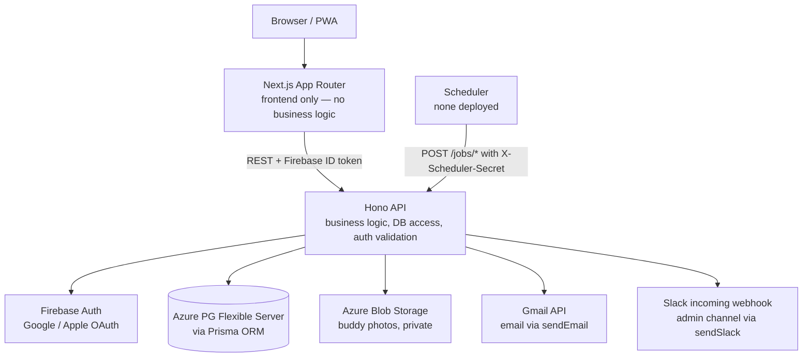
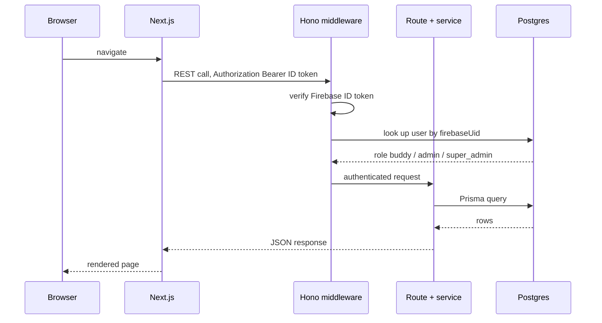
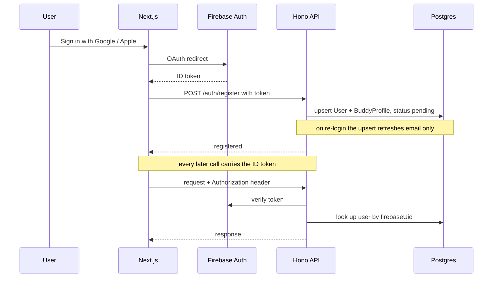
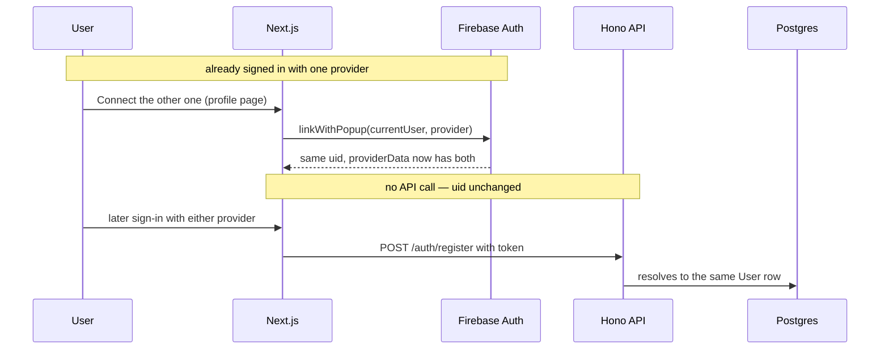
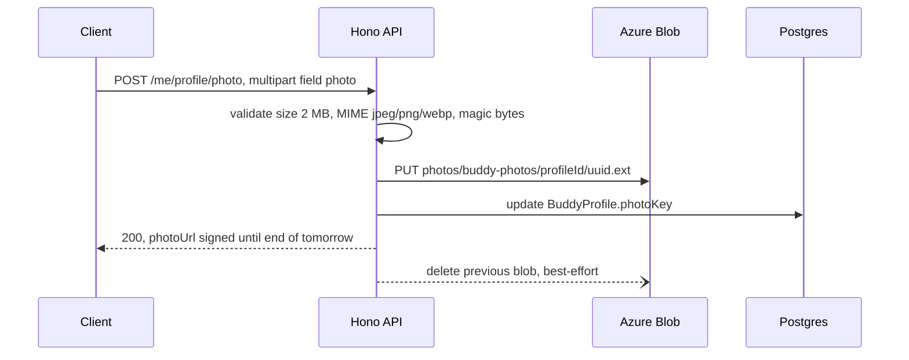
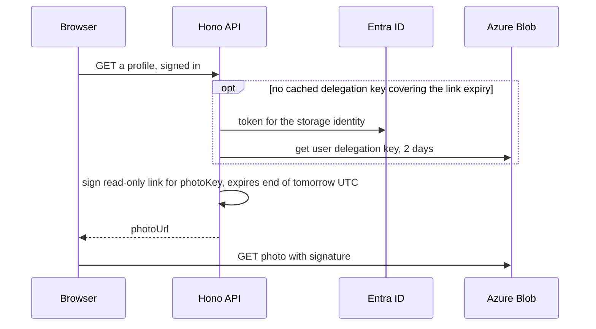
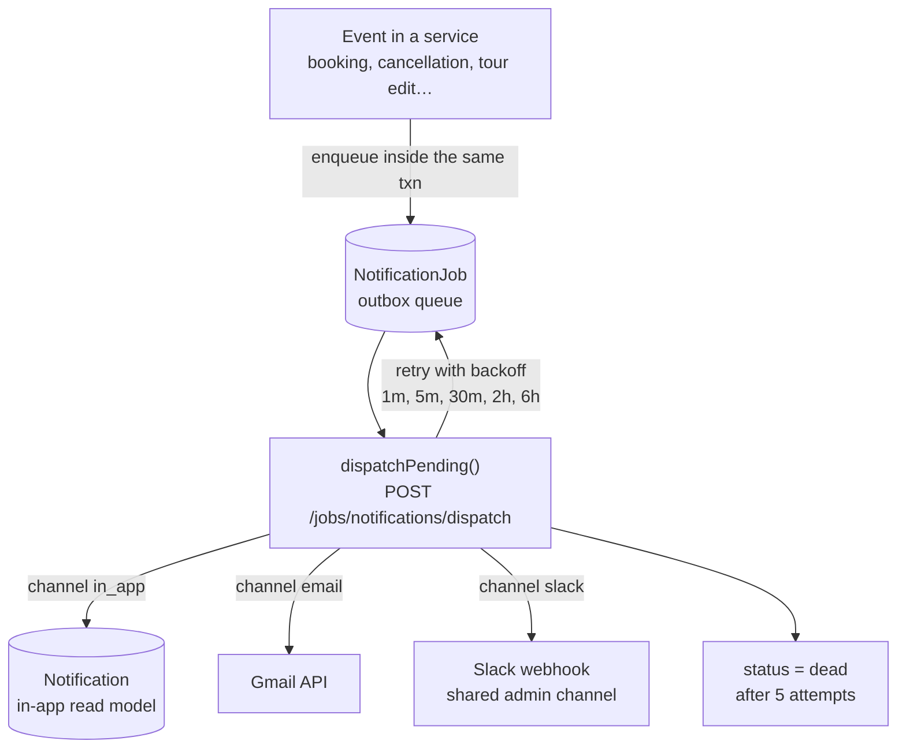
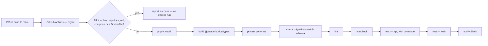
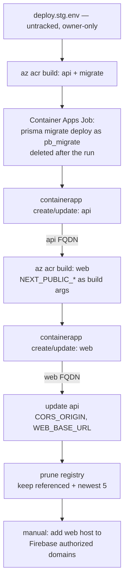
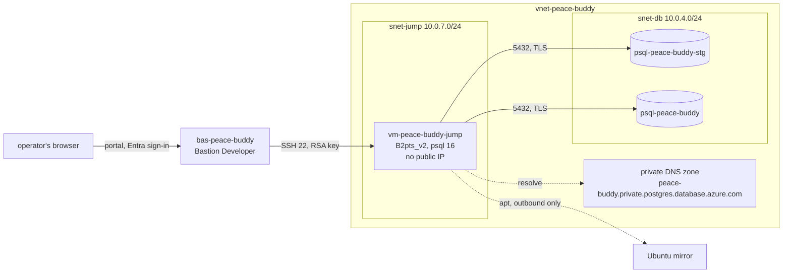

# Architecture

## System Overview



**Deployed on Azure Container Apps + PG Flexible Server in Japan East**, funded
by the Microsoft for Nonprofits grant — see `docs/decisions.md` (2026-09-10) and
`docs/deploy-plan.md`. The GCP/Neon staging stack was retired on 2026-09-13. `DEPLOYMENT.md`
predates that decision and its hosting sections are stale; read it only for the
reasoning it records, not as current state.

## Repo Structure

Monorepo managed with pnpm workspaces:

```
/
├── apps/
│   ├── web/                    ← Next.js (frontend only — UI, routing, rendering)
│   │   ├── src/
│   │   │   ├── app/            ← Next.js App Router pages + globals.css
│   │   │   ├── components/
│   │   │   │   ├── ui/         ← shadcn/ui components (Button, Input, Table, Badge, …)
│   │   │   │   └── app-shell.tsx ← sidebar layout (variant: admin | buddy)
│   │   │   └── lib/
│   │   │       └── utils.ts    ← cn() utility (clsx + tailwind-merge)
│   │   └── components.json     ← shadcn config
│   └── api/                    ← Hono backend (all business logic, Prisma, auth middleware)
├── packages/
│   └── types/                  ← shared Zod schemas and TypeScript types
└── prisma/                     ← shared Prisma schema + seed script
```

The schema is applied with `prisma migrate deploy` from the migration files in
`prisma/migrations/`. `0_init` is the baseline generated from the schema as it
stood on 2026-09-12; every change since then is its own file. No deploy step
applies DDL — see `DEPLOYMENT.md`, "Schema Changes".

## UI Stack

- **Tailwind CSS v4** — CSS-first config via `postcss.config.mjs`; no `tailwind.config.js`
- **shadcn/ui** — component source lives in `apps/web/src/components/ui/`; owned by the project, not a package dependency
- **Radix UI** — accessible primitives underlying shadcn components
- **Theming** — CSS variables defined in `globals.css`:
  - Default (buddy-facing): warm zinc palette
  - Admin: slate/cool blue — applied via `.theme-admin` class on the `AppShell` wrapper
  - Dark mode: enabled; toggled via `.dark` class
- **`AppShell`** — shared sidebar layout used by admin and buddy pages. Accepts `variant: 'admin' | 'buddy'` to apply the correct theme and nav items.

See PRD §13 for the full tech stack rationale.

## Responsive Layout Convention

Admin data tables follow a **card-on-mobile, table-on-desktop** pattern with a consistent breakpoint:

- **Below `lg:` (< 1024px):** card list — each row rendered as a tappable card, all fields visible
- **At `lg:` and above (≥ 1024px):** full table with sortable column headers

Implementation: two sibling elements in the same component — `<div className="lg:hidden …">` (cards) and `<div className="hidden lg:block …">` (table). Sort state is shared; sort controls appear above the card list on mobile.

**All new admin list/detail tables must use `lg:` as the breakpoint.** Using `md:` creates an inconsistent switch point across pages.

## Request Flow



Route composition lives in `apps/api/src/routes/index.ts`, which mounts three
apps side by side: `publicApp` (Firebase token only), `protectedApp` (token +
DB user record), and `schedulerApp` (`X-Scheduler-Secret` header).

## Auth Flow



### Second provider on one account

A buddy attaches a second provider from their own profile page rather than at
sign-in. `linkWithPopup` attaches the credential to the Firebase user already in
the session, which keeps the same `uid`, so `User.firebaseUid` still resolves to
the one row — no second `User`, no duplicate `BuddyProfile`. Both directions are
offered: whichever provider the buddy signed up with is the one the other is
added to.



Sign-in-time linking is not used: Apple's Hide My Email returns a relay address
that never equals the Google one, so there is no shared key to match on before
authentication. See `docs/decisions.md` 2026-09-13.

Approval is a separate admin action: `PUT /admin/buddies/:id/status` moves the
buddy `pending → trainee` or `pending → rejected`, and the buddy is notified.

See PRD §4 for the signup approval business rules.

## Admin Profile System

### Identity Model
Admins are users with `role = 'admin' | 'super_admin'`. Each admin has a corresponding `AdminProfile` record storing:
- `name`: Human-readable name (required, used for evaluation attribution)
- `deletedAt`: Soft-delete timestamp (null = active)

Admin creation flow:
1. Super-admin creates User via admin API (`role = 'admin'`)
2. Admin logs in via Google/Apple (Firebase OAuth)
3. System detects `role = 'admin'`, auto-creates AdminProfile with name from Firebase displayName
4. Name fallback: if Firebase provides no displayName, use email prefix (e.g., "john" from "john@example.com")

### Soft-Delete Visibility
Soft-deleted admins (`deletedAt IS NOT NULL`) are **completely invisible**:
- `GET /admin/profiles` excludes deleted admins
- `GET /admin/profile` (for a deleted admin) returns 404
- Evaluations created by deleted admins still reference them (immutable audit trail), but admin's name won't appear in current roster

Only non-deleted admins and system operations can see the roster.

### Auth Enforcement
Admin-only endpoints enforce role checks explicitly in route handlers:
```
if (user.role !== 'admin' && user.role !== 'super_admin') {
  return c.json({ error: 'Forbidden' }, 403)
}
```

This applies to: `GET /admin/profile`, `PATCH /admin/profile`, `GET /admin/profiles`.

Super-admin-only endpoints check:
```
if (user.role !== 'super_admin') {
  return c.json({ error: 'Forbidden' }, 403)
}
```

This applies to: `POST /admin/profiles` (create), `DELETE /admin/profiles/:userId` (soft-delete).

### API Conventions
- **Create**: `POST /admin/profiles` — requires super_admin
- **Read**: `GET /admin/profile` (own), `GET /admin/profiles` (roster) — requires admin
- **Update**: `PATCH /admin/profile` — update own name, requires admin
- **Delete**: `DELETE /admin/profiles/:userId` — soft-delete (set `deletedAt`), super_admin only, prevents self-deletion

## File Upload Flow

Profile photos are the only file type uploaded in v1. Storage: **Azure Blob Storage**, one account per environment in Japan East, in a private `photos` container. The api reaches it as the environment's user-assigned storage identity — no account keys, and shared-key auth is off on the account. Upload is single-step through the api, not a signed-URL handoff:



`BuddyProfile.photoKey` holds only the blob name. Every response that carries a photo swaps it for `photoUrl`, a read-only user delegation SAS link that is identical all UTC day and expires at the end of the next day. The browser fetches the image from Blob directly, browsers and next/image cache it by URL for the day, and a copied link stops working within two days:



Deletion: `DELETE /me/profile/photo` nulls `photoKey` and deletes the blob.

Locally the api talks to Azurite from `docker-compose.yml` with the same SDK, signing with Azurite's published development key. See `docs/decisions.md` 2026-09-13, "Photos are stored as blob names".

## Notification Flow

Notifications use an **outbox pattern**. Nothing is sent inline with the request
that triggered it: the originating transaction writes `NotificationJob` rows, and
a separate cron-driven dispatcher drains them. This means a failed email can never
roll back a booking, and a committed booking can never lose its notification.



Enqueue time decides *whether* an email is queued at all, and both audiences are
gated there. `decideAdminEmail()` in `notification.service.ts` reads the admin's
`NotificationPreference` and returns `immediate` (queue an email job), `digest`
(skip — see below), or `off`. `decideBuddyEmail()` in the same file reads the
buddy's rows from the same table and returns a plain boolean — buddies have no
mode and no Slack column (PRD §10.6). It returns `true` unconditionally for the
events a buddy may not mute, so a stored row for one of those is ignored rather
than honoured (`docs/decisions.md` 2026-09-18).

In-app is deliberately *not* gated, for either audience: the preference is about
what lands in an inbox, and a muted event stays findable in the app.

Slack is enqueued differently: `enqueueSlackForAdmins()` writes **one** job per
event with `recipientUserId: null`, because delivery is channel-wide rather than
per-recipient. It consults no `NotificationPreference` row and is gated only on a
template existing for the event — `NotificationPreference.slackEnabled` is
informational only (`docs/decisions.md` 2026-08-15).

> **⚠ `digest` mode drops the email.** `DigestQueue` exists in the schema but is
> never written to and never flushed; `POST /jobs/notifications/digest` does not
> exist. Admin email is **off by default** now that admin notifications go to
> Slack, so nothing lands here by accident — but an admin who enables email and
> selects `digest` receives nothing. Tracked in `docs/roadmap.md`.

### Scheduled jobs

All `/jobs/*` endpoints are guarded by `X-Scheduler-Secret` (`schedulerAuth.ts`).

| Endpoint | Cadence | Purpose |
|---|---|---|
| `/jobs/notifications/dispatch` | frequent | Drain the outbox — the only sender |
| `/jobs/notifications/reminders` | hourly | Enqueue `tour_reminder` per `Tour.notificationOffsets` |
| `/jobs/notifications/maybe-reminders` | hourly | Enqueue `maybe_reminder` before the Maybe deadline |
| `/jobs/notifications/maybe-deadlines` | hourly | Enqueue `maybe_deadline_missed` for unresolved Maybes |

The three enqueue jobs are idempotent via `NotificationDispatchLog(eventKey UNIQUE)`.
The dispatcher claims each job with a compare-and-swap on `attempts`, so two
concurrent workers can't send the same job twice.

**No scheduler is deployed.** Cloud Scheduler went with the GCP stack on
2026-09-13, and nothing on Azure calls these endpoints; notifications are to be
re-planned.

> `DEPLOYMENT.md` calls for consolidating these four into **one hourly tick** before
> deploy — Cloud Scheduler's free tier is 3 jobs, and four separate schedules push
> Neon past its free compute allowance. **That pressure disappears on Azure**
> (`docs/decisions.md`, 2026-09-10): Container Apps Jobs bill per execution
> against the same free monthly grant and impose no job-count limit, and B1ms is
> an always-on instance. Keep the four endpoints as they are.

See PRD §10 for event types, channels, and delivery mode defaults.

## Environments

| Env | Status | Description |
|---|---|---|
| `development` | **Live** | Everything in Docker Compose — Next.js, Hono, local Postgres, Firebase Auth emulator. See `README.md` |
| `preview` | **Not built** | No PR-preview environment exists. There is no deploy workflow |
| `staging` | **Live** | Azure Container Apps + PG Flexible Server B1ms `psql-peace-buddy-stg`, Japan East, signing in through Firebase project `peace-buddy-staging`. Where non-dev members check work. Its compute is **started by hand** and stopped when done, so it is off most of the time by design. Replaced the Cloud Run + Neon stack, retired 2026-09-13 |
| `production` | **Being built** | Azure Container Apps + PG Flexible Server B1ms, Japan East, on the Microsoft for Nonprofits grant — decided 2026-09-10, see `docs/decisions.md`. Database is private to a VNet with no public endpoint. Provisioning is `scripts/azure-provision.sh`; progress is tracked in `docs/deploy-plan.md`. Always on |

Prod and staging share one resource group, VNet, Container Apps environment and
registry, and have a separate Postgres server and storage account each. Costs
are in `docs/azure-costs.md`. Nothing replaced the retired GCP/Neon stack;
`development` above stays as local Docker Compose.

On Azure each server carries two restricted login roles, created by
`scripts/azure-db-roles.sh` right after provisioning. `pb_app` reads and writes
rows and is what `DATABASE_URL` holds; `pb_migrate` owns the tables and runs
`prisma migrate deploy` and nothing else. The server admin account is used only
to rotate them. See `docs/deploy-plan.md` §4.1.

## CI/CD

`.github/workflows/ci.yml` is the main workflow. It runs on PRs and pushes to
`main`. **There is no deploy pipeline** — deployment is manual and not yet set up.

`ci` is the check ruleset `main` names as required, so its `on:` trigger is
deliberately unfiltered — a workflow skipped by `on: paths:` reports no status
at all and could never satisfy that check. The path filter sits on the steps
instead: `dorny/paths-filter` runs first on pull requests, and every step from
*Install dependencies* down — the Slack notification included — is guarded on
its output. A PR touching only `docs/**`, markdown, `docker-compose.yml` or a
`Dockerfile` reports a green `ci` having run no check. Everything else,
`scripts/**` and `prisma/**` included, runs in full; so does every push to
`main`. The Postgres service starts either way, because services start before
the first step. As of 2026-09-13 the ruleset matches no refs, so the check is
not actually enforced — see `docs/decisions.md` (2026-09-13).

`.github/workflows/shellcheck.yml` runs `shellcheck` over every `.sh` under
`scripts/`, on PRs that touch them and nothing else. It is not a required check;
see `docs/decisions.md` (2026-09-13). Heredoc bodies are outside what it can
see. The same command runs locally — see `README.md` "Running Tests".



Both Dockerfiles are multi-stage. `--target dev` is what Docker Compose builds
and still ends in `CMD … dev`; `--target runner` is the production image —
`node dist/index.js` for the api, Next's standalone server for web.

## Deploy

Manual, driven by `scripts/deploy.sh` — no pipeline. Terraform was rejected;
see `docs/decisions.md` (2026-09-08, revisited 2026-09-10).

```sh
scripts/deploy.sh scripts/deploy.stg.env   # template: scripts/deploy.env.example
```

One config file per environment, owner-only and gitignored, naming the Azure
resources and carrying every application secret. The script refuses a file
anyone else can read, and names the target in a coloured banner — red for prod
— before it builds anything.

Infrastructure is provisioned separately, and rarely: `scripts/azure-provision.sh`
for the resource group, registry, VNet, Container Apps environment, Postgres
server, Blob storage account and the jump VM, then `scripts/azure-db-roles.sh` for the two database roles, once per
environment. The deploy script creates nothing but the two apps.

Images are built with `az acr build`, server-side, because the apps need
`linux/amd64` and the dev machines are arm64. Apps and the migration job pull
them with one user-assigned identity holding `AcrPull`, so no registry password
is stored. api and migrate are tagged with the commit; web, which carries the
environment's api URL, with the commit and the environment. The last step
deletes old images, keeping any image an app or job still references and the
newest five per repository; see `docs/decisions.md` 2026-09-13.



The order is forced: `NEXT_PUBLIC_*` is inlined into the web bundle at build
time, so the api must be deployed before web is built — and the api's
`CORS_ORIGIN` then needs web's URL, so the api is patched last. Migrations run
before the api is updated, and a failed migration stops the deploy with nothing
changed; see `docs/decisions.md` 2026-09-13. Both apps run `--min-replicas 0`;
that flag is the difference between $0 and a real bill.

## Logs and monitoring

Every app in `cae-peace-buddy` writes stdout/stderr and platform events to one
Log Analytics workspace, `workspace-rgpeacebuddygjmh` (customer id
`04d99fc8-0f21-4400-8680-c0201f3caf70`), kept 30 days. Prod and staging share
it, so filter by app name: `ca-api-stg` / `ca-web-stg` now, `ca-api` / `ca-web`
once prod exists. No Datadog or other agent — nothing to install.

### Tail live

```sh
az containerapp logs show -g rg-peace-buddy -n ca-api-stg --follow --tail 50 --format text
az containerapp logs show -g rg-peace-buddy -n ca-api-stg --type system --follow   # starts, crashes, image pulls
```

This streams from a running replica. Staging is stopped most of the time and
scales to zero, so for anything past, query the workspace instead.

### Search history

Portal → the workspace → Logs, or from the CLI:

```sh
az monitor log-analytics query -w 04d99fc8-0f21-4400-8680-c0201f3caf70 -o table --analytics-query "
ContainerAppConsoleLogs_CL
| where ContainerAppName_s == 'ca-api-stg' and TimeGenerated > ago(1h)
| where Stream_s == 'stderr' or Log_s has ' 500 '
| project TimeGenerated, Stream_s, Log_s
| order by TimeGenerated desc"
```

| Table | Holds | Useful columns |
|---|---|---|
| `ContainerAppConsoleLogs_CL` | the app's stdout/stderr, one row per line | `ContainerAppName_s`, `Stream_s`, `Log_s` |
| `ContainerAppSystemLogs_CL` | revision starts/stops, crashes, scaling, image pulls | `ContainerAppName_s`, `Reason_s`, `Log_s` |

A stack trace spans several rows with the same `TimeGenerated`.

### Alerts — not set up

Nothing alerts on errors or restarts yet; the only alerts are the cost ones from
`scripts/azure-cost-alerts.sh`. No decision is recorded. The likely shape is an
Azure Monitor log search alert rule on `ContainerAppConsoleLogs_CL` (stderr or
5xx) and one on `ContainerAppSystemLogs_CL` (container terminated), both firing
an action group. Open before choosing:

- An action group's webhook payload is not Slack's format, so it cannot post to
  a Slack incoming webhook directly. It needs email to a Slack channel address,
  or a Logic App to reshape it.
- Use a separate channel/webhook from `SLACK_WEBHOOK_URL`, which is the app's
  booking and notification channel.
- Log search alert rule pricing is unverified.
- The workspace has no daily ingestion cap, so the "under 5 GB/mo, free"
  assumption in `docs/azure-costs.md` is not enforced.

## Querying the database

Both servers are private to `vnet-peace-buddy`, and their hostnames resolve only
inside it. A person reaches them from `vm-peace-buddy-jump`, a VM in that VNet,
by opening a shell in the portal through Bastion Developer. The VM has no
public IP and holds no database password. It is deallocated unless in use, and
it deallocates itself at 21:00 JST. See `docs/decisions.md` 2026-09-17.



One-time setup: an RSA key pair in PEM form, the only kind the portal client
accepts. `scripts/azure-provision.sh` refuses to create the VM without it.

```sh
ssh-keygen -t rsa -b 4096 -m PEM -f ~/.ssh/peace_buddy_jump
```

Each time:

```sh
az vm start -g rg-peace-buddy -n vm-peace-buddy-jump
# staging outside 08:45–20:45 JST only:
az postgres flexible-server start -g rg-peace-buddy -n psql-peace-buddy-stg
```

Then in the portal: `vm-peace-buddy-jump` → **Connect** → **Connect via
Bastion**. Choose **SSH Private Key from Local File**, user `pbops`, and the
file `~/.ssh/peace_buddy_jump`. In that shell:

```sh
psql "host=psql-peace-buddy-stg.postgres.database.azure.com dbname=peacebuddy user=pb_app sslmode=require"
```

Paste the password from `PG_APP_PASSWORD` in `scripts/azure.stg.env` when psql
asks for it. For prod, use `psql-peace-buddy` and `scripts/azure.env`. Connect as
`pb_app` for data fixes. Use `pb_migrate` or `pbadmin` only when a change needs
their rights, because a table created as anyone but `pb_migrate` is unreadable
to `pb_app` (`docs/decisions.md` 2026-09-12). Don't put a password in
`PGPASSWORD`, `.pgpass` or a script on the VM.

When done:

```sh
az vm deallocate -g rg-peace-buddy -n vm-peace-buddy-jump
```

Use `deallocate`, not `stop`: a stopped VM that isn't deallocated still bills
compute. Bastion Developer allows one session at a time.
