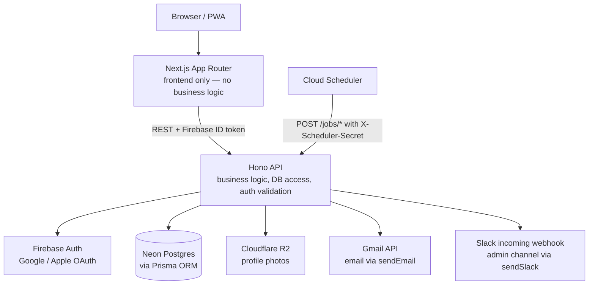
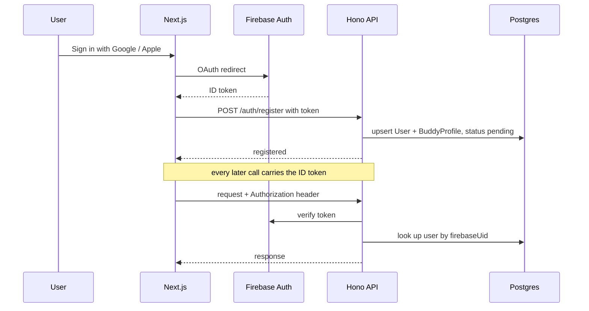
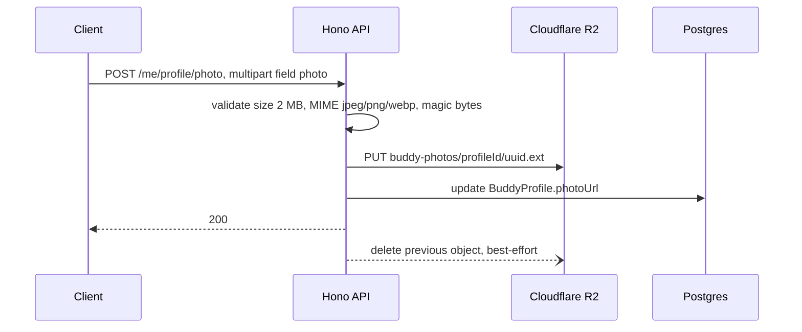
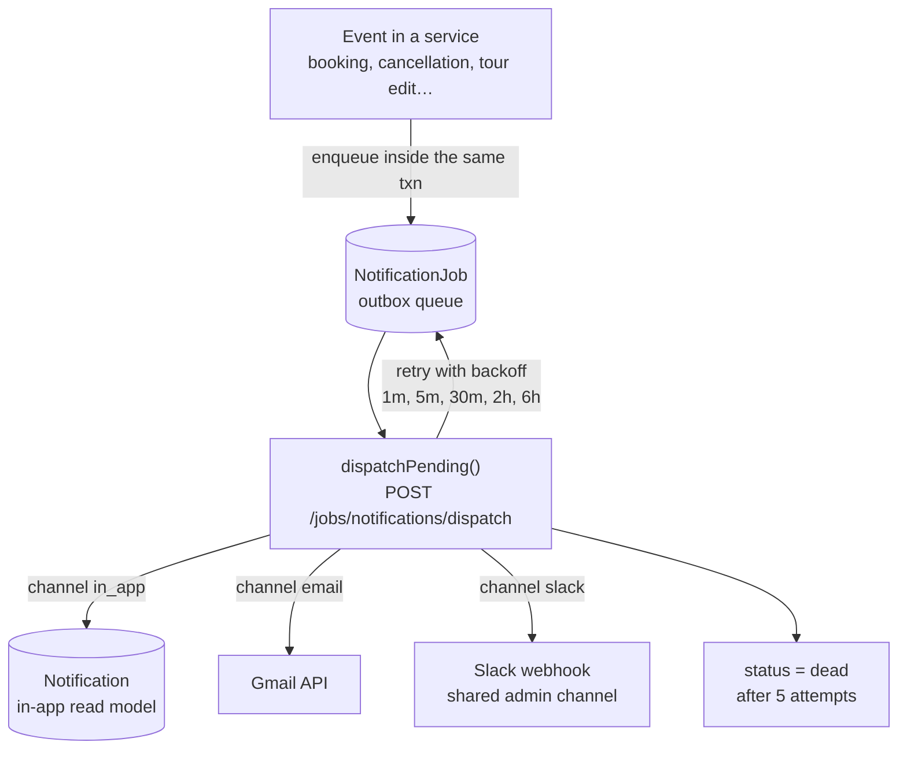
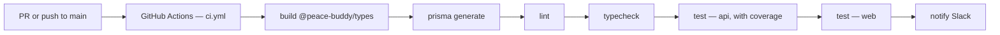
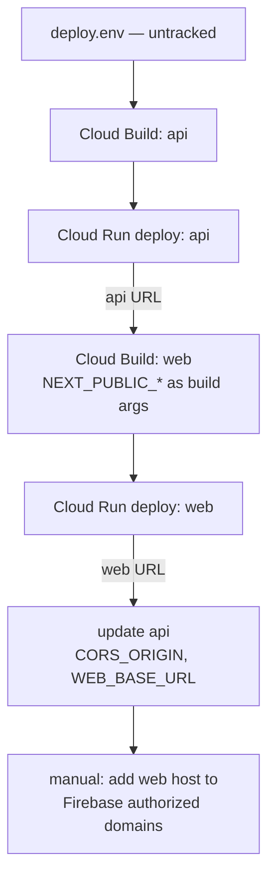

# Architecture

## System Overview



**Staging runs on Cloud Run and Neon; both are being replaced.** As of
2026-09-10 the permanent target is **Azure Container Apps + PG Flexible Server
in Japan East**, funded by the Microsoft for Nonprofits grant — see
`docs/decisions.md` (2026-09-10) and `docs/deploy-plan.md`. `DEPLOYMENT.md`
predates that decision and its hosting sections are stale; read it only for the
reasoning it records, not as current state.

## Repo Structure

Monorepo managed with pnpm workspaces:

```
/
├── apps/
│   ├── web/                    ← Next.js (frontend only — UI, routing, rendering)
│   │   ├── src/
│   │   │   ├── app/            ← Next.js App Router pages + globals.css
│   │   │   ├── components/
│   │   │   │   ├── ui/         ← shadcn/ui components (Button, Input, Table, Badge, …)
│   │   │   │   └── app-shell.tsx ← sidebar layout (variant: admin | buddy)
│   │   │   └── lib/
│   │   │       └── utils.ts    ← cn() utility (clsx + tailwind-merge)
│   │   └── components.json     ← shadcn config
│   └── api/                    ← Hono backend (all business logic, Prisma, auth middleware)
├── packages/
│   └── types/                  ← shared Zod schemas and TypeScript types
└── prisma/                     ← shared Prisma schema + seed script
```

The schema is applied with `prisma migrate deploy` from the migration files in
`prisma/migrations/`. `0_init` is the baseline generated from the schema as it
stood on 2026-09-12; every change since then is its own file. No deploy step
applies DDL — see `DEPLOYMENT.md`, "Schema Changes".

## UI Stack

- **Tailwind CSS v4** — CSS-first config via `postcss.config.mjs`; no `tailwind.config.js`
- **shadcn/ui** — component source lives in `apps/web/src/components/ui/`; owned by the project, not a package dependency
- **Radix UI** — accessible primitives underlying shadcn components
- **Theming** — CSS variables defined in `globals.css`:
  - Default (buddy-facing): warm zinc palette
  - Admin: slate/cool blue — applied via `.theme-admin` class on the `AppShell` wrapper
  - Dark mode: enabled; toggled via `.dark` class
- **`AppShell`** — shared sidebar layout used by admin and buddy pages. Accepts `variant: 'admin' | 'buddy'` to apply the correct theme and nav items.

See PRD §13 for the full tech stack rationale.

## Responsive Layout Convention

Admin data tables follow a **card-on-mobile, table-on-desktop** pattern with a consistent breakpoint:

- **Below `lg:` (< 1024px):** card list — each row rendered as a tappable card, all fields visible
- **At `lg:` and above (≥ 1024px):** full table with sortable column headers

Implementation: two sibling elements in the same component — `<div className="lg:hidden …">` (cards) and `<div className="hidden lg:block …">` (table). Sort state is shared; sort controls appear above the card list on mobile.

**All new admin list/detail tables must use `lg:` as the breakpoint.** Using `md:` creates an inconsistent switch point across pages.

## Request Flow


Route composition lives in `apps/api/src/routes/index.ts`, which mounts three
apps side by side: `publicApp` (Firebase token only), `protectedApp` (token +
DB user record), and `schedulerApp` (`X-Scheduler-Secret` header).

## Auth Flow



Approval is a separate admin action: `PUT /admin/buddies/:id/status` moves the
buddy `pending → trainee` or `pending → rejected`, and the buddy is notified.

See PRD §4 for the signup approval business rules.

## Admin Profile System

### Identity Model
Admins are users with `role = 'admin' | 'super_admin'`. Each admin has a corresponding `AdminProfile` record storing:
- `name`: Human-readable name (required, used for evaluation attribution)
- `deletedAt`: Soft-delete timestamp (null = active)

Admin creation flow:
1. Super-admin creates User via admin API (`role = 'admin'`)
2. Admin logs in via Google/Apple (Firebase OAuth)
3. System detects `role = 'admin'`, auto-creates AdminProfile with name from Firebase displayName
4. Name fallback: if Firebase provides no displayName, use email prefix (e.g., "john" from "john@example.com")

### Soft-Delete Visibility
Soft-deleted admins (`deletedAt IS NOT NULL`) are **completely invisible**:
- `GET /admin/profiles` excludes deleted admins
- `GET /admin/profile` (for a deleted admin) returns 404
- Evaluations created by deleted admins still reference them (immutable audit trail), but admin's name won't appear in current roster

Only non-deleted admins and system operations can see the roster.

### Auth Enforcement
Admin-only endpoints enforce role checks explicitly in route handlers:
```
if (user.role !== 'admin' && user.role !== 'super_admin') {
  return c.json({ error: 'Forbidden' }, 403)
}
```

This applies to: `GET /admin/profile`, `PATCH /admin/profile`, `GET /admin/profiles`.

Super-admin-only endpoints check:
```
if (user.role !== 'super_admin') {
  return c.json({ error: 'Forbidden' }, 403)
}
```

This applies to: `POST /admin/profiles` (create), `DELETE /admin/profiles/:userId` (soft-delete).

### API Conventions
- **Create**: `POST /admin/profiles` — requires super_admin
- **Read**: `GET /admin/profile` (own), `GET /admin/profiles` (roster) — requires admin
- **Update**: `PATCH /admin/profile` — update own name, requires admin
- **Delete**: `DELETE /admin/profiles/:userId` — soft-delete (set `deletedAt`), super_admin only, prevents self-deletion

## File Upload Flow

Profile photos are the only file type uploaded in v1. Storage: **Cloudflare R2** (S3-compatible). Single-step upload, not a signed-URL handoff:

> **Changing.** R2 has no Japan jurisdiction, so photos move to Azure Blob
> Storage in Japan East, one account per environment, reached by managed
> identity. Decided 2026-09-12, sequenced after the Azure cutover. Local
> development moves to Azurite. See `docs/decisions.md`. This section describes
> what runs today.



Deletion: `DELETE /me/profile/photo` removes the R2 object and nulls `photoUrl`.

## Notification Flow

Notifications use an **outbox pattern**. Nothing is sent inline with the request
that triggered it: the originating transaction writes `NotificationJob` rows, and
a separate cron-driven dispatcher drains them. This means a failed email can never
roll back a booking, and a committed booking can never lose its notification.



Enqueue time decides *whether* an email is queued at all. `decideAdminEmail()` in
`notification.service.ts` reads the admin's `NotificationPreference` and returns
`immediate` (queue an email job), `digest` (skip — see below), or `off`.

Slack is enqueued differently: `enqueueSlackForAdmins()` writes **one** job per
event with `recipientUserId: null`, because delivery is channel-wide rather than
per-recipient. It consults no `NotificationPreference` row and is gated only on a
template existing for the event — `NotificationPreference.slackEnabled` is
informational only (`docs/decisions.md` 2026-08-15).

> **⚠ `digest` mode drops the email.** `DigestQueue` exists in the schema but is
> never written to and never flushed; `POST /jobs/notifications/digest` does not
> exist. Admin email is **off by default** now that admin notifications go to
> Slack, so nothing lands here by accident — but an admin who enables email and
> selects `digest` receives nothing. Tracked in `docs/roadmap.md`.

### Scheduled jobs

All `/jobs/*` endpoints are guarded by `X-Scheduler-Secret` (`schedulerAuth.ts`).

| Endpoint | Cadence | Purpose |
|---|---|---|
| `/jobs/notifications/dispatch` | frequent | Drain the outbox — the only sender |
| `/jobs/notifications/reminders` | hourly | Enqueue `tour_reminder` per `Tour.notificationOffsets` |
| `/jobs/notifications/maybe-reminders` | hourly | Enqueue `maybe_reminder` before the Maybe deadline |
| `/jobs/notifications/maybe-deadlines` | hourly | Enqueue `maybe_deadline_missed` for unresolved Maybes |

The three enqueue jobs are idempotent via `NotificationDispatchLog(eventKey UNIQUE)`.
The dispatcher claims each job with a compare-and-swap on `attempts`, so two
concurrent workers can't send the same job twice.

> `DEPLOYMENT.md` calls for consolidating these four into **one hourly tick** before
> deploy — Cloud Scheduler's free tier is 3 jobs, and four separate schedules push
> Neon past its free compute allowance. **That pressure disappears on Azure**
> (`docs/decisions.md`, 2026-09-10): Container Apps Jobs bill per execution
> against the same free monthly grant and impose no job-count limit, and B1ms is
> an always-on instance. Keep the four endpoints as they are.

See PRD §10 for event types, channels, and delivery mode defaults.

## Environments

| Env | Status | Description |
|---|---|---|
| `development` | **Live** | Everything in Docker Compose — Next.js, Hono, local Postgres, Firebase Auth emulator. See `README.md` |
| `preview` | **Not built** | No PR-preview environment exists. There is no deploy workflow |
| `staging` | **Live, being replaced** | Today: Cloud Run (`asia-southeast1`) + Neon (`aws-ap-southeast-1`) + Firebase project `peace-buddy-staging` — the only deployed environment, and already where non-dev members check work. Its data moves to Azure alongside prod, onto its own B1ms server; the GCP/Neon side is then decommissioned. On Azure its compute is **started by hand** and stopped when done, so it is off most of the time by design |
| `production` | **Being built** | Azure Container Apps + PG Flexible Server B1ms, Japan East, on the Microsoft for Nonprofits grant — decided 2026-09-10, see `docs/decisions.md`. Database is private to a VNet with no public endpoint. Provisioning is `scripts/azure-provision.sh`; progress is tracked in `docs/deploy-plan.md`. Always on |

Prod and staging share one resource group, VNet, Container Apps environment and
registry, and have a separate Postgres server and storage account each. Costs
are in `docs/azure-costs.md`. The GCP/Neon side is decommissioned once Azure
staging is trusted, and nothing replaces it; `development` above stays as local
Docker Compose.

On Azure each server carries two restricted login roles, created by
`scripts/azure-db-roles.sh` right after provisioning. `pb_app` reads and writes
rows and is what `DATABASE_URL` holds; `pb_migrate` owns the tables and runs
`prisma migrate deploy` and nothing else. The server admin account is used only
to rotate them. See `docs/deploy-plan.md` §4.1.

## CI/CD

`.github/workflows/ci.yml` is the only workflow. It runs on PRs and pushes to
`main`. **There is no deploy pipeline** — deployment is manual and not yet set up.



Both Dockerfiles are multi-stage. `--target dev` is what Docker Compose builds
and still ends in `CMD … dev`; `--target runner` is the production image —
`node dist/index.js` for the api, Next's standalone server for web.

## Deploy

Manual, driven by `scripts/deploy.sh` — no pipeline. Terraform was rejected;
see `docs/decisions.md` (2026-09-08, revisited 2026-09-10).

> **This section describes the live Cloud Run deploy, which is being replaced.**
> The Azure equivalent keeps the same ordering — `az acr build` in place of
> Cloud Build, `az containerapp update` in place of `gcloud run deploy` — because
> the ordering exists to solve the build-arg and CORS dependency shown below, not
> anything GCP-specific. Infrastructure is provisioned separately by
> `scripts/azure-provision.sh`. See `docs/deploy-plan.md` §5.

```sh
scripts/deploy.sh path/to/deploy.env   # template: scripts/deploy.env.example
```

Images are built on Cloud Build rather than locally, because Cloud Run needs
`linux/amd64` and the dev machines are arm64.



The order is forced: `NEXT_PUBLIC_*` is inlined into the web bundle at build
time, so the api must be deployed before web is built — and the api's
`CORS_ORIGIN` then needs web's URL, so the api is patched last. Both services
run `--min-instances=0`; that flag is the difference between $0 and a real bill.
