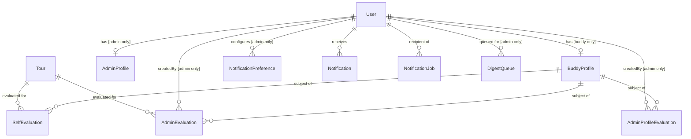
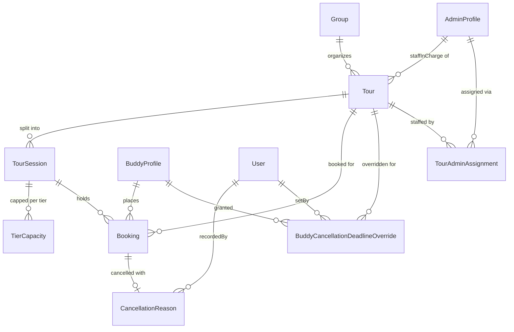

# Data Model

See PRD §5–9 for field definitions and business rules. This document covers DB-level schema design: entity relationships, constraints, indexes, and infrastructure-only entities not described in the PRD.

## Entity Overview

### Identity and evaluations

`NotificationDispatchLog` has no relations — it is a standalone idempotency log keyed by `eventKey`.

### Tours and bookings

## Schema

### User
Not in PRD. Core identity record shared by buddies and admins.

| Field | Type | Constraints |
|---|---|---|
| id | UUID | PK |
| firebaseUid | String | Unique |
| email | String | |
| role | Enum | `buddy` / `admin` / `super_admin` |
| locale | Enum | `ja` / `en`; default `ja`. Used as recipient locale for notification email + Slack content. **Planned — not yet in schema.** |
| createdAt | Timestamp | |

### AdminProfile
Internal profile for admin users. Stores admin name for evaluation attribution and future expansion.

| Field | Type | Constraints |
|---|---|---|
| id | UUID | PK |
| userId | UUID | FK → User, Unique |
| name | String | |
| deletedAt | Timestamp? | Soft delete (NULL = active) |
| createdAt | Timestamp | |

**Index:** `deletedAt` — for filtering active admins

### BuddyProfile

| Field | Type | Constraints |
|---|---|---|
| id | UUID | PK |
| userId | UUID | FK → User, Unique |
| status | Enum | `pending` / `trainee` / `active` / `rejected` / `suspended` |
| tier | Enum? | `junior` / `buddy` / `star` / `blackstar` — NULL for trainees |
| memberType | Enum | `buddy` / `plab_member`; default `buddy`. Non-nullable |
| displayName | String | |
| realName | String | |
| photoUrl | String? | |
| bio | Text? | |
| contactInfo | String? | |
| languages | String[] | |
| skills | String[] | |
| availability | Text? | |
| internalNotes | Text? | Admin-only; never exposed to buddy |
| onboardingSeenAt | Timestamp? | Set the first time an approved buddy is sent to their profile; NULL means they have not been sent yet |
| createdAt | Timestamp | |
| updatedAt | Timestamp | |

**Status lifecycle:** `pending` → `trainee` (approve) → `active` (promote, sets `tier = junior`) / `rejected`. Active buddies can be `suspended`.  
**Tier:** always NULL when `status = trainee`.  
**Member type:** a second, independent axis — `tier` is what a person can do, `memberType` is what they are to PLAB. Unlike `tier` it is never NULL: employment is known for everyone, including trainees. It affects no eligibility, capacity, permission or notification; `BookingPool` still splits on `tier === junior` alone.

### Group

| Field | Type | Constraints |
|---|---|---|
| id | UUID | PK |
| name | String | |
| type | Enum | `school` / `company` / `community` / `other` |
| contactName | String? | |
| contactEmail | String? | |
| contactPhone | String? | |
| notes | Text? | |
| createdAt | Timestamp | |
| updatedAt | Timestamp | |

### Tour

| Field | Type | Constraints |
|---|---|---|
| id | UUID | PK |
| groupId | UUID | FK → Group |
| status | Enum | `draft` / `published` / `cancelled` / `completed` |
| tourDate | Date | |
| bookingOpen | Boolean | Default false |
| location | String | |
| description | Text? | |
| adminMemo | Text? | Admin-only |
| cancellationDeadline | Date | |
| maybeDeadline | Date? | |
| notificationOffsets | Int[] | Days before tour date to send reminders; default `[3, 1]` |
| staffInChargeId | UUID? | FK → AdminProfile (relation `StaffInCharge`). Optional. If set, must be one of the tour's assigned admins. |
| createdAt | Timestamp | |
| updatedAt | Timestamp | |

**Index:** `(status, tourDate)`

Capacity and meeting times live on `TourSession`, not on Tour directly. A tour has 1 or 2 sessions (the API rejects a third). Many-to-many admin assignment is via `TourAdminAssignment` (below).

### TourSession

Per-session capacity and timing record. A tour must have at least one session.

| Field | Type | Constraints |
|---|---|---|
| id | UUID | PK |
| tourId | UUID | FK → Tour |
| order | Int | Display order within tour |
| label | String? | Optional label (e.g. "Morning") |
| meetingTime | Time | |
| startTime | Time? | |
| endTime | Time? | |
| capacity | Int | Total seats for this session |
| minBuddies | Int? | Optional minimum-buddies threshold. When `participantCount < minBuddies` the session is flagged `belowMinimum` in API responses. |
| participantCount | Int | Default 0; cached count of participants (group size — visitors, not buddies) |
| createdAt | Timestamp | |
| updatedAt | Timestamp | |

**Unique:** `(tourId, order)`  
**Index:** `tourId`

### TourAdminAssignment

Many-to-many join between admins and tours. Independent of the `staffInChargeId` field on Tour.

| Field | Type | Constraints |
|---|---|---|
| id | UUID | PK |
| tourId | UUID | FK → Tour (`onDelete: Cascade`) |
| adminId | UUID | FK → AdminProfile |
| createdAt | Timestamp | |

**Unique:** `(tourId, adminId)` — one assignment per admin per tour

### TierCapacity

Per-session, per-pool seat allocation. Controls how many seats each buddy tier pool can claim.

| Field | Type | Constraints |
|---|---|---|
| id | UUID | PK |
| sessionId | UUID | FK → TourSession |
| pool | Enum | `junior` / `non_junior` / `anyone` |
| percent | Int | % of session capacity allocated to this pool |
| createdAt | Timestamp | |
| updatedAt | Timestamp | |

**Unique:** `(sessionId, pool)`

Three pools: `junior`, `non_junior`, `anyone`. The `anyone` pool absorbs confirmed counts from both tier pools to compute remaining seats. Percentages are set by admin per session.

### Booking

| Field | Type | Constraints |
|---|---|---|
| id | UUID | PK |
| buddyId | UUID | FK → BuddyProfile |
| tourId | UUID | FK → Tour |
| sessionId | UUID | FK → TourSession |
| buddyTier | Enum | Snapshot of buddy's tier at booking time |
| status | Enum | `confirmed` / `maybe` / `waitlist` / `declined` |
| bookedAt | Timestamp | |
| updatedAt | Timestamp | |

**Unique:** `(buddyId, sessionId)` — one booking per buddy per session  
**Indexes:** `(tourId, status)`, `(sessionId, status)`, `(sessionId, status, buddyTier)`

Waitlist promotion uses a serializable DB transaction scoped to the session's tier pool to prevent overbooking.

### CancellationReason

| Field | Type | Constraints |
|---|---|---|
| id | UUID | PK |
| bookingId | UUID | FK → Booking, Unique |
| category | Enum | `health` / `emergency` / `personal` / `work` / `other` |
| freeText | Text? | |
| unavoidable | Boolean? | NULL = unreviewed; true/false set by admin |
| recordedBy | UUID | FK → User |
| createdAt | Timestamp | |

### AdminEvaluation

Per-tour evaluation written by an admin about a specific buddy. Score fields are `Int?` (1–5). All note fields are `Text?`.

| Field | Type | Constraints |
|---|---|---|
| id | UUID | PK |
| buddyId | UUID | FK → BuddyProfile |
| tourId | UUID | FK → Tour |
| createdBy | UUID | FK → User (admin) |
| overallRating | Int? | 1–5 |
| overallRatingNote | Text? | |
| reliability | Int? | 1–5 |
| reliabilityNote | Text? | |
| communication | Int? | 1–5 |
| communicationNote | Text? | |
| groupEngagement | Int? | 1–5 |
| groupEngagementNote | Text? | |
| memory | Int? | 1–5 |
| memoryNote | Text? | |
| knowledge | Int? | 1–5 |
| knowledgeNote | Text? | |
| dedication | Int? | 1–5 |
| dedicationNote | Text? | |
| dialogue | Int? | 1–5 | Core differentiating skill |
| dialogueNote | Text? | |
| adaptability | Int? | 1–5 |
| adaptabilityNote | Text? | |
| emotionNote | Text? | No score — text only |
| confidence | Int? | 1–5 |
| confidenceNote | Text? | |
| absentWithoutReport | Boolean | Default false — set by admin when buddy was absent without advance notice |
| createdAt | Timestamp | |
| updatedAt | Timestamp | |

**Unique:** `(buddyId, tourId, createdBy)` — one per admin per buddy per tour  

Scale: 1 = Needs Improvement / 2 = Developing / 3 = Proficient / 4 = Advanced / 5 = Exceptional.

`absentWithoutReport` is a factual record. Admins use the count (surfaced on the buddy detail page as `absenceSummary.absentWithoutReport`) to inform the `reliability` score in `AdminProfileEvaluation`. No auto-computation.

### AdminProfileEvaluation

Overall profile-level evaluation of a buddy, not tied to a specific tour. Same score scale as AdminEvaluation. Does not include `absentWithoutReport` (that is per-tour fact, not profile judgement).

| Field | Type | Constraints |
|---|---|---|
| id | UUID | PK |
| buddyId | UUID | FK → BuddyProfile |
| createdBy | UUID | FK → User (admin) |
| overallRating | Int? | 1–5 |
| overallRatingNote | Text? | |
| reliability | Int? | 1–5 |
| reliabilityNote | Text? | |
| communication | Int? | 1–5 |
| communicationNote | Text? | |
| groupEngagement | Int? | 1–5 |
| groupEngagementNote | Text? | |
| memory | Int? | 1–5 |
| memoryNote | Text? | |
| knowledge | Int? | 1–5 |
| knowledgeNote | Text? | |
| dedication | Int? | 1–5 |
| dedicationNote | Text? | |
| dialogue | Int? | 1–5 |
| dialogueNote | Text? | |
| adaptability | Int? | 1–5 |
| adaptabilityNote | Text? | |
| emotionNote | Text? | No score — text only |
| confidence | Int? | 1–5 |
| confidenceNote | Text? | |
| createdAt | Timestamp | |
| updatedAt | Timestamp | |

**Unique:** `(buddyId, createdBy)` — one per admin per buddy

### SelfEvaluation

Same score scale as AdminEvaluation. All note fields optional. `reliability` does not appear in self-evaluations.

| Field | Type | Constraints |
|---|---|---|
| id | UUID | PK |
| buddyId | UUID | FK → BuddyProfile |
| tourId | UUID | FK → Tour |
| overallRating | Int? | 1–5 |
| overallRatingNote | Text? | |
| communication | Int? | 1–5 |
| communicationNote | Text? | |
| groupEngagement | Int? | 1–5 |
| groupEngagementNote | Text? | |
| memory | Int? | 1–5 |
| memoryNote | Text? | |
| knowledge | Int? | 1–5 |
| knowledgeNote | Text? | |
| dedication | Int? | 1–5 |
| dedicationNote | Text? | |
| dialogue | Int? | 1–5 |
| dialogueNote | Text? | |
| adaptability | Int? | 1–5 |
| adaptabilityNote | Text? | |
| emotionNote | Text? | No score — text only |
| confidence | Int? | 1–5 |
| confidenceNote | Text? | |
| createdAt | Timestamp | |
| updatedAt | Timestamp | |

**Unique:** `(buddyId, tourId)`

### BuddyCancellationDeadlineOverride
Not in PRD. Stores per-buddy overrides of a tour's cancellation deadline.

| Field | Type | Constraints |
|---|---|---|
| id | UUID | PK |
| buddyId | UUID | FK → BuddyProfile |
| tourId | UUID | FK → Tour |
| deadline | Date | |
| setBy | UUID | FK → User (admin) |
| createdAt | Timestamp | |

**Unique:** `(buddyId, tourId)`

### Notification Tables

> **⚠ Planned (foundations only).** The three tables below exist in `prisma/schema.prisma` and the `NotifEventType` / `EmailMode` enums are exported from `packages/types`, but no service code reads or writes these tables yet. See PRD §10 for intended behaviour.

### NotificationPreference
Per-admin, per-event channel and delivery mode configuration.

| Field | Type | Constraints |
|---|---|---|
| id | UUID | PK |
| adminId | UUID | FK → User |
| eventType | Enum | `new_signup` / `new_booking` / `cancellation` / `maybe_resolved` / `maybe_deadline_missed` |
| emailEnabled | Boolean | |
| emailMode | Enum | `immediate` / `digest` |
| slackEnabled | Boolean | |

**Unique:** `(adminId, eventType)`

### Notification
In-app notifications for buddies and admins.

| Field | Type | Constraints |
|---|---|---|
| id | UUID | PK |
| userId | UUID | FK → User |
| type | Enum | |
| payload | JSON | |
| readAt | Timestamp? | |
| createdAt | Timestamp | |

### DigestQueue
Pending items for admin daily digest emails.

| Field | Type | Constraints |
|---|---|---|
| id | UUID | PK |
| adminId | UUID | FK → User |
| eventType | Enum | |
| payload | JSON | |
| flushedAt | Timestamp? | |
| createdAt | Timestamp | |

### NotificationDispatchLog
**Planned — not yet in schema.** Idempotency record for scheduled-job dispatches. A row is inserted before each scheduled send; a unique-constraint collision indicates the reminder was already dispatched, so the job no-ops.

| Field | Type | Constraints |
|---|---|---|
| id | UUID | PK |
| eventKey | String | Unique. Format `<eventType>:<scope>:<recipientUserId>`, e.g. `tour_reminder:<tourId>:<offsetDays>:<userId>` |
| createdAt | Timestamp | |

## Indexes

| Table | Index | Reason |
|---|---|---|
| Tour | `(status, tourDate)` | Published upcoming tours |
| TourSession | `tourId` | Sessions for a tour |
| Booking | `(tourId, status)` | Tour-level seat count queries |
| Booking | `(sessionId, status)` | Session-level seat count queries |
| Booking | `(sessionId, status, buddyTier)` | Tier-pool capacity checks |
| Notification | `(userId, readAt)` | Unread count |
| DigestQueue | `(adminId, flushedAt)` | Pending digest fetch |
| AdminProfile | `deletedAt` | Active admin filter |

## Soft Delete Policy

| Entity | Policy |
|---|---|
| AdminProfile | Soft delete only — set `deletedAt` to hide from listings |
| BuddyProfile | Never hard-deleted — use `status = suspended` |
| Booking | Never hard-deleted |
| Tour | Draft → hard delete allowed; Published/Cancelled/Completed → never deleted |
| Group | No delete in v1 |
| Evaluations | No delete in v1 |
