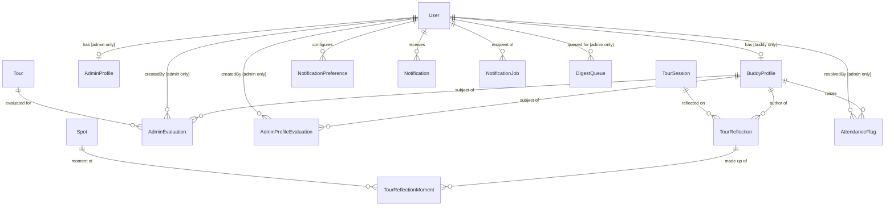
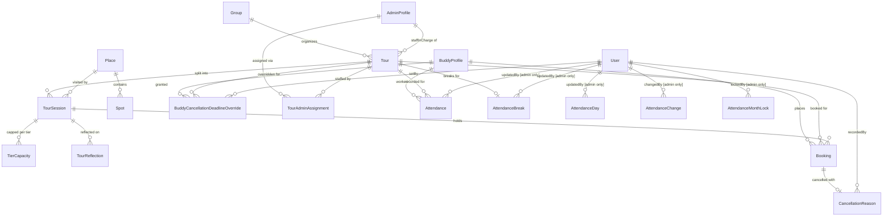

# Data Model

See PRD §5–9 for field definitions and business rules. This document covers DB-level schema design: entity relationships, constraints, indexes, and infrastructure-only entities not described in the PRD.

## Entity Overview

### Identity and evaluations

`NotificationDispatchLog` has no relations — it is a standalone idempotency log keyed by `eventKey`.

### Tours and bookings

`AttendanceDay` is keyed by date, not by tour: every tour on that date shares
its finish time. `AttendanceBreak` is keyed by tour: everyone on the tour
takes its break together. `AttendanceChange` names the buddy and tour it touched by id
only, with no foreign key — it is a log, and must outlive what it describes.

## Schema

### User
Not in PRD. Core identity record shared by buddies and admins.

| Field | Type | Constraints |
|---|---|---|
| id | UUID | PK |
| firebaseUid | String | Unique |
| email | String | |
| role | Enum | `buddy` / `admin` / `super_admin` |
| locale | Enum | `ja` / `en`; default `ja`. Used as recipient locale for notification email + Slack content. **Planned — not yet in schema.** |
| createdAt | Timestamp | |

### AdminProfile
Internal profile for admin users. Stores admin name for evaluation attribution and future expansion.

| Field | Type | Constraints |
|---|---|---|
| id | UUID | PK |
| userId | UUID | FK → User, Unique |
| name | String | |
| deletedAt | Timestamp? | Soft delete (NULL = active) |
| createdAt | Timestamp | |

**Index:** `deletedAt` — for filtering active admins

### BuddyProfile

| Field | Type | Constraints |
|---|---|---|
| id | UUID | PK |
| userId | UUID | FK → User, Unique |
| status | Enum | `pending` / `trainee` / `active` / `rejected` / `suspended` |
| tier | Enum? | `junior` / `buddy` / `star` / `blackstar` — NULL for trainees |
| memberType | Enum | `buddy` / `plab_member`; default `buddy`. Non-nullable |
| displayName | String | |
| realName | String | |
| photoKey | String? | Blob name in the environment's private `photos` container. Responses carry a signed `photoUrl` instead; see `decisions.md` 2026-09-13 |
| bio | Text? | |
| contactInfo | String? | |
| languages | String[] | |
| skills | String[] | |
| availability | Text? | |
| internalNotes | Text? | Admin-only; never exposed to buddy |
| onboardingSeenAt | Timestamp? | Set the first time an approved buddy is sent to their profile; NULL means they have not been sent yet |
| createdAt | Timestamp | |
| updatedAt | Timestamp | |

**Status lifecycle:** `pending` → `trainee` (approve) → `active` (promote, sets `tier = junior`) / `rejected`. Active buddies can be `suspended`.  
**Tier:** always NULL when `status = trainee`.  
**Member type:** a second, independent axis — `tier` is what a person can do, `memberType` is what they are to PLAB. Unlike `tier` it is never NULL: employment is known for everyone, including trainees. It affects no eligibility, capacity, permission or notification; `BookingPool` still splits on `tier === junior` alone.

### Group

| Field | Type | Constraints |
|---|---|---|
| id | UUID | PK |
| name | String | |
| type | Enum | `school` / `company` / `community` / `other` |
| contactName | String? | |
| contactEmail | String? | |
| contactPhone | String? | |
| notes | Text? | |
| createdAt | Timestamp | |
| updatedAt | Timestamp | |

### Place

Admin-managed lookup table replacing the old free-text `Tour.location`. Retired via `active = false`, never deleted — `TourSession` and `Spot` reference rows by id.

| Field | Type | Constraints |
|---|---|---|
| id | UUID | PK |
| nameJa | String | |
| nameEn | String | |
| sortOrder | Int | Display order in admin lists and pickers |
| active | Boolean | Default true |

### Spot

A point of interest inside a Place (e.g. a monument inside a park). Not every Place has spots — one with none drives the tour reflection form's single-textarea fallback, in place of the moment-by-moment spot picker.

| Field | Type | Constraints |
|---|---|---|
| id | UUID | PK |
| placeId | UUID | FK → Place |
| nameJa | String | |
| nameEn | String | |
| sortOrder | Int | Display order within the place |
| active | Boolean | Default true |

**Index:** `placeId`

### Tour

| Field | Type | Constraints |
|---|---|---|
| id | UUID | PK |
| groupId | UUID | FK → Group |
| status | Enum | `draft` / `published` / `cancelled` / `completed` |
| tourDate | Date | |
| bookingOpen | Boolean | Default false |
| description | Text? | |
| adminMemo | Text? | Admin-only |
| cancellationDeadline | Date | |
| maybeDeadline | Date? | |
| notificationOffsets | Int[] | Days before tour date to send reminders; default `[3, 1]` |
| staffInChargeId | UUID? | FK → AdminProfile (relation `StaffInCharge`). Optional. If set, must be one of the tour's assigned admins. |
| createdAt | Timestamp | |
| updatedAt | Timestamp | |

**Index:** `(status, tourDate)`

Capacity and meeting times live on `TourSession`, not on Tour directly. A tour has 1 or 2 sessions (the API rejects a third). Many-to-many admin assignment is via `TourAdminAssignment` (below). A tour has no place of its own: each session has exactly one (`TourSession.placeId`), and a tour's places are its sessions' places.

### TourSession

Per-session capacity and timing record. A tour must have at least one session.

| Field | Type | Constraints |
|---|---|---|
| id | UUID | PK |
| tourId | UUID | FK → Tour |
| order | Int | Display order within tour |
| label | String? | Optional label (e.g. "Morning") |
| meetingTime | Time | |
| startTime | Time? | |
| endTime | Time? | |
| capacity | Int | Total seats for this session |
| minBuddies | Int? | Optional minimum-buddies threshold. When `participantCount < minBuddies` the session is flagged `belowMinimum` in API responses. |
| participantCount | Int | Default 0; cached count of participants (group size — visitors, not buddies) |
| placeId | UUID | FK → Place. Exactly one per session; the two sessions of a tour may go to different places. Changing it is refused while a `TourReflectionMoment` on this session references a spot of the current place (enforced in `adminSession.service.ts`, not the DB). |
| createdAt | Timestamp | |
| updatedAt | Timestamp | |

**Unique:** `(tourId, order)`  
**Index:** `tourId`, `placeId`

### TourAdminAssignment

Many-to-many join between admins and tours. Independent of the `staffInChargeId` field on Tour.

| Field | Type | Constraints |
|---|---|---|
| id | UUID | PK |
| tourId | UUID | FK → Tour (`onDelete: Cascade`) |
| adminId | UUID | FK → AdminProfile |
| createdAt | Timestamp | |

**Unique:** `(tourId, adminId)` — one assignment per admin per tour

### TierCapacity

Per-session, per-pool seat allocation. Controls how many seats each buddy tier pool can claim.

| Field | Type | Constraints |
|---|---|---|
| id | UUID | PK |
| sessionId | UUID | FK → TourSession |
| pool | Enum | `junior` / `non_junior` / `anyone` |
| percent | Int | % of session capacity allocated to this pool |
| createdAt | Timestamp | |
| updatedAt | Timestamp | |

**Unique:** `(sessionId, pool)`

Three pools: `junior`, `non_junior`, `anyone`. The `anyone` pool absorbs confirmed counts from both tier pools to compute remaining seats. Percentages are set by admin per session.

### Booking

| Field | Type | Constraints |
|---|---|---|
| id | UUID | PK |
| buddyId | UUID | FK → BuddyProfile |
| tourId | UUID | FK → Tour |
| sessionId | UUID | FK → TourSession |
| buddyTier | Enum | Snapshot of buddy's tier at booking time |
| status | Enum | `confirmed` / `maybe` / `waitlist` / `declined` |
| bookedAt | Timestamp | |
| updatedAt | Timestamp | |

**Unique:** `(buddyId, sessionId)` — one booking per buddy per session  
**Indexes:** `(tourId, status)`, `(sessionId, status)`, `(sessionId, status, buddyTier)`

Waitlist promotion uses a serializable DB transaction scoped to the session's tier pool to prevent overbooking.

### CancellationReason

| Field | Type | Constraints |
|---|---|---|
| id | UUID | PK |
| bookingId | UUID | FK → Booking, Unique |
| category | Enum | `health` / `emergency` / `personal` / `work` / `other` |
| freeText | Text? | |
| unavoidable | Boolean? | NULL = unreviewed; true/false set by admin |
| recordedBy | UUID | FK → User |
| createdAt | Timestamp | |

### AdminEvaluation

Per-tour evaluation written by an admin about a specific buddy. Score fields are `Int?` (1–5). All note fields are `Text?`.

| Field | Type | Constraints |
|---|---|---|
| id | UUID | PK |
| buddyId | UUID | FK → BuddyProfile |
| tourId | UUID | FK → Tour |
| createdBy | UUID | FK → User (admin) |
| overallRating | Int? | 1–5 |
| overallRatingNote | Text? | |
| reliability | Int? | 1–5 |
| reliabilityNote | Text? | |
| communication | Int? | 1–5 |
| communicationNote | Text? | |
| groupEngagement | Int? | 1–5 |
| groupEngagementNote | Text? | |
| memory | Int? | 1–5 |
| memoryNote | Text? | |
| knowledge | Int? | 1–5 |
| knowledgeNote | Text? | |
| dedication | Int? | 1–5 |
| dedicationNote | Text? | |
| dialogue | Int? | 1–5 | Core differentiating skill |
| dialogueNote | Text? | |
| adaptability | Int? | 1–5 |
| adaptabilityNote | Text? | |
| emotionNote | Text? | No score — text only |
| confidence | Int? | 1–5 |
| confidenceNote | Text? | |
| createdAt | Timestamp | |
| updatedAt | Timestamp | |

**Unique:** `(buddyId, tourId, createdBy)` — one per admin per buddy per tour  

Scale: 1 = Needs Improvement / 2 = Developing / 3 = Proficient / 4 = Advanced / 5 = Exceptional.

Absence is not on the evaluation: it moved to `Attendance.absent` (#262), and
the migration turned every `absentWithoutReport = true` into an absent,
unreported `Attendance` row.

### AdminProfileEvaluation

Overall profile-level evaluation of a buddy, not tied to a specific tour. Same score scale as AdminEvaluation.

| Field | Type | Constraints |
|---|---|---|
| id | UUID | PK |
| buddyId | UUID | FK → BuddyProfile |
| createdBy | UUID | FK → User (admin) |
| overallRating | Int? | 1–5 |
| overallRatingNote | Text? | |
| reliability | Int? | 1–5 |
| reliabilityNote | Text? | |
| communication | Int? | 1–5 |
| communicationNote | Text? | |
| groupEngagement | Int? | 1–5 |
| groupEngagementNote | Text? | |
| memory | Int? | 1–5 |
| memoryNote | Text? | |
| knowledge | Int? | 1–5 |
| knowledgeNote | Text? | |
| dedication | Int? | 1–5 |
| dedicationNote | Text? | |
| dialogue | Int? | 1–5 |
| dialogueNote | Text? | |
| adaptability | Int? | 1–5 |
| adaptabilityNote | Text? | |
| emotionNote | Text? | No score — text only |
| confidence | Int? | 1–5 |
| confidenceNote | Text? | |
| createdAt | Timestamp | |
| updatedAt | Timestamp | |

**Unique:** `(buddyId, createdBy)` — one per admin per buddy

### TourReflection

The buddy's own account of a session they guided: four free-text prompts plus structured `TourReflectionMoment` rows, no scores. Replaces the scored `SelfEvaluation` (#236). `memorableMoment` was a fifth free-text prompt until #239 replaced it with `TourReflectionMoment`.

Keyed on the **session**, not the tour — a buddy who works two slots of one tour may write one up per slot. The obligation is still per tour: one row anywhere in a tour silences the `self_eval_prompt` reminder and sets `reflectionSubmitted` on `GET /me/bookings`. There is no `tourId` column; the tour is read through `session`.

The four prompt fields are nullable, but **at least one prompt, or at least one moment, must be present** — enforced by `CreateTourReflectionSchema` / `UpdateTourReflectionSchema` in `packages/types`, not by a DB constraint. A `PUT` replaces all four prompts and every moment, so the rule holds on an edit without reading the stored row back.

| Field | Type | Constraints |
|---|---|---|
| id | UUID | PK |
| buddyId | UUID | FK → BuddyProfile |
| sessionId | UUID | FK → TourSession |
| didWell | Text? | What I did well |
| couldImprove | Text? | What I could have done better |
| notesForOthers | Text? | To share with other buddies and admins |
| openQuestions | Text? | Questions I couldn't answer |
| createdAt | Timestamp | |
| updatedAt | Timestamp | |

**Unique:** `(buddyId, sessionId)`
**Index:** `(sessionId)`

### TourReflectionMoment

A structured memorable moment, 0..n per reflection. `position` keeps the buddy's entry order — row order is not guaranteed (random UUIDs, identical `createdAt` within one `createMany`), so this is read back sorted by `position`, never by `createdAt` or `id`.

Exactly one of `spotId` / `placeNote` is set — enforced in Zod, not the DB. `spotId` picks a spot of the session's place; `placeNote` is free text, used when the buddy picks "Other" or when the session's place has no spots (the reflection form falls back to a single textarea and fills this in automatically with the place's `nameJa`, whatever the buddy's UI language).

| Field | Type | Constraints |
|---|---|---|
| id | UUID | PK |
| reflectionId | UUID | FK → TourReflection (`onDelete: Cascade`) |
| position | Int | Entry order |
| spotId | UUID? | FK → Spot. Exactly one of `spotId`/`placeNote` is set. |
| placeNote | Text? | Free-text place name, when there's no spot to reference |
| description | Text | Required |

**Index:** `reflectionId`, `spotId`

### BuddyCancellationDeadlineOverride
Not in PRD. Stores per-buddy overrides of a tour's cancellation deadline.

| Field | Type | Constraints |
|---|---|---|
| id | UUID | PK |
| buddyId | UUID | FK → BuddyProfile |
| tourId | UUID | FK → Tour |
| deadline | Date | |
| setBy | UUID | FK → User (admin) |
| createdAt | Timestamp | |

**Unique:** `(buddyId, tourId)`

### Attendance tables

The record of when each buddy actually worked (#262, PRD §11.10). Working
hours per buddy per day are first arrival → last leave − breaks, over the
tours of that date they were not absent from. `TourSession.endTime` plays no
part. See `docs/decisions.md` 2026-10-01.

### AttendanceDay
When the day ended: reflection closes each tour day once, for everyone.

| Field | Type | Constraints |
|---|---|---|
| id | UUID | PK |
| date | Date | Unique — one finish time per tour date |
| finishTime | Time | The default leave time of everyone who worked that date |
| updatedBy | UUID | FK → User (admin) |
| updatedAt | Timestamp | |

### Attendance
A buddy's exceptions on one tour. No row, or a null time, means the default.

| Field | Type | Constraints |
|---|---|---|
| id | UUID | PK |
| buddyId | UUID | FK → BuddyProfile |
| tourId | UUID | FK → Tour |
| absent | Boolean | Default false. Absent = 0 hours, reported or not |
| absenceReported | Boolean? | Set only when absent |
| arrivalTime | Time? | Null = the meeting time of the buddy's first confirmed session |
| lateReason | Enum? | `transport_delay` / `other`; only with an arrival after the default |
| lateNote | Text? | |
| lateExcused | Boolean? | Only when late. `false` counts in the buddy stats |
| leaveTime | Time? | Null = the day's `finishTime`. Never overwritten by a change to it |
| leaveNote | Text? | Early leave is recorded, never counted against the buddy |
| updatedBy | UUID | FK → User (admin) |
| createdAt | Timestamp | |
| updatedAt | Timestamp | |

**Unique:** `(buddyId, tourId)` · **Index:** `tourId`

### AttendanceBreak
The tour's unpaid break, taken by everyone on it together. No row = no break.
With start and end, each buddy loses only the part inside their own arrival →
leave; with minutes alone, every buddy present loses them (up to their span).

| Field | Type | Constraints |
|---|---|---|
| id | UUID | PK |
| tourId | UUID | FK → Tour. Unique — one break per tour |
| breakStart | Time? | With `breakEnd`, or neither |
| breakEnd | Time? | |
| breakMinutes | Int | Unpaid minutes; derived from start/end when those are given |
| updatedBy | UUID | FK → User (admin) |
| updatedAt | Timestamp | |

### AttendanceChange
Append-only log of every change to the record.

| Field | Type | Constraints |
|---|---|---|
| id | UUID | PK |
| kind | Enum | `finish_time` / `attendance` / `tour_break` / `month_locked` / `month_unlocked` |
| date | Date | The tour date, or the month's first day for a lock |
| buddyId | UUID? | No FK |
| tourId | UUID? | No FK |
| before | JSON? | Row before the change; null when created |
| after | JSON? | Row after the change; null when removed |
| changedBy | UUID | FK → User (admin) |
| createdAt | Timestamp | |

**Index:** `date`

### AttendanceMonthLock
A closed month. Its record is read-only until unlocked; unlocking deletes the row.

| Field | Type | Constraints |
|---|---|---|
| id | UUID | PK |
| month | Date | Unique — the month's first day |
| lockedBy | UUID | FK → User (admin) |
| lockedAt | Timestamp | |

### AttendanceFlag
A buddy saying their record for a day looks wrong.

| Field | Type | Constraints |
|---|---|---|
| id | UUID | PK |
| buddyId | UUID | FK → BuddyProfile |
| date | Date | The tour date flagged |
| note | Text | What the buddy says is wrong |
| createdAt | Timestamp | |
| resolvedAt | Timestamp? | Null = open |
| resolvedBy | UUID? | FK → User (admin) |

**Index:** `date`, `buddyId`

### Notification Tables

### NotificationPreference
Per-user, per-event email configuration, for admins and buddies alike.

| Field | Type | Constraints |
|---|---|---|
| id | UUID | PK |
| userId | UUID | FK → User |
| eventType | Enum | Admin: `new_signup` / `new_booking` / `cancellation` / `maybe_resolved` / `maybe_deadline_missed`. Buddy: `tour_published` / `tour_details_changed` / `tour_reminder` / `maybe_reminder` |
| emailEnabled | Boolean | |
| emailMode | Enum | `immediate` / `digest`. Admin-only; buddy rows carry `immediate` and nothing reads it |
| slackEnabled | Boolean | Admin-only and informational (PRD §10.3); buddy rows carry `false` |

**Unique:** `(userId, eventType)`

The buddy events a buddy may **not** mute — `tour_cancelled`, `waitlist_promoted`, `account_approved`, `account_rejected` — have no `NotifEventType` value, so no row can exist for them. That absence *is* the enforcement; the enqueue path ignores any stored row for them regardless (`docs/decisions.md` 2026-09-18). `waitlist_opened` and `self_eval_prompt` have no email template at all.

### Notification
In-app notifications for buddies and admins.

| Field | Type | Constraints |
|---|---|---|
| id | UUID | PK |
| userId | UUID | FK → User |
| type | Enum | |
| payload | JSON | |
| readAt | Timestamp? | |
| createdAt | Timestamp | |

### DigestQueue
Pending items for admin daily digest emails.

| Field | Type | Constraints |
|---|---|---|
| id | UUID | PK |
| adminId | UUID | FK → User |
| eventType | Enum | |
| payload | JSON | |
| flushedAt | Timestamp? | |
| createdAt | Timestamp | |

### NotificationDispatchLog
**Planned — not yet in schema.** Idempotency record for scheduled-job dispatches. A row is inserted before each scheduled send; a unique-constraint collision indicates the reminder was already dispatched, so the job no-ops.

| Field | Type | Constraints |
|---|---|---|
| id | UUID | PK |
| eventKey | String | Unique. Format `<eventType>:<scope>:<recipientUserId>`, e.g. `tour_reminder:<tourId>:<offsetDays>:<userId>` |
| createdAt | Timestamp | |

## Indexes

| Table | Index | Reason |
|---|---|---|
| Tour | `(status, tourDate)` | Published upcoming tours |
| TourSession | `tourId` | Sessions for a tour |
| Booking | `(tourId, status)` | Tour-level seat count queries |
| Booking | `(sessionId, status)` | Session-level seat count queries |
| Booking | `(sessionId, status, buddyTier)` | Tier-pool capacity checks |
| Notification | `(userId, readAt)` | Unread count |
| DigestQueue | `(adminId, flushedAt)` | Pending digest fetch |
| AdminProfile | `deletedAt` | Active admin filter |
| Attendance | `tourId` | A tour's attendance sheet |
| AttendanceChange | `date` | A day's or month's change log |
| AttendanceFlag | `date`, `buddyId` | Open flags per month; a buddy's own flags |

## Soft Delete Policy

| Entity | Policy |
|---|---|
| AdminProfile | Soft delete only — set `deletedAt` to hide from listings |
| BuddyProfile | Never hard-deleted — use `status = suspended` |
| Booking | Never hard-deleted |
| Tour | Draft → hard delete allowed; Published/Cancelled/Completed → never deleted |
| Group | No delete in v1 |
| Evaluations | No delete in v1 |
| Attendance | "Back to default" deletes the row; the change log keeps it |
| AttendanceBreak | "None" deletes the row; the change log keeps it |
| AttendanceChange | Never deleted or updated |
