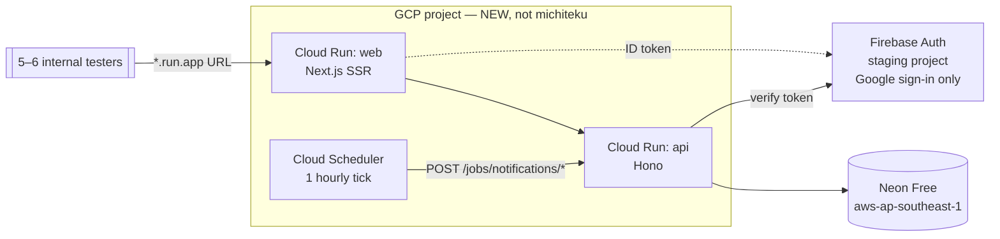

# Deploy Plan — dogfood first, hosting decision deferred

Working document for the first deploy. Written 2026-09-07 as a handoff between
machines. Not a decision record — nothing here is settled until it lands in
`docs/decisions.md`.

## Status

**Goal:** get a working deployment in front of 5–6 internal members (dogfooding)
within days, at $0.

**Not the goal yet:** the permanent hosting decision. That is blocked on a
Microsoft for Nonprofits application (paused — the Microsoft application page has
a software fault). Do not wait for it. See "Decision state".

## Target topology (dogfood only)



Deliberately omitted for this round, to keep the critical path short:

| Omitted | Why |
|---|---|
| Firebase Hosting | App is SSR + middleware + cookie auth, so it needs a server anyway. `firebase.json` has only emulator config — no `hosting` block to reuse. Two Cloud Run services is fewer moving parts. |
| Custom domain `buddy.plab.jp` | Needs an NS delegation in Xserver → Cloudflare, plus DNS propagation and cert issuance. Use the default `*.run.app` URLs instead. |
| Apple sign-in | Google-only is enough for 6 testers. Remaining work is Firebase console config (`docs/decisions.md`, 2026-08-15). |
| Cloudflare R2 | Leave `R2_*` blank unless photo upload is being tested. |
| Billing kill-switch (Pub/Sub → disable billing) | Budget alert only for now. **Must exist before real buddies.** |

## Plan

### 1. Repo changes — no accounts needed, do these first

- [ ] **`apps/api/Dockerfile`** — production build. Currently line 25 is a dev
      server, and it runs `prisma db push` on every container start:
      ```
      CMD ["sh", "-c", "... prisma db push ... && pnpm --filter @peace-buddy/api dev"]
      ```
      Cloud Run runs multiple instances; concurrent `db push` against one database
      is unsafe, and `db push` drops columns without asking. Target: multi-stage,
      `prisma generate` + `pnpm build` at build time, `CMD node dist/index.js`.
      Run `db push` once by hand against the Neon branch.
- [ ] **`apps/web/Dockerfile`** — production build. Line 19 is `next dev`.
      Target: `next build` → `next start`.
- [ ] **`apps/web/next.config.ts`** — add `output: 'standalone'`. Artifact
      Registry's free tier is 0.5 GB total and a non-standalone Next image will
      exceed it (only $0.10/GB after, but free to avoid).
- [ ] **Optional:** consolidate the four job endpoints in
      `apps/api/src/routes/jobs.ts` into one hourly tick. Cloud Scheduler gives 3
      free jobs per billing account and there are 4 endpoints. For 6 testers,
      POSTing them by hand is also fine — decide before wiring Scheduler.

Both apps already have `build` and `start` scripts, so the Dockerfile work is a
build-stage and `CMD` change, not new code.

### 2. Console setup — browser, cannot be automated from here

- [ ] **GCP project.** `gcloud` on the old machine was pointed at `michiteku` —
      **wrong project.** Create or choose the correct one, then enable billing
      (Cloud Run does not exist on Firebase's free Spark plan).
- [ ] **Budget alert** on that project, set low. Alerts notify only; they do not
      cap spend.
- [ ] **Neon** — sign up, create project in `aws-ap-southeast-1` (Singapore).
      Copy the **pooled** connection string (`-pooler` host) and set
      `connection_limit` in `DATABASE_URL`, or Cloud Run scaling out will exhaust
      Neon's connection cap.
- [ ] **Firebase** — `firebase login`, then create **two** projects, staging and
      prod, even though only staging gets deployed. Projects are free, and the
      Auth user pool is the one thing that is painful to separate later: mixing
      dogfood accounts with real buddies means untangling `User` /
      `BuddyProfile` rows against Firebase UIDs at launch.
- [ ] In the **staging** Firebase project: enable Google sign-in, add the
      `*.run.app` host to authorized domains, generate the service account for
      `FIREBASE_CLIENT_EMAIL` / `FIREBASE_PRIVATE_KEY`.

### 3. Deploy

- [ ] Build and push both images to Artifact Registry.
- [ ] `gcloud run deploy` for `api` and `web`. **`--min-instances=0` on both** —
      that flag is the difference between $0 and a real bill.
- [ ] Set env vars on the services (see `apps/api/.env.example`): `DATABASE_URL`,
      `CORS_ORIGIN`, `WEB_BASE_URL`, `NEXT_PUBLIC_API_URL`, `SCHEDULER_SECRET`,
      the Firebase service-account pair, `EMAIL_DISABLED`, `SLACK_*`.
      Secrets go on the service, never into a file in the repo.
- [ ] Run `prisma db push` once against the Neon database.
- [ ] Smoke test: sign in with Google, create a tour, book it, check the Slack
      webhook fires.

### 4. Before real buddies (not before dogfooding)

- [ ] Billing kill-switch: budget alert → Pub/Sub → Cloud Function that disables
      billing. `DEPLOYMENT.md` calls this the single highest-value ops task.
- [ ] Nightly `pg_dump` → R2, and **one tested restore**. This is what makes
      every hosting option below reversible.
- [ ] Artifact Registry image cleanup policy.
- [ ] Custom domain, Apple sign-in, real staging/prod split.
- [ ] Delete `memory/project_prerelease.md` and switch to `prisma migrate deploy`.
- [ ] APPI: decide between full Japan residency and documented
      外的環境の把握 (see "Data residency" below).

## Decision state

**For now — Neon, revisited next year.** Dev budget grows next year; migration
off Neon is cheap (below), so this is a low-cost commitment.

**Pending — Microsoft for Nonprofits.** Application started, paused on a fault in
Microsoft's page. If the grant lands it changes the answer: $2,000/yr of Azure
credit against a ~$200/yr stack in **Japan East**, which solves cost and data
residency together. `DEPLOYMENT.md` rejected chasing credits on the grounds that
re-architecting to capture one is a bad trade — that reasoning assumed an
existing stack, and per `docs/architecture.md` production is **not built**. This
is a different first deploy, not a migration. Reopening it needs a new
`docs/decisions.md` entry.

**Migration off Neon is cheap — keep it that way.** Verified in the repo:

- `prisma/schema.prisma` — plain `provider = "postgresql"`, `url = env("DATABASE_URL")`. No `directUrl`, no preview features.
- `apps/api/src/lib/db.ts:5` — bare `new PrismaClient()`, no driver adapter.
- Zero matches for `neon`, `@prisma/adapter`, `pgbouncer`, `pooler`, `pgvector` across `apps/`, `packages/`, `prisma/`.
- Schema uses only stock Postgres types (`@db.Date`, `@db.Time`).

Migration is `pg_dump` → `pg_restore` → change one env var. **Do not adopt**
`@neondatabase/serverless` / `@prisma/adapter-neon` (Cloud Run holds normal TCP
connections, so it buys nothing), Neon branching in CI (CI already runs against
the docker-compose Postgres), or Neon Auth / Data API.

## Research findings — verified 2026-09-05

### Neon

| | Free | Launch |
|---|---|---|
| Price | $0 | **No monthly minimum**, pay-as-you-go |
| Storage | 0.5 GB/project | $0.35/GB-month |
| Compute | 100 CU-hours/project/month | $0.106/CU-hour |
| History | **6 hours** (1 GB limit) | up to 7 days |
| Autosuspend | after 5 min | after 5 min, can be disabled |

Estimated Launch cost at ~70 members: **$2–4/mo (~$25–48/yr)**.

**Neon has no Tokyo region.** 8 AWS regions; APAC is Singapore
(`aws-ap-southeast-1`) and Sydney only. If using Neon, **put Cloud Run in
Singapore too** — one ~80ms hop per request beats ~70ms × every query.

### Alternatives priced

| Option | Region | Cost | Verdict |
|---|---|---|---|
| **Azure PG Flexible B1ms, Japan East** | 🇯🇵 Tokyo | $12.41/mo compute + ~$4 storage ≈ $200/yr list → **$0 on the nonprofit credit** | Best if the grant lands |
| **Prisma Postgres Starter** | 🇯🇵 Tokyo | $10/mo = $120/yr — 1M ops, 10 GB, daily backups 7-day retention | Best Tokyo option without the grant. Free tier (200k ops / 500 MB) is "evaluation only" per their FAQ |
| **Japanese VPS** (Sakura / Xserver / ConoHa) | 🇯🇵 | ~$60–85/yr for the *whole* stack | Simplest legal story — Japanese company, Japanese datacenter. Highest devops |
| Cloud SQL `db-f1-micro` | 🇯🇵 Tokyo | ~$130–170/yr *(estimated — Tokyo rate not verified; $8/mo in us-central1)* | Eats the whole budget, and shared-core carries **no SLA** |
| Supabase | 🇯🇵 Tokyo | Free pauses after **1 week idle**; Pro $25/mo; PITR **+$100/mo** | Out — the 0-tour months would pause it |
| Fly Managed Postgres | 🇯🇵 Tokyo | $38/mo minimum | Out on price |

### Compute free tiers

Cloud Run and Azure Container Apps publish the **same** monthly free grant:
180,000 vCPU-seconds, 360,000 GiB-seconds, 2M requests. Estimated load at ~70
members is ~56k requests and ~8,400 vCPU-seconds/month — 20–35× headroom.

Cloud Run's free **egress** is 1 GB/month **North America only**; from Tokyo you
pay from the first byte (~$0.12/GiB, ≈$6–25/yr here).

Realistic all-in with Neon: **~$35–80/yr**, not the $120 the padded `$0–5/mo`
estimate in `DEPLOYMENT.md` implies. The only path to a real bill is
`--min-instances ≥ 1`.

### Nonprofit programmes

- **Goodstack** (already verified) lists **no** infrastructure providers:
  Microsoft, Adobe Acrobat, Asana, Docusign, OpenAI, Upwork, Zoom. Its only value
  here is as the route to Microsoft.
- **Microsoft**: $2,000/yr Azure credit, activate within 90 days, renews
  annually, no rollover. Eligibility is "recognized legal status equal to
  501(c)(3)"; Microsoft's eligibility page does **not** name Japanese entity
  types. Still open.
- **AWS**: US 501(c)(3) only — does not apply.
- **Google Cloud**: no published credit amount. Plan for zero.

### Data residency (APPI)

The PPC **クラウド例外** applies when the provider is contractually barred from
handling the personal data and access controls are in place: it is then not a
third-party provision at all, so **Article 28 consent is not required**. What is
owed instead is **外的環境の把握** under Article 23 安全管理措置 — identify the
storing country's regime and disclose the country.

So Singapore is not illegal; it is paperwork. Japan-resident data removes the
paperwork. *Not legal advice — the PPC Q&A is the authority.*

**The database is not the whole problem.** Firebase Auth is US-only and already
holds every member's email and display name in the United States. Regionalized
Firebase Auth was roadmapped for end-2025; **status not verified — check.** Auth
is settled as Firebase in `docs/decisions.md`, so "full Japan residency" and "no
Google at all" are the same, much larger decision, and it is not the database's.

## Corrections owed to `DEPLOYMENT.md`

1. Launch has **no** fixed monthly fee — resolves the "any fixed base fee not verified" caveat. The old "$19/month for 10 GB" is gone.
2. **Neon has no Tokyo region.** Not mentioned in the doc at all; it is the real cost of choosing Neon.
3. The 6-hour history window is a *detection* limit, not a data-loss limit — you can restore to any point within 6 hours, but a deletion noticed on Thursday is unrecoverable. For occasional users, **a daily dump kept 30 days beats 6h PITR**.
4. Cloud Run's `$0–5/mo` was a guess with no traffic estimate; measured against the free tier it is ~$0 with 20–35× headroom, and egress is the only non-zero line.
5. Header says **200–250 buddies**; the real number is **~70**.
6. Add Prisma Postgres, the Japanese-VPS option, and Azure Japan East to "Why Not Alternatives".
7. Record the budget: **$100–200/yr for the whole stack**.

## Open questions

- Microsoft nonprofit eligibility for plab's legal form — blocked on their page fault.
- Region for the dogfood Cloud Run services: Singapore (colocate with Neon) or Tokyo.
- Consolidate the 4 cron endpoints now, or drive them by hand during dogfooding.
- Has regionalized Firebase Auth shipped?
- Full Japan residency vs documented 外的環境の把握 — decide before real buddies.

## Machine state — recheck on the new PC

From the old machine, 2026-09-07:

| Tool | State |
|---|---|
| `gcloud` 527.0.0 | authed as lynn.sakashita@michiteku.jp, project `michiteku` — **wrong project** |
| `docker` 27.5.1 | ok |
| `firebase` 15.15.0 | **not logged in** |
| `gh` 2.65.0 | ok |
| `neonctl`, `psql`, `pg_dump`, `pnpm` | not installed |

`psql` / `pg_dump` will be needed for the backup job; `pnpm` runs in Docker per
`CLAUDE.md`.

## Sources

Neon [pricing](https://neon.com/pricing) · [plans](https://neon.com/docs/introduction/plans) · [regions](https://neon.com/docs/introduction/regions) —
[Supabase pricing](https://supabase.com/pricing) —
[Prisma pricing](https://www.prisma.io/pricing) · [Postgres FAQ](https://www.prisma.io/docs/postgres/faq) —
[Fly Managed Postgres](https://fly.io/docs/mpg/) —
[Cloud Run pricing](https://cloud.google.com/run/pricing) —
[Azure Container Apps pricing](https://azure.microsoft.com/en-us/pricing/details/container-apps/) · [Azure PG B1ms](https://www.bytebase.com/dbcost/azure-flexible/instance/B1ms/) —
[Cloud SQL pricing](https://www.bytebase.com/dbcost/cloudsql-pricing/) —
[Microsoft nonprofit eligibility](https://www.microsoft.com/en-us/nonprofits/eligibility) · [Azure grant activation](https://learn.microsoft.com/en-us/industry/nonprofit/microsoft-for-nonprofits/claim-activate-nonprofit-azure-grant) —
[Goodstack discounts](https://goodstack.org/software-discounts) —
APPI [クラウド例外](https://digitalforensic.jp/2024/06/10/column825/) · [越境移転と外的環境の把握](https://www.ushijima-law.gr.jp/topics/appi_crossborder_transfer/)
