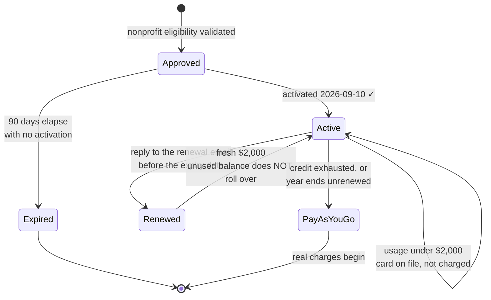
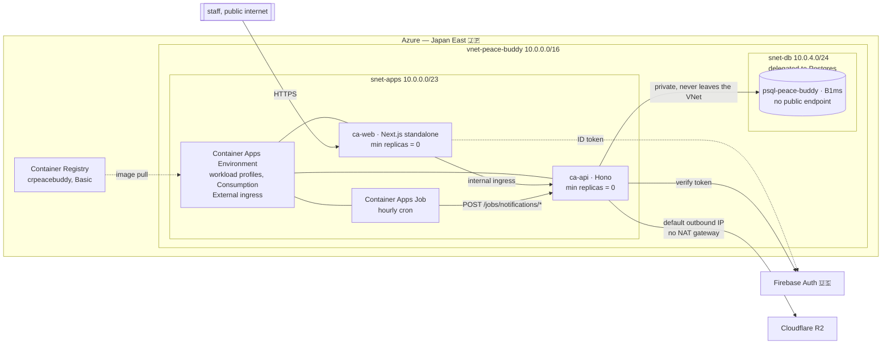
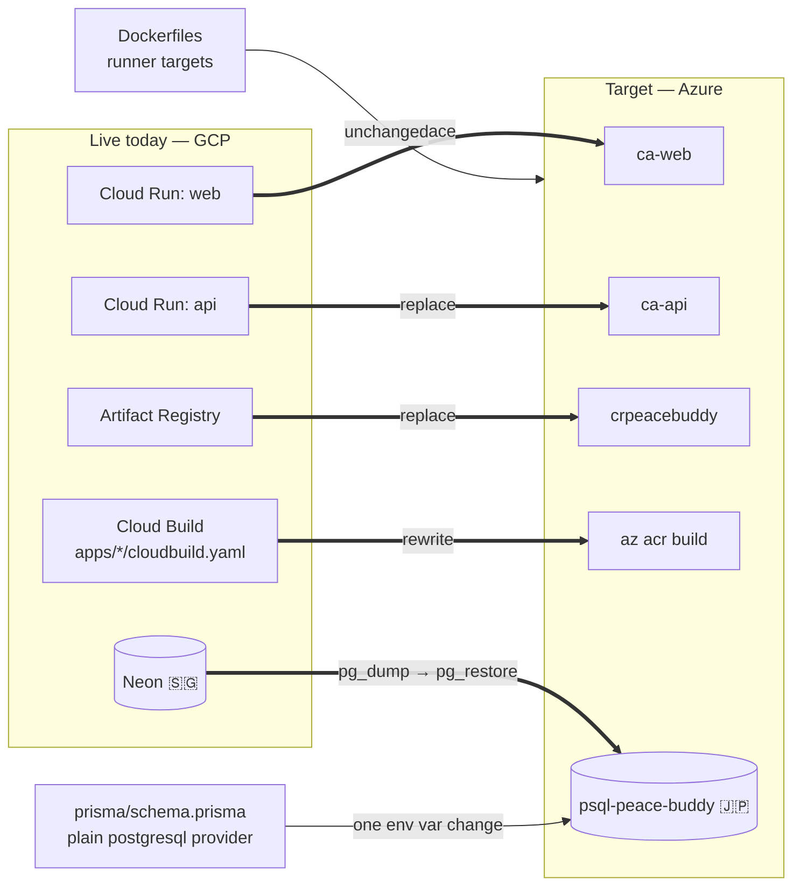
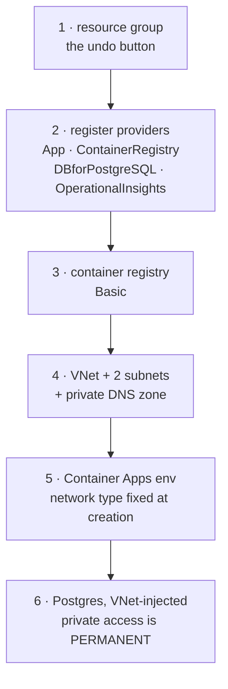
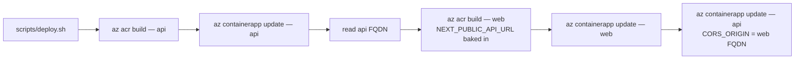
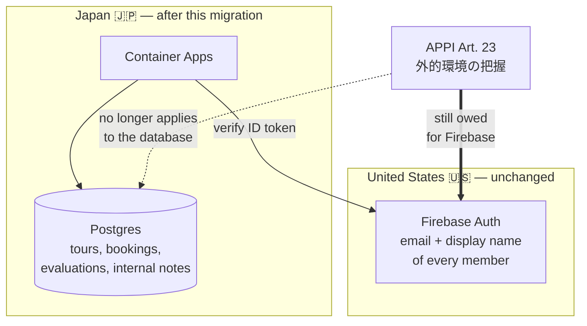

# Deploy Plan — migrate to Azure Japan East on the nonprofit grant

Working document, last revised **2026-09-10**. Replaces the 2026-09-07 GCP-first
version, whose repo checklist has shipped.

**Grant activated.** $2,000/yr of Azure Sponsorship credit is live. Provisioning
is underway; see "Progress" below for what actually exists.

## Status

Staging is **live on GCP** — Cloud Run `asia-southeast1`, Neon
`aws-ap-southeast-1`, Firebase `peace-buddy-staging`. Production has never been
built. So this is a migration of one dogfood environment, not a production
cutover, and it is the cheapest moment it will ever be.

Load, for sizing arguments: **~70 members**, peak season is November at roughly
**one tour every two days**. This is an internal business tool, not a consumer
app. Every capacity number below should be read against that, and every one of
them has one to two orders of magnitude of headroom.

## Decisions taken

| Question | Answer | Reasoning |
|---|---|---|
| Cloud | **Azure** | $2,000/yr grant against a stack listing near $260/yr |
| Region | **Japan East** (Tokyo) | Japan West is ~15ms closer to Kyushu, where nearly all users are, but Japan East is Microsoft's primary Japanese region and gets features first. 15ms is imperceptible on a server-rendered page, and this is an internal tool |
| Compute | **Container Apps, workload-profiles environment, Consumption profile** | Charges nothing scaled to zero. App Service bills hourly whether or not anyone visits, which would drain the grant on an app that is idle most of the month |
| Database | **PG Flexible Server B1ms** | Cheapest real tier. Japan East placement removes the APPI 外的環境の把握 burden for application data |
| DB networking | **Private, VNet-injected** | Costs $0. No public endpoint at all, so a leaked password is not sufficient to reach the data |
| Infra as code | **Shell script now, Bicep later** | Learning Azure's resource model and a templating language at once makes failures ambiguous. Codify once the shape is proven |

## 1. Grant lifecycle

The credit covers **first-party Azure services only** — no reserved instances,
no marketplace offers, no support plans. It is worth a budget alert set well
under $2,000, because alerts are the only warning before the silent conversion
to pay-as-you-go.

## 2. Target topology

Ingress stays public because staff reach the app from the internet. Only the
database is private. A NAT gateway is **not** required — Container Apps gives
every environment a default outbound public IP, and a NAT gateway buys only a
*static* outbound address, which nothing here needs.

Two constraints from the GCP plan **die here**, and both were shaping the code:

| Old constraint | Status on Azure |
|---|---|
| Cloud Scheduler's free tier is 3 jobs, so consolidate the 4 endpoints in `apps/api/src/routes/jobs.ts` into one hourly tick | **Gone.** Container Apps Jobs bill per execution against the same free grant, with no job-count limit. Keep the four endpoints |
| Neon's free compute allowance cannot absorb four hourly schedules | **Gone.** B1ms is always-on, paid from credit |

Still deliberately omitted: custom domain `buddy.plab.jp`, Apple sign-in, and a
real staging/prod split.

## 3. What moves, what is reused

Already shipped, do not redo:

- Both Dockerfiles are multi-stage with production `runner` targets
  (`node dist/index.js` for api, Next standalone for web). Commit `839892c`.
- `apps/web/next.config.ts` emits `output: 'standalone'`.
- `scripts/deploy.sh` and `scripts/deploy.env.example` exist and work for Cloud
  Run. Commit `3dcc21e`.

Portability was verified and still holds: a plain `postgresql` provider with no
`directUrl`, a bare `PrismaClient` with no driver adapter, and no reference to
Neon anywhere in `apps/`, `packages/`, or `prisma/`. **Keep it that way.**

## 4. Provisioning

Infrastructure is `scripts/azure-provision.sh`, reading an untracked
`scripts/azure.env` (template: `scripts/azure.env.example`, gitignored
alongside the existing `deploy.env`). It is idempotent — every step checks for
existence first, so a partial run resumes by rerunning.

Two steps are one-way doors. A Container Apps environment's network type cannot
be changed after creation, and a Postgres server cannot be converted between
public and private access. Both are cheap to get right and expensive to undo.

## 5. Deploy pipeline

`az acr build` is a direct analogue of `gcloud builds submit` — it builds
server-side, so nothing is pushed from a laptop, which also sidesteps the
ARM-versus-x86 mismatch on an Apple Silicon machine. The ordering in
`scripts/deploy.sh` survives the rewrite, because it exists to solve a real
problem: the web image bakes `NEXT_PUBLIC_API_URL` at build time, so the api
needs a URL before web can build, and the api's CORS origin is only known once
web is deployed.

Rewrite work, not yet started:

- [ ] `scripts/deploy.sh` — `gcloud builds submit` → `az acr build`,
      `gcloud run deploy` → `az containerapp create/update`,
      `gcloud run services describe` → `az containerapp show`.
- [ ] `scripts/deploy.env.example` — `PROJECT`/`REGION`/`REPO` become the Azure
      names. The 12 application secrets are unchanged.
- [ ] Delete `apps/api/cloudbuild.yaml` and `apps/web/cloudbuild.yaml`.
- [ ] `--min-instances=0` becomes `--min-replicas 0`. **This flag is the
      difference between $0 and burning credit.**

### Cold starts

Scale-to-zero means a request arriving after hours of silence waits for a
container to boot, a few seconds for a Node image. At one tour every two days,
most requests will be cold. For staff who know what the tool is, that is
acceptable. Raising `--min-replicas` to 1 removes it and costs tens of dollars a
year at idle rates, which the grant absorbs. Start at 0, change it only if it
actually annoys people. It is one flag and reversible.

## 6. Database cutover

- [ ] `pg_dump` from Neon, `pg_restore` into Azure. `psql` and `pg_dump` are
      **not installed** on this machine — run them from a Postgres container.
- [ ] The private hostname resolves only inside the VNet, so the restore must
      run from something inside it, not from a laptop.
- [ ] Point `DATABASE_URL` at Azure, redeploy the api, smoke test.
- [ ] Keep the Neon project for a week, then delete it.

Pre-release, so schema changes still go through `prisma db push` (see
`memory/project_prerelease.md`). Run it by hand once against the new server,
never from a container `CMD` — Container Apps runs multiple replicas and
concurrent `db push` is unsafe.

## 7. Cost against the credit

| Line item | Japan East, list | Annual | Notes |
|---|---|---|---|
| PG Flexible B1ms compute | ~$12.41/mo | ~$149 | the only meaningful line |
| PG storage, 32GB | ~$4/mo | ~$48 | minimum size |
| Container Registry Basic | ~$5/mo | ~$60 | includes 10GB |
| Container Apps, scaled to zero | $0 | $0 | inside the free monthly grant |
| VNet, subnets, private DNS | $0 | $0 | |
| NAT gateway | not used | $0 | not required for outbound |
| Private endpoint | not used | $0 | VNet injection is free, endpoints are not |
| **Total** | | **~$257 of $2,000** | |

Container Apps' free grant is per subscription per calendar month: 180,000
vCPU-seconds, 360,000 GiB-seconds, 2M HTTP requests. Estimated load is ~8,400
vCPU-seconds and ~56k requests — 20–35× headroom.

About $1,700/yr goes unused and does not roll over. That is headroom for
backups, monitoring, and a real staging/prod split. It is **not** a reason to
upsize the database.

## 8. Data residency — half solved

Moving the database to Japan East removes the 外的環境の把握 disclosure burden
for application data. It does **not** remove it for Firebase Auth, which is
US-only. Auth is settled as Firebase in `docs/decisions.md` (2026-08-15), so
"full Japan residency" means dropping Google as the identity provider — a much
larger decision, and not this one. *Not legal advice; the PPC Q&A is the
authority.*

## 9. Before real buddies — unchanged by the grant

- [ ] Nightly `pg_dump` → R2, and **one tested restore**. Azure's built-in
      backups are the belt; this is the braces, and it is what keeps every
      future hosting move reversible.
- [ ] Budget alert and a cost anomaly alert.
- [ ] Container Registry image cleanup policy.
- [ ] Custom domain, Apple sign-in, real staging/prod split.
- [ ] Delete `memory/project_prerelease.md`, switch to `prisma migrate deploy`.

## Progress

| Step | State |
|---|---|
| Grant activated | ✅ 2026-09-10 |
| `az` CLI installed, signed in | ✅ |
| Resource group `rg-peace-buddy`, Japan East | ✅ |
| Providers registered | ✅ |
| Registry `crpeacebuddy`, Basic | ✅ |
| Container Apps environment | ⬜ an earlier VNet-less attempt is gone; verified 2026-09-11 that no environment exists |
| VNet, subnets, private DNS | ⬜ |
| Postgres | ⬜ |
| Application database role, replacing the admin account in `DATABASE_URL` | ⬜ |
| `scripts/deploy.sh` rewritten for Azure | ⬜ |
| Data migrated off Neon | ⬜ |

The provisioning script prints a `DATABASE_URL` built from the server admin
account, because a restricted role can only be created with `psql` from inside
the VNet, which does not exist until the script has run. Create that role as the
first step of the deploy work and put the restricted credentials in the deploy
config. The admin account should not end up in `DATABASE_URL`.

Left over in `rg-peace-buddy` from the earlier attempt: a Log Analytics
workspace named `workspace-rgpeacebuddyyg8h`. Creating the environment makes a
new one, so this can be deleted.

## Unverified — check these before trusting the plan

Written down explicitly because they are the load-bearing assumptions, and none
of them has been confirmed against a live subscription.

1. **B1ms and storage pricing for Japan East.** Taken from Bytebase, a
   third-party table. Microsoft's own pricing page did not surface a Japan East
   figure. Verify in the portal calculator.
2. **Container Registry Basic at ~$5/mo.** Same problem, not confirmed for
   Japan East.
3. **`scripts/azure-provision.sh` has never been executed.** Syntax-checked
   only. No `shellcheck` available on this machine.
4. **Private DNS zone naming.** Azure constrains the zone suffix for
   VNet-injected Postgres. `peace-buddy.private.postgres.database.azure.com`
   follows the documented pattern but has not been created.
5. **Cold start duration.** "A few seconds" is an estimate for a Node image, not
   a measurement of these images.
6. **Regionalized Firebase Auth**, roadmapped for end-2025, status still
   unchecked.

Removed from this list on 2026-09-11: subnet delegation. Microsoft's networking
documentation states that a workload-profiles environment requires the
`Microsoft.App/environments` delegation and a `/27` or larger subnet, while a
legacy consumption-only environment must not be delegated and needs `/23` or
larger. The script creates a workload-profiles environment, delegates, and uses
a `/23`, which satisfies both constraints.

## Machine state — 2026-09-10

| Tool | State |
|---|---|
| `az` | installed and signed in |
| `psql`, `pg_dump` | **not installed** — needed for the cutover, run via Docker |
| `docker` 29.4.0 | ok |
| `firebase` 15.15.0 | ok |
| `gh` 2.51.0 | ok |

## Sources

[Azure grant activation](https://learn.microsoft.com/en-us/industry/nonprofit/microsoft-for-nonprofits/claim-activate-nonprofit-azure-grant) ·
[Container Apps billing](https://learn.microsoft.com/en-us/azure/container-apps/billing) ·
[Container Apps networking](https://learn.microsoft.com/en-us/azure/container-apps/networking) ·
[Container Apps pricing](https://azure.microsoft.com/en-us/pricing/details/container-apps/) ·
[Container Apps GA in Japan West](https://www.azalio.io/launched-generally-available-azure-container-apps-in-australia-se-france-south-japan-west-and-spain-central/) ·
[Postgres private access](https://learn.microsoft.com/en-us/azure/postgresql/network/concepts-networking-private) ·
[Azure PG B1ms](https://www.bytebase.com/dbcost/azure-flexible/instance/B1ms/) ·
APPI [クラウド例外](https://digitalforensic.jp/2024/06/10/column825/) ·
[越境移転と外的環境の把握](https://www.ushijima-law.gr.jp/topics/appi_crossborder_transfer/)
