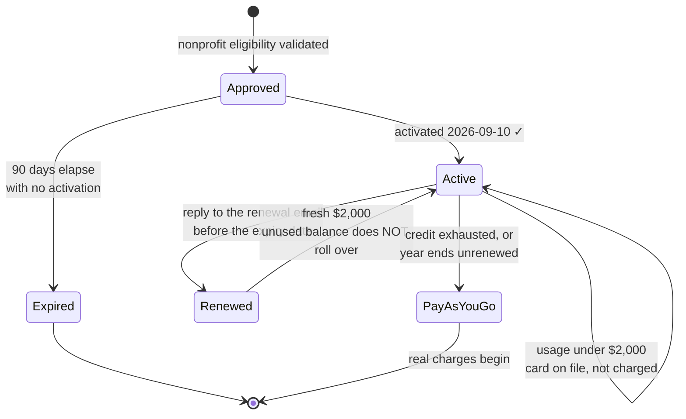
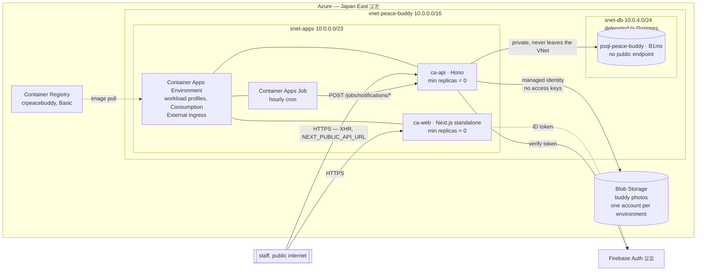
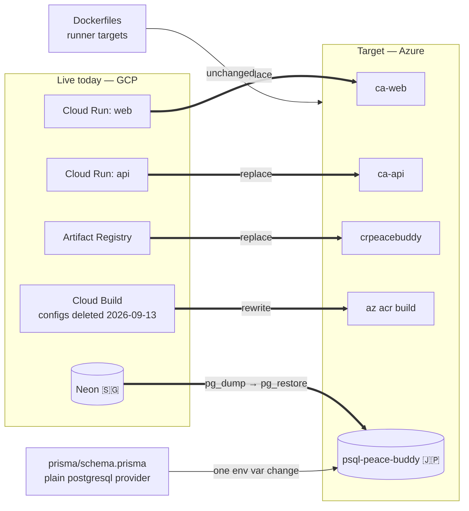
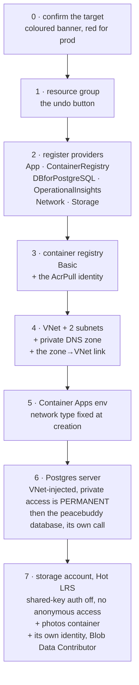
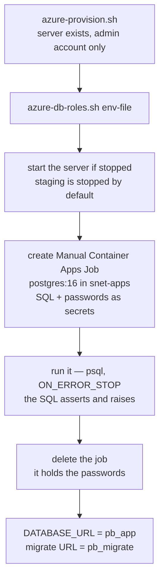
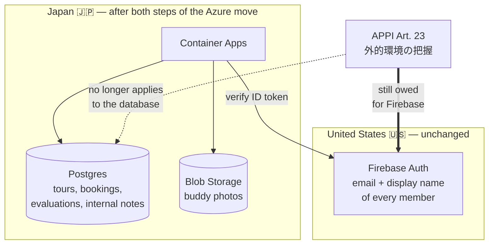

# Deploy Plan — migrate to Azure Japan East on the nonprofit grant

Working document, last revised **2026-09-12**. Replaces the 2026-09-07 GCP-first
version, whose repo checklist has shipped.

**Grant activated.** $2,000/yr of Azure Sponsorship credit is live. Provisioning
is underway; see "Progress" below for what actually exists.

## Status

Staging is **live on GCP** — Cloud Run `asia-southeast1`, Neon
`aws-ap-southeast-1`, Firebase `peace-buddy-staging`. Production has never been
built. So this is a migration of one dogfood environment, not a production
cutover, and it is the cheapest moment it will ever be.

**The environment model changed on 2026-09-12.** There is one deployed
environment today — the GCP/Neon stack behind `peace-buddy-staging` — and
non-dev members already use it to check and test work, which is staging's job.
It runs on free tiers nobody maintains. Azure gets **two environments, prod and
staging**, on separate Postgres servers. The GCP/Neon stack's data moves to
Azure staging (§6); the GCP side is then decommissioned as its own task, and
nothing replaces it. Local Docker Compose stays for development. See
`decisions.md` 2026-09-12.

Load, for sizing arguments: **~70 members**, peak season is November at roughly
**one tour every two days**. This is an internal business tool, not a consumer
app. Every capacity number below should be read against that, and every one of
them has one to two orders of magnitude of headroom.

## Decisions taken

| Question | Answer | Reasoning |
|---|---|---|
| Cloud | **Azure** | $2,000/yr grant against a stack listing near $260/yr |
| Region | **Japan East** (Tokyo) | Japan West is ~15ms closer to Kyushu, where nearly all users are, but Japan East is Microsoft's primary Japanese region and gets features first. 15ms is imperceptible on a server-rendered page, and this is an internal tool |
| Compute | **Container Apps, workload-profiles environment, Consumption profile** | Charges nothing scaled to zero. App Service bills hourly whether or not anyone visits, which would drain the grant on an app that is idle most of the month |
| Database | **PG Flexible Server B1ms** | Cheapest real tier. Japan East placement removes the APPI 外的環境の把握 burden for application data |
| DB networking | **Private, VNet-injected** | Costs $0. No public endpoint at all, so a leaked password is not sufficient to reach the data |
| Infra as code | **Shell script now, Bicep later** | Learning Azure's resource model and a templating language at once makes failures ambiguous. Codify once the shape is proven |
| Environments | **prod + staging on Azure, nothing else deployed** | Non-dev members already test on the one deployed environment, `peace-buddy-staging` on GCP free tiers. One maintained environment beats a free one nobody owns. Local Docker Compose covers development |
| DB per environment | **A separate B1ms each** | Sharing one server saves $66/yr against this design — staging's server is stopped most of the year — and was rejected: it couples prod and staging to one CPU credit budget and one 35-connection ceiling, and it is not how anyone runs these |
| Staging uptime | **Started by hand, stopped when done** | Staging is dormant between feature cycles. Storage bills regardless; compute is the only variable and it is $0.026/hr |
| Photo storage | **Azure Blob, Japan East** | R2 has no Japan jurisdiction and location hints are best-effort, so photos kept the APPI burden the database move removed |

## 1. Grant lifecycle



The credit covers **first-party Azure services only** — no reserved instances,
no marketplace offers, no support plans. It is worth a budget alert set well
under $2,000, because alerts are the only warning before the silent conversion
to pay-as-you-go.

## 2. Target topology



The diagram shows **one** environment. Prod and staging are provisioned to the
same shape, each with its own Postgres server and its own storage account, both
inside the single VNet and the single Container Apps environment. Staging's
server is stopped by default; see §7.

Ingress is external on **both** apps, because staff reach the app from the
internet and the browser calls the api directly — `NEXT_PUBLIC_API_URL` is
inlined into the client bundle, which is also why the api needs `CORS_ORIGIN`.
Only the database is private. A NAT gateway is **not** required — Container Apps gives
every environment a default outbound public IP, and a NAT gateway buys only a
*static* outbound address, which nothing here needs.

Two constraints from the GCP plan **die here**, and both were shaping the code:

| Old constraint | Status on Azure |
|---|---|
| Cloud Scheduler's free tier is 3 jobs, so consolidate the 4 endpoints in `apps/api/src/routes/jobs.ts` into one hourly tick | **Gone.** Container Apps Jobs bill per execution against the same free grant, with no job-count limit. Keep the four endpoints |
| Neon's free compute allowance cannot absorb four hourly schedules | **Gone.** B1ms is always-on, paid from credit |

Still deliberately omitted: custom domain `buddy.plab.jp` and Apple sign-in. The
staging/prod split is **no longer omitted** — it is the point of this plan now.

## 3. What moves, what is reused



Already shipped, do not redo:

- Both Dockerfiles are multi-stage with production `runner` targets
  (`node dist/index.js` for api, Next standalone for web). Commit `839892c`.
- `apps/web/next.config.ts` emits `output: 'standalone'`.
- `scripts/deploy.sh` and `scripts/deploy.env.example` were rewritten for
  Azure on 2026-09-13 (#152) and `apps/*/cloudbuild.yaml` deleted. The Cloud
  Run versions are in commit `3dcc21e` if the live GCP stack ever needs another
  deploy before it is decommissioned.

Portability was verified and still holds: a plain `postgresql` provider with no
`directUrl`, a bare `PrismaClient` with no driver adapter, and no reference to
Neon anywhere in `apps/`, `packages/`, or `prisma/`. **Keep it that way.**

## 4. Provisioning

Infrastructure is `scripts/azure-provision.sh`, taking an untracked env file
as its argument — `scripts/azure.env` for prod, `scripts/azure.stg.env` for
staging (template: `scripts/azure.env.example`; `azure*.env` is gitignored
alongside the existing `deploy.env`). It is idempotent — every step checks for
existence first, so a partial run resumes by rerunning.

Numbered as the script's own sections are:



Two steps are one-way doors. A Container Apps environment's network type cannot
be changed after creation, and a Postgres server cannot be converted between
public and private access. Both are cheap to get right and expensive to undo.

**Step 4 must link the private DNS zone to the VNet itself.** This is easy to
leave out, because `flexible-server create --private-dns-zone` creates the link
when it also creates the zone. Handed a zone that already exists, which is what
this script does, it registers the server's A record and does nothing else. The
result passes every inspection: the zone is there, the record is there with the
right private IP, and the server reports the right configuration. Only the
first connection from inside the VNet fails, with NXDOMAIN. Staging hit exactly
that on 2026-09-12, in the first job run of `azure-db-roles.sh`, and the link
step was added to the script in the same change.

**The private hostname is read from the server, never composed.** Azure names
the A record in the zone with a generated token rather than the server name —
staging's is `efd7adde3020` — and publishes
`<server>.postgres.database.azure.com` as a public CNAME onto it, which answers
only inside the linked VNet. That CNAME is what `fullyQualifiedDomainName`
returns and it is the name to connect with. `<server>.<DNS_ZONE>`, which both
scripts used to print, is a name that never existed.

One environment holds **four apps** — `ca-api` / `ca-web` for prod and
`ca-api-stg` / `ca-web-stg` for staging. A second Container Apps environment per
stack would be the textbook isolation, and it is the one thing here that costs:
a second VNet, a second pair of public IPs at ~$88/yr, and a second load
balancer. Four apps in one environment cost the same as two, because idle
revisions scale to zero. See `decisions.md` 2026-09-12.

**The script is run once per environment, with that environment's env file.**
It takes `ENVIRONMENT`, names the target in a coloured confirmation banner — red
for prod, anything else blue — and refuses to create anything until someone
agrees to it. `ENVIRONMENT` reaches nothing but that banner; the values that
decide what steps 6 and 7 create are `PG_SERVER`, `STORAGE_ACCOUNT` and
`STORAGE_IDENTITY` — `psql-peace-buddy`, `stpeacebuddy` and
`id-peace-buddy-blob` for prod, `psql-peace-buddy-stg`, `stpeacebuddystg` and
`id-peace-buddy-blob-stg` for staging — and the banner prints the server and
account before anything is created. Steps 1 through 5 are the shared resource
group, registry, VNet and Container Apps environment; they are idempotent, so
the second run skips them and only steps 6 and 7 produce a second server,
database, storage account and identity.

**Step 7 is the environment's Blob storage** — the account, a private `photos`
container, and an identity holding Storage Blob Data Contributor on that
account only. Shared-key auth is off, so an account key authorises nothing and
anyone reaching blobs by hand does it with `--auth-mode login`. The public
endpoint stays on, because browsers load photos through SAS URLs, but anonymous
access is disabled for the whole account. Connecting the api to it — attaching
the identity and the config keys — is #154. See `decisions.md` 2026-09-13.

### 4.1 Database roles — the step straight after provisioning

`azure-provision.sh` can only print a `DATABASE_URL` built from the server
admin account, because a restricted role has to be created with `psql` from
inside the VNet, which does not exist until the script has run. That account
can administer every database on the server, so it must not be what the api
connects as.

`scripts/azure-db-roles.sh <env-file>` closes that gap, once per server,
before anything is deployed against it. It creates two roles and asserts the
result rather than assuming it. See `decisions.md` 2026-09-12, "Two database
roles per server".

| Role | Holds | Used by |
|---|---|---|
| `pb_migrate` | `CREATE` on schema `public`, owns every table | `prisma migrate deploy`, by hand, nothing else |
| `pb_app` | `USAGE`, plus `SELECT`/`INSERT`/`UPDATE`/`DELETE` | the deployed api — this is `DATABASE_URL` |

Neither has `SUPERUSER`, `CREATEDB`, `CREATEROLE` or `BYPASSRLS`, neither is a
member of `azure_pg_admin`, and `CONNECT` on `peacebuddy` is revoked from
`PUBLIC`.



The job exists because the server has no public endpoint, its hostname
resolves only inside the VNet, nothing is deployed yet to `exec` into, and
`psql` is not installed on the dev machine. It is deleted after the run because
it stores all three passwords as secrets for as long as it exists.

The SQL is idempotent, so re-running is how a password is rotated. **Re-run it
after any restore.** `ALTER DEFAULT PRIVILEGES FOR ROLE pb_migrate` covers
tables that role creates, not tables restored under another owner, and the
catch-up grant on existing objects is in the same file.

## 5. Deploy pipeline

`az acr build` is a direct analogue of `gcloud builds submit` — it builds
server-side, so nothing is pushed from a laptop, which also sidesteps the
ARM-versus-x86 mismatch on an Apple Silicon machine. The ordering in
`scripts/deploy.sh` survives the rewrite, because it exists to solve a real
problem: the web image bakes `NEXT_PUBLIC_API_URL` at build time, so the api
needs a URL before web can build, and the api's CORS origin is only known once
web is deployed.

```mermaid
flowchart LR
    L["scripts/deploy.sh env-file"] --> B1["az acr build — api<br/>and migrate"]
    B1 --> M["Container Apps Job<br/>prisma migrate deploy<br/>as pb_migrate, then deleted"]
    M --> D1["az containerapp create/update — api"]
    D1 --> URL["read api FQDN"]
    URL --> B2["az acr build — web<br/>NEXT_PUBLIC_API_URL baked in"]
    B2 --> D2["az containerapp create/update — web"]
    D2 --> CORS["az containerapp update — api<br/>CORS_ORIGIN = web FQDN"]
    CORS --> PRUNE["az acr repository delete<br/>all but referenced + newest 5"]
```



Both images are built before anything is applied or deployed, so a build that
fails cannot leave a migrated database behind. The migration runs as its own
job, as `pb_migrate`, and a non-zero exit stops the deploy with nothing
updated — see §6 and `docs/decisions.md` 2026-09-13.

Done 2026-09-13, #152:

- [x] `scripts/deploy.sh` — `gcloud builds submit` → `az acr build`,
      `gcloud run deploy` → `az containerapp create/update`,
      `gcloud run services describe` → `az containerapp show`. One env file per
      environment, named in a coloured confirmation banner like the other two
      scripts, and refused unless it is owner-only.
- [x] `scripts/deploy.env.example` — `PROJECT`/`REGION`/`REPO` become
      `RESOURCE_GROUP`, `ACR_NAME`, `ACA_ENV`, `ACA_API`, `ACA_WEB` and
      `ENVIRONMENT`. The application secrets are unchanged apart from the
      second connection string.
- [x] Delete `apps/api/cloudbuild.yaml` and `apps/web/cloudbuild.yaml`.
- [x] `--min-instances=0` becomes `--min-replicas 0`. **This flag is the
      difference between $0 and burning credit.**
- [x] `migrate` stage in `apps/api/Dockerfile`, carrying the Prisma CLI and the
      migration history that the `runner` stage deliberately does not.

Not yet run against anything. The first real deploy is staging, and as of
2026-09-13 nothing stands in front of it: §6's restore moved the data, so the
database it would migrate is the Azure one.

Images are pulled with `id-peace-buddy-acrpull`, one user-assigned identity
created by `azure-provision.sh` and granted `AcrPull` once, so no registry
password is stored in an app or a job. The registry has no admin user enabled,
and does not need one. It is user-assigned rather than system-assigned because
a system-assigned identity is born with the resource holding it and the
platform validates the pull before the role assignment propagates — which the
first staging deploy hit, and which the migration job would hit on every run,
being recreated each time. See `decisions.md` 2026-09-13, "Images are pulled
with a user-assigned identity".

Both apps answer on the hostname Container Apps generates until a real domain
is bound. A bound custom domain cannot be discovered from the app the way the
generated name can, so `WEB_HOSTNAME` and `API_HOSTNAME` in the deploy config
name it instead; blank means "use the generated one". Binding a hostname is two
DNS records, a `CNAME` to the app and a `TXT` on `asuid.<host>` carrying the
app's `customDomainVerificationId`, then `az containerapp hostname add` and
`hostname bind`, which issues a free managed certificate. Set the config key
only after that certificate exists — the value is what `CORS_ORIGIN` and the
web bundle's `NEXT_PUBLIC_API_URL` are built from. See `decisions.md`
2026-09-13, "Custom hostnames come from config".

### Cold starts

Scale-to-zero means a request arriving after hours of silence waits for a
container to boot, a few seconds for a Node image. At one tour every two days,
most requests will be cold. For staff who know what the tool is, that is
acceptable. Raising `--min-replicas` to 1 removes it and costs tens of dollars a
year at idle rates, which the grant absorbs. Start at 0, change it only if it
actually annoys people. It is one flag and reversible.

## 6. Database cutover

**Prod and staging cut over differently**, because only one of them has data.

The server does not arrive with the application database on it. az 2.90 accepts
`--database-name` on `flexible-server create` only for elastic clusters, so
`peacebuddy` is created by its own `flexible-server db create` call, the tail of
step 6 in §4, and it is that database rather than the server's defaults that
`DATABASE_URL` points at.

**Both need their roles first.** `scripts/azure-db-roles.sh` (§4.1) runs
before either path below, and every `migrate deploy` here connects as
`pb_migrate`, never as the admin. A migration applied by the admin produces
tables the api cannot read.

**Prod has never existed.** Build it with `prisma migrate deploy` from
`0_init` against an empty server. No dump, no baseline, no enum problem.

**Staging carries Neon's data**, and that data is the reason the cutover is not
just a restore:

- [x] Run the enum remap against Neon **first** — the technique is in
      `DEPLOYMENT.md`, the SQL actually executed is
      `scripts/staging-enum-remap.sql`. Done 2026-09-12 in #142, together with
      the remaining drift and the baseline itself, so Neon now matches
      `schema.prisma` and carries a `_prisma_migrations` table with both
      directories marked applied.
- [x] `scripts/azure-db-restore.sh scripts/azure.stg.env deploy.env` does the
      move and checks it, in one Container Apps job. See §6.1. Run **2026-09-13**
      in #153, against an empty target: 20 tables, row counts agreeing on both
      ends, history matching `prisma/migrations/`, `pb_app` verified. The server
      was stopped again afterwards.
- [ ] Point `DATABASE_URL` at Azure, redeploy the api, smoke test. **Not part
      of #153.** Nothing on Azure serves the app yet — no image has been built
      and neither container app exists — and the api that does serve staging
      runs on Cloud Run, which has no route into the VNet. So there is nothing
      to repoint yet: this step *is* the first Azure deploy, and it belongs
      with §5. The restore is what unblocks it.
- [ ] Keep the Neon project for a week, then delete it — **not before
      2026-09-20**, and not until the api actually runs against Azure, since
      until then Neon is still the database staging serves from. Deleting it is
      part of retiring the GCP stack (#156).

Schema changes go through `prisma migrate deploy` (see `DEPLOYMENT.md`,
"Schema Changes"). Run it by hand once against each new server, never from a
container `CMD` — Container Apps runs multiple replicas and concurrent DDL is
unsafe.

**Settled 2026-09-13 with the deploy rewrite:** release runs a one-shot
Container Apps Job for `migrate deploy`, started by `scripts/deploy.sh` before
the api is updated and deleted afterwards. Keeping it manual was not the
cheaper option it looked like — the private hostname means a manual run needs
the same job, so the only difference was whether someone had to remember it.
See `docs/decisions.md` 2026-09-13, "`migrate deploy` runs as a one-shot
Container Apps Job".

The cutover itself needed no hand-run `migrate deploy` and no hand-run
`migrate status`: the dump carried `_prisma_migrations` across and the restore
job asserted it against `prisma/migrations/`, so the first deploy's migration
job will find nothing pending. See §6.1.

### 6.1 The restore job

One `pg_dump | psql` through a pipe, inside a one-shot Container Apps job that
is created, run and deleted — the same shape and the same reasoning as §4.1,
because the target hostname still resolves only inside the VNet and `psql` is
still not installed on the dev machine. Nothing is written to disk at either
end, and the source is only ever read from.

**The client is `postgres:18`, not `postgres:16`.** Neon runs Postgres 18 and
the Azure server is 16, and `pg_dump` refuses to read a server newer than
itself. Dumping 18 for a 16 target is not a supported direction, so the two
lines of output that 16 rejects are filtered in the pipe and named at the
filter: `SET transaction_timeout`, a GUC that does not exist before 17, and
`CREATE SCHEMA public`, which is already there and owned by the server admin.
A dump of this schema contains nothing else version-specific — no extensions
beyond `plpgsql`, no generated columns.

**It loads as `pb_migrate`, and that is what removes a step.** Tables arrive
owned by whoever loads them. Loading as the migration role is the ownership
`prisma migrate deploy` needs anyway, and it puts the restored tables under the
default privileges `azure-db-roles.sh` granted *for that role*, so `pb_app`
needs no catch-up grant and **`azure-db-roles.sh` does not have to be re-run**.
Load as the admin instead and it does. The job asserts the privilege rather
than trusting this.

Three assertions, any of which fails the job:

| Check | Fails when |
|---|---|
| Per-table row counts, source against target | any table disagrees; exact `count(*)`, not `n_live_tup`, which reads zero on a freshly loaded table |
| `_prisma_migrations` against `prisma/migrations/` | a directory has no row (pending), a row has no directory (drift), or a row is unfinished or rolled back |
| `pb_app` privileges on every restored table and sequence | the catch-up grant is actually needed after all |

The migration check is SQL, not `prisma migrate status` — it compares the same
two things, and it costs no second job and no Prisma inside the VNet. See
`decisions.md` 2026-09-13.

`--reset` drops the target's tables, sequences and enums before loading, which
is how a partial load is retried. It refuses to run when `ENVIRONMENT` is prod.

## 7. Cost against the credit

Verified **2026-09-12** against the Azure Retail Prices API for Japan East.
`azure-costs.md` holds the full derivation, the rates each figure came from, and
the alternatives that were costed and rejected.

| Line item | Rate | Annual |
|---|---|---|
| Prod Postgres B1ms, always on | $0.026/hr | $228 |
| Prod storage, 32 GiB | $0.138/GiB/mo | $53 |
| Staging Postgres B1ms, started by hand | $0.026/hr | ~$13 at 500 hrs |
| Staging storage, 32 GiB | $0.138/GiB/mo | $53 |
| Container Registry Basic | $0.1666/day | $61 |
| Two static public IPv4 | $0.005/hr each | $88 |
| Private DNS zone | $0.50/mo | $6 |
| Blob storage — buddy photos and nightly dumps | $0.02/GB/mo | ~$2 |
| Container Apps, scaled to zero | free grant | $0 |
| VNet and subnets | — | $0 |
| Database backups to 32 GiB | included | $0 |
| Load balancer | **unresolved** | $0 to $219 |
| **Total** | | **$504 to $723 of $2,000** |

Container Apps' free grant is per subscription per calendar month: 180,000
vCPU-seconds, 360,000 GiB-seconds, 2M HTTP requests, shared across both
environments. Estimated load is ~8,400 vCPU-seconds and ~56k requests — 20–35×
headroom.

The load balancer is the only unresolved line. Microsoft's networking doc says a
custom-VNet external environment bills one standard load balancer, the standard
rules meter returns $0.025/hr, and a $0.00 variant of the same meter also
exists. **Read the first real bill rather than the pricing API.**

### Staging is started by hand

Staging holds a real database and storage account permanently; only its compute
is switched off. Storage is $53/yr whether it runs or not, so the hours cost
$0.026 each and nothing else — **$66/yr** all in at 500 hours, against $281/yr
if it simply stayed on. A scheduled 4–6 hour daily window would be $91–$110/yr
on the same basis; `azure-costs.md` has the comparison.

```
az postgres flexible-server start -g rg-peace-buddy -n psql-peace-buddy-stg
az postgres flexible-server stop  -g rg-peace-buddy -n psql-peace-buddy-stg
```

**Azure restarts a stopped server by itself after seven days.** With no
scheduler enforcing the stopped state, staging will quietly come back during
every dormant stretch and bill compute until someone notices. It was found
running at 00:40 UTC on **2026-09-13**, after this section already recorded it as
stopped, and stopped then, so it comes back on its own around **2026-09-20**
unless stopped again. That is the accepted cost of not building a scheduler. The
budgets in §9 are the only thing that will catch it, which makes them
load-bearing rather than nice to have.

Starting takes minutes, not seconds, so start it before people need it.

About $1,300/yr goes unused and does not roll over. That is headroom for
backups, monitoring, and a custom domain. It is **not** a reason to upsize the
database.

## 8. Data residency — half solved



**The diagram is the end state, and it takes two steps to get there.** The
cutover moves the database; photos follow afterwards as a separate piece of work
(§2, and the checklist below). Between the two, the database is in Japan East
and member photographs are still on R2, so the photo gap stays open until the
second step lands.

Moving the database **and then the buddy photos** to Japan East removes the
外的環境の把握 disclosure burden for application data. Photos were the gap:
Cloudflare R2 supports EU, US and FedRAMP jurisdictions only, with no Japan
option, and its location hints are explicitly best-effort rather than a
guarantee, so member photographs had no residency story at all. It does **not**
remove the burden for Firebase Auth, which is US-only. Auth is settled as Firebase in `docs/decisions.md` (2026-08-15), so
"full Japan residency" means dropping Google as the identity provider — a much
larger decision, and not this one. *Not legal advice; the PPC Q&A is the
authority.*

## 9. Before real buddies — unchanged by the grant

- [ ] Nightly `pg_dump` → **Azure Blob**, prod storage account, its own
      container, lifecycle rule expiring blobs older than **30 days** — and
      **one tested restore**. **Prod only**: staging is stopped most of the year
      and holds nothing that is not reproducible. It runs as a **second
      Container Apps Job**, separate from the hourly notification cron in §2,
      because the same two constraints as the cutover apply — the private
      hostname resolves only inside the VNet, so the job must sit in
      `snet-apps`, and `pg_dump` has to come from the image, so it cannot be
      the api image. Azure's built-in Flexible Server backups are the belt; this
      is the braces against a bad migration or a delete. It is not off-cloud:
      losing the subscription loses both, accepted on the grounds that if the
      subscription is lost the app stops anyway. ~$0.50/yr at 30 snapshots.
      Decided 2026-09-12, see `decisions.md`.
- [x] Budget alert and a cost anomaly alert. **Load-bearing**, see §7: nothing
      else will tell you staging auto-restarted after seven days. Done
      2026-09-13 by `scripts/azure-cost-alerts.sh`: an annual subscription
      budget, a monthly budget on the staging server alone, and a daily anomaly
      alert. Amounts and limits in `azure-costs.md`, "Cost alerts".
- [x] Container Registry image cleanup. Written 2026-09-13, #160, as the last
      step of `scripts/deploy.sh` rather than a registry policy, which Basic
      does not have: it keeps every image an active revision or job references
      and the newest five per repository. Web images are now tagged per
      environment. Dry-run against the live registry only; like the rest of
      `deploy.sh` (§5), not yet run in a deploy. See `decisions.md` 2026-09-13.
- [ ] Custom domain, Apple sign-in.
- [x] Delete `memory/project_prerelease.md`, switch to `prisma migrate deploy`. Done 2026-09-12. Where `migrate deploy` runs on release was settled 2026-09-13 in #152: a one-shot Container Apps Job, started by `scripts/deploy.sh`. See §5.

## Progress

| Step | State |
|---|---|
| Grant activated | ✅ 2026-09-10 |
| `az` CLI installed, signed in | ✅ |
| Resource group `rg-peace-buddy`, Japan East | ✅ |
| Providers registered | ✅ — except `Microsoft.Storage`, found unregistered 2026-09-13; step 2 now registers it |
| Registry `crpeacebuddy`, Basic | ✅ |
| Costs verified against the Retail Prices API | ✅ 2026-09-12, see `azure-costs.md` |
| VNet, subnets, private DNS | ✅ 2026-09-12 — `snet-apps` `10.0.0.0/23`, `snet-db` `10.0.4.0/24`, zone `peace-buddy.private.postgres.database.azure.com` |
| Private DNS zone linked to the VNet | ✅ 2026-09-12 — missing until the first job run failed on NXDOMAIN; `link-vnet-peace-buddy`, and `azure-provision.sh` now creates it |
| Container Apps environment | ✅ 2026-09-12 — VNet-injected into `snet-apps` |
| Postgres — **staging** | ✅ 2026-09-12 — `psql-peace-buddy-stg`, B1ms, 32 GiB, public access disabled, HA disabled. Stopped by hand after creation |
| Database `peacebuddy` on staging | ✅ 2026-09-12 — its own `flexible-server db create` step, see §6 |
| Postgres — **prod** | ⬜ #175 — not provisioned, deliberately; see `decisions.md` 2026-09-12, "Staging is provisioned first" |
| `azure-db-roles.sh` + `azure-db-roles.sql`, the two-role setup | ✅ 2026-09-12 — run end to end against staging; see §4.1 |
| Roles created on **staging** | ✅ 2026-09-12 — `pb_migrate` and `pb_app` on `psql-peace-buddy-stg`, every grant asserted by the SQL |
| Roles created on **prod** | ⬜ #175 — blocked on the prod server not existing |
| Budgets and cost anomaly alert | ✅ 2026-09-13 — #157, `azure-cost-alerts.sh` run with the staging env file; see `azure-costs.md` "Cost alerts" |
| Storage account — **staging** | ✅ 2026-09-13, #151 — `stpeacebuddystg`, StorageV2 Hot LRS, shared-key auth off, no anonymous access, TLS 1.2; private `photos` container; `id-peace-buddy-blob-stg` holding Storage Blob Data Contributor on the account only |
| Storage account — **prod** | ⬜ #175 — `azure-provision.sh` step 7, run with `scripts/azure.env` alongside the prod server |
| Photo service ported from the S3 SDK to Azure Blob | ⬜ `apps/api/src/services/buddyPhoto.service.ts`, its test, `deploy.sh`, `deploy.env.example`, `next.config.ts` remote patterns |
| Azurite in `docker-compose` for local photo upload | ⬜ |
| `scripts/deploy.sh` rewritten for Azure, parameterised by environment | ✅ 2026-09-13, #152 — written, not yet run against Azure |
| Neon baselined onto Prisma Migrate — enum remap, then drift, then `migrate resolve` for both directories | ✅ 2026-09-12, #142 |
| `azure-db-restore.sh`, the dump-and-load job | ✅ 2026-09-13 — rehearsed against a local Postgres 16 target, then run against Azure; see §6.1 |
| Prod built from `0_init` with `migrate deploy` | ⬜ |
| Staging migration history reconciled after restore | ✅ 2026-09-13 — nothing to reconcile; the dump carried `_prisma_migrations` and the restore job asserted it against `prisma/migrations/` |
| Where `migrate deploy` runs on release, decided | ✅ 2026-09-13, #152 — one-shot Container Apps Job, run by `scripts/deploy.sh` as `pb_migrate` |
| Data migrated off Neon | ✅ 2026-09-13, #153 — staging only; prod has no data to move |
| `DATABASE_URL` repointed at Azure, api redeployed, smoke tested | ⬜ this is the first real deploy, which the restore unblocks; tracked with §5, not #153 |
| Photos migrated off R2 | ⬜ sequence **after** the cutover; not on its critical path |
| Nightly `pg_dump` job + 30-day lifecycle rule, prod | ⬜ second Container Apps Job, in `snet-apps`, image carrying `pg_dump` |
| One tested restore from a dump | ⬜ the checklist item that actually proves the backup |
| R2 account torn down — bucket, the five `R2_*` keys, `deploy.env.example` | ⬜ after photos move; R2 leaves the stack entirely |
| GCP/Neon stack decommissioned — Cloud Run, Neon, the `peace-buddy-staging` project | ⬜ own task after this plan; only once Azure staging is trusted by the non-dev members |

The provisioning script prints a `DATABASE_URL` built from the server admin
account, because a restricted role can only be created with `psql` from inside
the VNet, which does not exist until the script has run. `scripts/azure-db-roles.sh`
is that step; see §4.1. Run it against a server before deploying anything to it,
and put `pb_app` in the deploy config. The admin account should not end up in
`DATABASE_URL`.

Left over in `rg-peace-buddy` from a VNet-less Container Apps environment
attempted before 2026-09-11 and since deleted: a Log Analytics workspace named
`workspace-rgpeacebuddyyg8h`. Creating the environment on 2026-09-12 made a new
one, so the old workspace is now orphaned and can be deleted. Not yet checked
against the subscription.

## Unverified — check these before trusting the plan

Written down explicitly because they are the load-bearing assumptions. Struck
entries are settled — 1 and 2 against the Azure Retail Prices API, 3 and 4
against the live subscription. The rest are still open.

1. ~~**B1ms and storage pricing for Japan East.**~~ **Resolved 2026-09-12.**
   $0.026/hr and $0.138/GiB/mo from the Retail Prices API. The old $12.41/mo
   figure was ~35% low.
2. ~~**Container Registry Basic at ~$5/mo.**~~ **Resolved 2026-09-12.**
   $0.1666/day, so $5.07/mo. The estimate was right.
3. ~~**`scripts/azure-provision.sh` has never been executed.**~~ **Resolved
   2026-09-12.** Run end to end against staging, #165. `shellcheck` now runs in
   CI over the files in `scripts/` (#183, `.github/workflows/shellcheck.yml`)
   and they pass — but it does not analyse heredoc bodies, so the bash payload
   `azure-db-restore.sh` assembles for its restore job is unchecked, and the
   prod path has still not been executed. Its DNS-link and hostname fixes (§4)
   were made after that run and have themselves not been executed by the
   script — staging's link was created by hand.
4. ~~**Private DNS zone naming.**~~ **Resolved 2026-09-12.**
   `peace-buddy.private.postgres.database.azure.com` was accepted and the
   staging server is linked to it.
5. **Cold start duration.** "A few seconds" is an estimate for a Node image, not
   a measurement of these images.
6. **Regionalized Firebase Auth**, roadmapped for end-2025, status still
   unchecked.
7. **Whether the managed load balancer is billed.** $0/yr or $219/yr; the
   pricing API carries both a $0.025/hr standard rules meter and a $0.00
   variant, and nothing says which one a Container Apps managed load balancer
   draws on. Settled by the first invoice, not by more research.
8. **Blob read volume for photos.** Costed at ~$2/yr assuming browser caching
   holds. If every avatar render became a blob read it would still be single
   digits, so this is noted for completeness rather than as a risk.

Removed from this list on 2026-09-11: subnet delegation. Microsoft's networking
documentation states that a workload-profiles environment requires the
`Microsoft.App/environments` delegation and a `/27` or larger subnet, while a
legacy consumption-only environment must not be delegated and needs `/23` or
larger. The script creates a workload-profiles environment, delegates, and uses
a `/23`, which satisfies both constraints.

## Machine state — 2026-09-10

| Tool | State |
|---|---|
| `az` | installed and signed in |
| `psql`, `pg_dump` | **not installed** — needed for the cutover, run via Docker |
| `docker` 29.4.0 | ok |
| `firebase` 15.15.0 | ok |
| `gh` 2.51.0 | ok |

## Sources

[Azure grant activation](https://learn.microsoft.com/en-us/industry/nonprofit/microsoft-for-nonprofits/claim-activate-nonprofit-azure-grant) ·
[Container Apps billing](https://learn.microsoft.com/en-us/azure/container-apps/billing) ·
[Container Apps networking](https://learn.microsoft.com/en-us/azure/container-apps/networking) ·
[Container Apps pricing](https://azure.microsoft.com/en-us/pricing/details/container-apps/) ·
[Container Apps GA in Japan West](https://www.azalio.io/launched-generally-available-azure-container-apps-in-australia-se-france-south-japan-west-and-spain-central/) ·
[Postgres private access](https://learn.microsoft.com/en-us/azure/postgresql/network/concepts-networking-private) ·
[Azure PG B1ms](https://www.bytebase.com/dbcost/azure-flexible/instance/B1ms/) ·
APPI [クラウド例外](https://digitalforensic.jp/2024/06/10/column825/) ·
[越境移転と外的環境の把握](https://www.ushijima-law.gr.jp/topics/appi_crossborder_transfer/)
