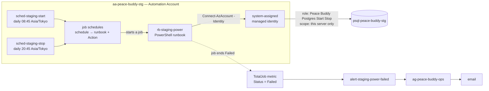

# Staging schedule — Azure Automation, until 2026-10-31

**Temporary.** Delete this file at teardown.

During dogfooding, staging's Postgres server runs **08:45–20:45 JST** every day.
An Azure Automation runbook starts and stops it. Why this design, and not GitHub
Actions or starting it by hand: `decisions.md` 2026-09-17. Issue #208.

## How it fits together



## Concepts

| Term | What it is here |
|---|---|
| Tenant | The Entra directory you sign in to, `plabnagasaki.onmicrosoft.com`. It holds identities |
| Subscription | The billing container: "Azure subscription 1", the sponsorship grant. It holds resources. Every `az` command acts on the active subscription |
| Resource provider | The service behind a resource type, such as `Microsoft.Automation`. It must be registered on the subscription before you can create that type of resource. Registering is free |
| CLI extension | An add-on command group for `az`. The `automation` extension is preview-only and incomplete: it has no identity flag, no job-schedule command and no job-output command, so those go through `az rest` |
| `az rest` | Sends a request straight to Azure Resource Manager. Used whenever the CLI has no command for something |
| Operation | A single permission string, such as `Microsoft.DBforPostgreSQL/flexibleServers/stop/action` |
| Role definition | A named list of operations. On its own it grants nothing |
| Role assignment | *who* + *role* + *scope*. This is the thing that actually grants access |
| Scope | Where an assignment applies: a subscription, a resource group, or one resource |
| Managed identity | An Entra identity that belongs to a resource and has no secret. *System-assigned* means it's created and deleted along with that resource |
| Runbook | The script that Automation runs. It has a draft and a published version, and only the published one runs |
| Job | One run of a runbook, with an ID, a status and an output log. The status goes `New → Queued → Starting → Running → Completed`, or ends `Failed` |
| Schedule | A time rule in the account. On its own it runs nothing |
| Job schedule | The link that connects a schedule to a runbook and gives it the parameters to run with |

## Setup log

As of 2026-09-17.

| Step | What | Status |
|---|---|---|
| 0 | Sign in, register providers, install the extension | ✅ |
| 1 | Custom role | ✅ `e8784d71-5cb5-442b-939e-5e2d8e3d1e00` |
| 2 | Automation account and its identity | ✅ principal `30144a08-de24-4ed3-a249-345e3912f9d4` |
| 3 | Role assignment on the server | ✅ |
| 4 | Runbook created, uploaded, published | ✅ |
| 5 | Test by hand | ◐ `start` on a running server passed; the real stop and start haven't been run |
| 6 | Schedules and job schedules | ⬜ |
| 7 | Failure alert | ⬜ |
| 8 | Staging budget ¥1,600 → ¥2,600 | ⬜ |
| 9 | Verify | ⬜ |

Every command is split across short lines on purpose. A long line copied out of
a chat window can break in two, and each half then runs as its own command.
Steps 6 and 7 **haven't been run yet**, so their commands may need adjusting.

### 0. Prerequisites

```
az login
az account list --query "[].{name:name, isDefault:isDefault}" -o table
```

There's only one subscription, so the active one is the grant.

```
az provider register -n Microsoft.Automation --wait
az provider register -n Microsoft.Insights --wait
az extension add --name automation --upgrade
```

Both providers were `NotRegistered`. `Microsoft.Insights` is Azure Monitor, which
step 7 needs.

### 1. Custom role

Read the exact operation names from Azure rather than typing them from memory:

```
az provider operation show \
  -n Microsoft.DBforPostgreSQL \
  --query "resourceTypes[?name=='flexibleServers'].operations[].name" \
  -o tsv | grep -E '/read$|/start/|/stop/'
```

The role file, which wasn't kept:

```json
{
  "Name": "Peace Buddy Postgres Start Stop",
  "Description": "Read, start and stop PostgreSQL flexible servers. Held by aa-peace-buddy-stg to run staging on a schedule.",
  "Actions": [
    "Microsoft.DBforPostgreSQL/flexibleServers/read",
    "Microsoft.DBforPostgreSQL/flexibleServers/start/action",
    "Microsoft.DBforPostgreSQL/flexibleServers/stop/action"
  ],
  "NotActions": [],
  "AssignableScopes": ["/subscriptions/<subscription>/resourceGroups/rg-peace-buddy"]
}
```

```
az role definition create \
  --role-definition role-pg-start-stop.json
```

- **Why a custom role and not `Contributor`:** `Contributor` would also let the
  scheduler delete the server.
- **Why `AssignableScopes` is the resource group:** a custom role can't list a
  single resource there. Step 3 narrows the grant to the server.

### 2. Automation account

```
az automation account create \
  -g rg-peace-buddy \
  -n aa-peace-buddy-stg \
  -l japaneast \
  --sku Basic
```

- **`Basic`, not `Free`:** both include 500 job-minutes a month. `Free` stops
  running jobs once those minutes are used up; `Basic` keeps running and bills
  the extra. We use about 60–120 minutes.
- **`aa-`** is the Cloud Adoption Framework abbreviation for an Automation
  account, like `rg-` and `psql-`.

`account create` has no identity flag, so turn the identity on with a PATCH:

```
AA_ID=$(az automation account show \
  -g rg-peace-buddy -n aa-peace-buddy-stg \
  --query id -o tsv)

az rest -m patch \
  -u "$AA_ID?api-version=2023-11-01" \
  -b '{"identity":{"type":"SystemAssigned"}}'
```

It prints `principalId`, the identity's object ID.

### 3. Role assignment

```
PG_ID=$(az postgres flexible-server show \
  -g rg-peace-buddy -n psql-peace-buddy-stg \
  --query id -o tsv)

az role assignment create \
  --assignee-object-id 30144a08-de24-4ed3-a249-345e3912f9d4 \
  --assignee-principal-type ServicePrincipal \
  --role e8784d71-5cb5-442b-939e-5e2d8e3d1e00 \
  --scope "$PG_ID"
```

`--assignee-principal-type ServicePrincipal` skips a lookup in Entra, and that
lookup often fails for an identity created only minutes earlier.

### 4. Runbook

The source is `scripts/azure-staging-power.ps1`. It takes `Action` (`start` or
`stop`) and then:

1. Signs in as the identity.
2. Reads the server's state.
3. Returns early if the server is already in that state. Stopping a stopped
   server is an error, and the job would count as failed and fire the step 7
   alert.
4. Otherwise sends start or stop, and throws on any status other than 200 or
   202 so that the job ends `Failed`.

It runs on PowerShell 5.1, because the extension can only create `PowerShell`
runbooks. It only needs `Az.Accounts`, which comes preinstalled.

```
az automation runbook create \
  -g rg-peace-buddy \
  --automation-account-name aa-peace-buddy-stg \
  -n rb-staging-power \
  --type PowerShell \
  -l japaneast

az automation runbook replace-content \
  -g rg-peace-buddy \
  --automation-account-name aa-peace-buddy-stg \
  -n rb-staging-power \
  --content @scripts/azure-staging-power.ps1

az automation runbook publish \
  -g rg-peace-buddy \
  --automation-account-name aa-peace-buddy-stg \
  -n rb-staging-power
```

`replace-content` writes the draft, and `publish` makes the draft the version
that jobs run. Neither prints anything when it succeeds. After any edit to the
`.ps1` file, run both again.

### 5. Test by hand

Start a job:

```
JOB=$(az automation runbook start \
  -g rg-peace-buddy \
  --automation-account-name aa-peace-buddy-stg \
  -n rb-staging-power \
  --parameters Action=start \
  --query name -o tsv); echo $JOB
```

Check its status, and repeat until it's `Completed` or `Failed`. The first job
stayed at `New` for over a minute.

```
az automation job show \
  -g rg-peace-buddy \
  --automation-account-name aa-peace-buddy-stg \
  -n $JOB \
  --query "{status:status, exception:exception}" -o json
```

Read its output. `Completed` only means nothing threw an error, so check what
the job actually did:

```
AA='/subscriptions/{subscriptionId}/resourceGroups/rg-peace-buddy'
AA="$AA/providers/Microsoft.Automation"
AA="$AA/automationAccounts/aa-peace-buddy-stg"

az rest --method get \
  --url "$AA/jobs/$JOB/output?api-version=2023-11-01"
```

**Done: `Action=start` on a running server.** It printed
`Server state: Ready` then `Already running.` This proves three things: the
identity can sign in, the role allows read, and the script runs on 5.1. It does
**not** prove that start or stop work, because the runbook returned before
calling either.

**Still to run: a real stop, then a start.**

1. Run the same three commands with `Action=stop`.
2. Check that
   `az postgres flexible-server show -g rg-peace-buddy -n psql-peace-buddy-stg --query state -o tsv`
   goes from `Stopping` to `Stopped`.
3. Run them again with `Action=start`, and wait for `Ready`.

Staging is unavailable for roughly 5–10 minutes during this, so pick a time when
nobody is testing.

### 6. Schedules — not run yet

```
az automation schedule create \
  -g rg-peace-buddy \
  --automation-account-name aa-peace-buddy-stg \
  -n sched-staging-stop \
  --frequency Day \
  --interval 1 \
  --start-time "2026-09-18T20:45:00+09:00" \
  --expiry-time "2026-10-31T23:59:00+09:00" \
  --time-zone "Asia/Tokyo"
```

Do the same for `sched-staging-start` at `08:45`. The start time has to be in
the future when the command runs, so adjust the date.

`--expiry-time` makes the 2026-10-31 end date enforce itself.

A schedule runs nothing until something links it to the runbook. The extension
has no job-schedule command, so the link goes through `az rest`, with `$AA` set
as in step 5:

```
az rest --method put \
  --url "$AA/jobSchedules/$(uuidgen)?api-version=2023-11-01" \
  --body '{"properties":{
    "schedule":{"name":"sched-staging-stop"},
    "runbook":{"name":"rb-staging-power"},
    "parameters":{"Action":"stop"}}}'
```

Then make the same link for start.

### 7. Failure alert — not run yet

The account emits a `TotalJob` metric with `Runbook` and `Status` dimensions,
which `az monitor metrics list-definitions` confirms.

```
az monitor action-group create \
  -g rg-peace-buddy \
  -n ag-peace-buddy-ops \
  --short-name pbops \
  --action email ops <COST_ALERT_EMAIL>

az monitor metrics alert create \
  -g rg-peace-buddy \
  -n alert-staging-power-failed \
  --scopes "$AA_ID" \
  --condition "total TotalJob > 0 where Status includes Failed" \
  --window-size 1h \
  --evaluation-frequency 1h \
  --action ag-peace-buddy-ops
```

`<COST_ALERT_EMAIL>` is the address in `scripts/azure.stg.env`.

### 8. Budget — not run yet

Set `BUDGET_SERVER_MONTHLY_JPY=2600` in `scripts/azure.stg.env`, then run:

```
scripts/azure-cost-alerts.sh scripts/azure.stg.env
```

### 9. Verify — not run yet

```
az automation schedule list \
  -g rg-peace-buddy \
  --automation-account-name aa-peace-buddy-stg \
  --query "[].{name:name, next:nextRun, expiry:expiryTime, on:isEnabled}" \
  -o table
```

The next morning, `az automation job list` should show a `Completed` stop job
from 20:45 and a `Completed` start job from 08:45.

## Cost

| Item | Per month |
|---|---|
| Postgres compute, 12 h a day | ~$9.50 (~¥1,510) |
| Postgres storage | ~$4.40 (~¥700), unchanged |
| Automation account, runbook, schedules, role | $0 |
| Job time, ~60–120 of 500 free minutes | $0 |
| Metric alert | ~$0.10, not yet checked against the Retail Prices API |
| Action group email | $0 under 1,000 emails |

A correct month is about ¥2,200. A month where the stop job silently fails is
about ¥3,700. The ¥2,600 budget sits between the two.

## Teardown — on or after 2026-10-31

The schedules stop on their own when they expire. The last run is the 20:45
stop on 2026-10-31, so staging is left stopped. From then on, Azure's
seven-day auto-restart applies again. To keep the schedule going instead,
update the expiry on both schedules.

To remove everything, run these in this order. The role assignment has to go
before the identity it points at.

```
az role assignment delete \
  --assignee 30144a08-de24-4ed3-a249-345e3912f9d4 \
  --scope "$PG_ID"

az monitor metrics alert delete \
  -g rg-peace-buddy -n alert-staging-power-failed

az automation account delete \
  -g rg-peace-buddy -n aa-peace-buddy-stg

az role definition delete \
  --name "Peace Buddy Postgres Start Stop"
```

Deleting the account also removes the runbook, the schedules, the job schedules
and the identity. Keep `ag-peace-buddy-ops` if anything else uses it.

After that:

1. Set the staging budget back to ¥1,600, or decide on a new amount.
2. Delete `scripts/azure-staging-power.ps1` and this file.
3. Add a `decisions.md` entry for whatever staging does next.

## Gotchas hit during setup

- **Commands copied from chat split in two.** The two halves failed in
  confusing ways. `az rest` reported
  `InvalidResourceType ... for api version '2023-11-01'` because its URL had
  been cut off, not because the version was wrong. Short lines ending in `\`
  fixed it.
- **A multi-line heredoc doesn't work through Claude Code's `!` prefix.** It
  left the shell waiting at `heredoc>`. Run commands in a separate terminal
  pane instead.
- **The first job stays at `New` for a while.** Automation has to prepare a
  sandbox for it. Wait and check again.
- **`Completed` doesn't mean the job did anything.** Read the job output.
